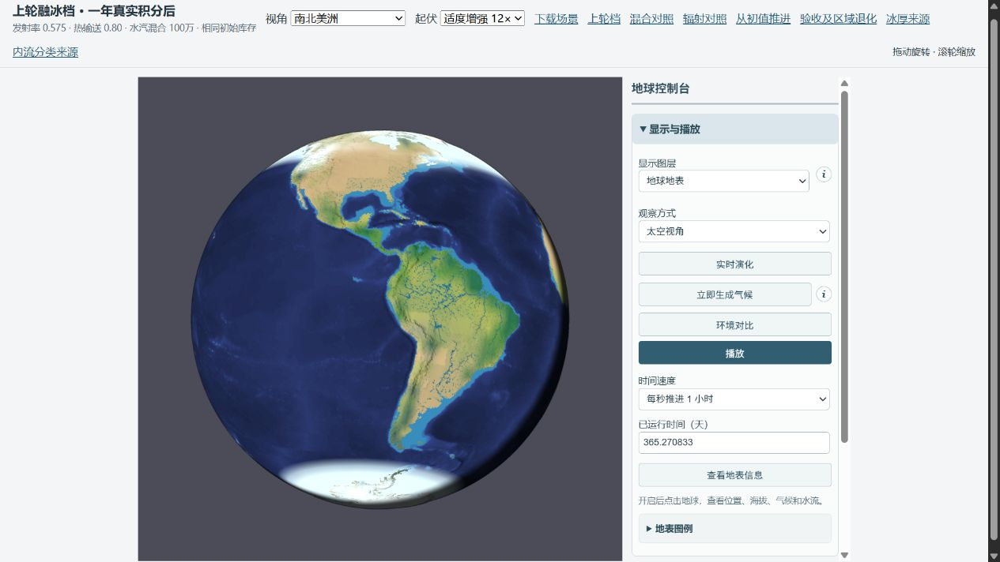
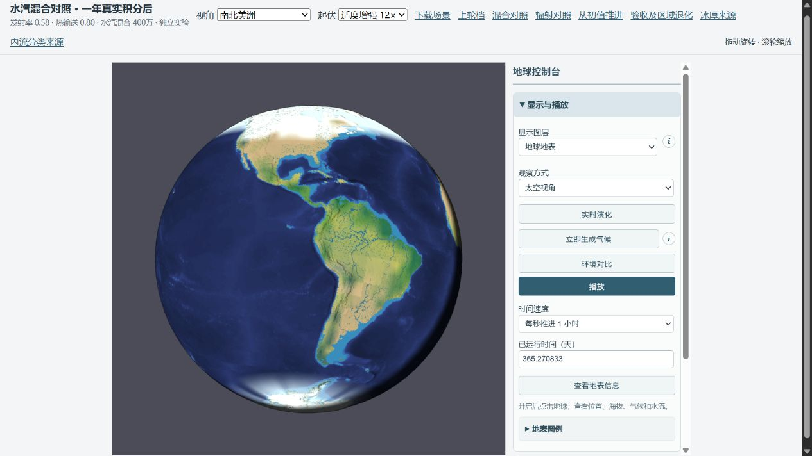

# 冰封、温带和澳洲的参数对照（2026-10-12）

选定独立实验档 mix4cool：{"thermal":{"diffusion":0.8,"emissivity":0.58},"water":{"moistureDiffusivityM2s":4000000}}。蒸发比例仍为 0.50、海洋输送 0.30 m/s、热容量和全部初始库存不变；正式 Earth 存档及 DEFAULT 设置保持不变。在增加水汽混合的同时适当回调辐射增暖。

## 完整地形验收

215348 个地形单元，1800 s 固定步长，从同一含里海有限库存的 lake-day0 存档积分 365.270833 天。初始库存 SHA256：952addee2268260c7acb5cee1f2fe576414c88539719b3b6559d624d5a89ceca。两个候选和两个参照均已在本轮采用相同的补偿求和算法重新积分；最终结果没有把旧算法的参照混进来。严格恢复与下一步完全一致检查全部通过。

| 指标 | 0.595 温和档 | 0.575 上轮档 | 本轮选定档 |
|---|---:|---:|---:|
| 北半球 NSIDC 月范围 MAE（百万 km²） | 9.81 | 9.65 | 9.46 |
| 南半球 NSIDC 月范围 MAE（百万 km²） | 22.17 | 19.82 | 18.39 |
| 年末实际海冰质量（全球平均水当量 mm） | 153.57 | 108.53 | 81.16 |
| 年末陆地积雪（全球平均水当量 mm） | 1.46 | 1.45 | 6.00 |
| 四温带区域等权年雨量绝对偏差（mm/年） | 338.0 | 327.1 | 305.9 |

相对 0.575 上轮档，南北海冰范围 MAE 分别下降 7.2%、1.9%，实际海冰质量下降 25.2%，四区平均降水绝对偏差下降 6.5%。三项约束的完整地形结果：通过。这不是全球气候全面验收，也不是观测误差已经足够小。

这里的冰封指标专指 NSIDC 海域海冰；新增输送与冷地降水同时增加了陆地积雪，年末从约 1.45 增至约 6.00 mm 全球水当量，所以北美陆地白色面积并不缩小。北半球夏末海冰仍接近零，明显低于观测；不能把减少海冰质量等同于全年冰雪形态正确。

## 所有 GPCC 区域

单位 mm/年；观测支持、区域边界和四个温带区域权重均未改变。

| 区域 | GPCC | 温和档 | 上轮档 | 本轮选定档 |
|---|---:|---:|---:|---:|
| Europe | 792.1 | 288.5 | 305.9 | 388.9 |
| East North America | 1056.0 | 557.8 | 592.3 | 558.9 |
| East Asia | 693.9 | 710.6 | 727.1 | 698.3 |
| West Siberia | 451.3 | 117.9 | 126.0 | 132.5 |
| India | 1138.1 | 626.3 | 640.5 | 537.2 |
| Himalaya foreland | 1120.4 | 1174.8 | 1253.6 | 3319.5 |
| Tibet | 443.5 | 181.9 | 193.6 | 508.7 |
| Australia southwest | 489.0 | 581.2 | 723.3 | 496.1 |
| Australia north | 985.9 | 1464.3 | 1550.6 | 1422.1 |
| Amazon | 2264.7 | 1667.2 | 1736.1 | 1505.2 |
| Congo | 1385.3 | 1391.9 | 1491.8 | 1260.4 |

澳洲逐区防退化：Australia southwest 通过；Australia north 通过，参照采用偏湿更小的 0.595 温和档，而非只相对较湿的上轮档比较。年总量改善不能代表澳洲季节反转或山地雨影已验收。

| 澳洲区域 | GPCC DJF / JJA | 本轮 DJF / JJA | 温和档月 MAE | 上轮月 MAE | 本轮月 MAE |
|---|---:|---:|---:|---:|---:|
| Australia southwest | 51.3 / 226.7 | 333.7 / 2.6 | 60.6 | 72.3 | 58.2 |
| Australia north | 660.3 / 6.3 | 682.3 / 38.2 | 42.2 | 49.7 | 37.7 |

DJF/JJA 为三个月累计 mm，月 MAE 为 mm/月。季节比较独立公开，不把年总量接近当成季节相位正确。

西南澳季节相位仍错误：模型夏季 DJF 降水远多于冬季 JJA，而同区域 GPCC 冬季更湿。北澳夏季降水接近观测，但冬季仍偏湿。年偏差和月 MAE 下降都不能代替这一季节检查。

北美东部相对上轮融冰档更干，温带平均改善主要来自欧洲、西西伯利亚增雨与东亚湿偏差减少；平均量不能掩盖这一退化。印度和亚马孙供水退化，喜马拉雅前缘明显过湿。机制账本显示喜马拉雅前缘降水几乎全部来自迎风坡雨出，不能把它称为对流或锋面改善。完整积分的机制分量保存在 acceptance.json，均分割实际降水而非附加水源。因此本轮仅保留独立参数试验，不能作为全面改进的正式 Earth 配置。

## 预算和数值检查

选定档 366 次每日检查，最大残差：总水 2.328e-10 mm；焓 2.248e-4 J/m²；逐格水汽 2.865e-11 mm；地形水分区 1.118e-1 m³。每一项低于 protocol.md 的阈值；本轮四个最终完整积分均进行了每日检查。

最初两个 900 s 粗路由试验的水量累加误差达到约 1.24e-6 / 1.70e-6 mm，严格恢复拒绝，记录于 rejected-runs.json。真实沿海回流回归测试复现了同样的 sub-ulp 转移损失，修复只在 compensatedOceanTransfers=true 时启用补偿求和，补偿状态随存档保存。它记录浮点舍入而非补水，所有物理转移仍从有限供体扣除。正式默认不含该开关，旧存档形状与默认数值行为保留。新四臂均启用相同开关，以免把不同累加方式当成参数效果。

900 s 粗路由复核：年均表温差 0.00736 °C、区域年雨量最大相对差 0.494%。明确未运行完整地形的 900 s 年度积分。新两臂的 strictContinuation 完全一致检查通过。

## 同库存粗路由筛选

此表用于筛选，不能替代完整地形或里海验收。每个粗路由试验初始库存哈希一致；粗路由库存与完整地形库存不可混用。

| 档位 | 北冰范围 MAE | 南冰范围 MAE | 温带四区偏差 | 西南澳雨 | 北澳雨 | 喜马拉雅前缘雨 |
|---|---:|---:|---:|---:|---:|---:|
| direct | 9.64 | 19.82 | 335.0 | 717.7 | 1554.7 | 1219.3 |
| evap045 | 9.54 | 19.94 | 373.4 | 629.6 | 1471.5 | 1144.9 |
| mild | 9.82 | 22.18 | 349.3 | 579.2 | 1463.8 | 1146.2 |
| mix2evap048 | 9.23 | 18.50 | 355.1 | 553.9 | 1475.2 | 1964.7 |
| mix3 | 9.34 | 18.39 | 330.3 | 541.7 | 1470.2 | 2683.7 |
| mix3heat11 | 9.21 | 15.02 | 306.9 | 764.0 | 1553.0 | 2791.3 |
| mix3heat14 | 9.13 | 13.83 | 276.6 | 912.3 | 1599.4 | 2853.9 |
| mix4 | 9.32 | 17.58 | 316.8 | 535.5 | 1439.3 | 3299.2 |
| mix4cool | 9.49 | 18.39 | 321.0 | 495.0 | 1425.7 | 3248.4 |
| mix6 | 8.97 | 14.79 | 286.3 | 550.8 | 1389.6 | 4389.5 |
| mix6cool | 9.66 | 17.38 | 296.8 | 470.3 | 1369.2 | 4260.3 |
| ocean10 | 9.75 | 19.48 | 332.4 | 725.0 | 1561.8 | 1206.3 |

减小蒸发虽能减少部分冷却，却使温带更干；单纯增加海洋输送不能同时改善北冰与澳洲；增加热输送的组合使澳洲更湿。提高全球水汽混合可将实际水汽重新分配到温带并改变凝结放热，但会加重喜马拉雅前缘的锋面与迎风坡降水。600 万档的印度、亚马孙和喜马拉雅副作用更大，所以完整验收优先选用较小的 400 万档。所有系数均属于简化模型敏感性试验，不宣称测量标定。

## 同日期、同视角截图

截图使用相同存档时刻、南北美洲中心、太空视角、12× 起伏、地表图层和关闭云层。保留真实晨昏；画面用于形态比较，降水看年度积分。

## 复现

profiles.json 记录全部参数，screen.ts/full.ts 由 esbuild 打包为 Node ESM；PARAM_PROFILE 指定试验，PARAM_DT 可指定 900。full.ts 读取同一 lake-day0.json，额外预算与机制账本不改物理演化。运行 analyze.mjs mix4cool 汇总原始积分结果，preview.mjs mix4cool 生成独立预览，manifest.mjs 记录输入、观测、源代码、快照和浏览器证据哈希。

观测沿用 [GPCC v2022](https://opendata.dwd.de/climate_environment/GPCC/gpcc_normals_v2022/) 和 [NSIDC G02202 v2](https://doi.org/10.7265/N55M63M1) 缓存及原共同有效支持。范围诊断的 15% 阈值、质量/0.5 m 规则、结冰温度和观测区域均不变。一年瞬态结果不代表长期收敛。
