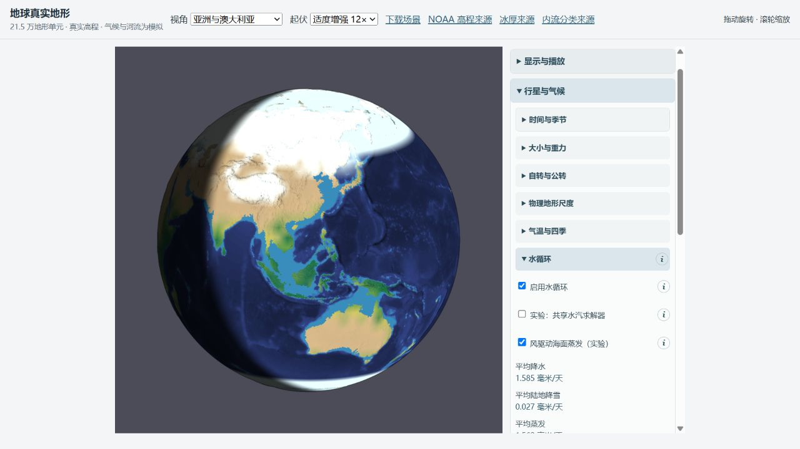

# 风驱动海面蒸发：运行机制已接入，整体准确度验收未通过

2026-10-15。此改动在实际应用中新增可切换的海面蒸发关系，并保留可复现的正反结果。**正式地球存档默认仍关闭；不能把本轮称为全球气候准确度提升。**

## 应用中的改动

「行星与气候 → 水循环 → 风驱动海面蒸发（实验）」启用新关系；「水循环参数 → 海面水汽交换系数」初始值为 0.0012，允许 0–0.005，0 停止海面蒸发。需要独立空气、陆地、海洋储热层，正式地球场景已经具备。

海面蒸发取决于实际风速、海温和空气水汽亏缺：

`E = C_E |U| × 0.622 × max(0, e_sat(T_sea) − RH_column × e_sat(T_air)) / (287.05 × T_air)`

E 为每平方米开阔海面的 kg/s，再乘海面面积和无冰比例。采用稀水汽理想气体近似；常规温度范围外对饱和水汽压公式作边界处理。依据是 [NOAA PMEL 通量说明](https://pmel.noaa.gov/ocs/flux-documentation) 中的 bulk 交换结构及 [FAO-56 Tetens 饱和水汽压关系](https://www.fao.org/4/X0490E/x0490e07.htm)。这不是完整 COARE 算法。

- 无日照时也可蒸发；低于淡水冰点但仍为液态的海水不再被淡水温度斜坡抑制。海冰及浮冰架覆盖阻挡交换。
- 重用有限海洋水库存和潜热转移。新增热量上限，在浅海、强风极限下防止透支显热；相变继续由既有求解器处理。此上限保证非负热库存，不证明极端参数的物理真实性。
- 粗气候网格和精细地表均接入。陆地、湖泊的蒸发仍使用原有太阳能限制。
- 开启、调系数、关闭都先恢复播放中最后可见的状态，随后改变未来通量。水量、温度、日期和预算起点保留；完整存档保存选项并能精确续跑。
- 解析初始化的海面蒸发诊断在冰库存和温度相变初始化后重新计算。共享水汽模式保留其已积分的参考通量。解析初始化的降雨和温度模型没有在本轮重写。

RH_column 来自整层水汽库存，并非观测的近地面湿度。因此 C_E 是有效参数；缺少稳定度、阵风、露水、海盐和喷溅参数化。没有使用观测雨量直接修改运行场。

## 全年对照与不采纳默认值的理由

七个配置见 [profiles.json](profiles.json)，全部结果和指标见 [metrics.md](metrics.md) 与 `screen-*.json`。它们从同一正式存档的同一温度、水量和初始焓出发，积分一个真实轨道年，步长 1800 s。只为筛选而共同改用粗网格排水，并共同启用海洋累加补偿；不是完整地形的全年验收，也不是平衡气候。

使用已保存的 GPCC 月资料和相同有效陆地面积；四个调参地区为欧洲、北美东部、东亚、西西伯利亚，七个检查地区为印度、喜马拉雅山前、青藏高原、西南澳、北澳、亚马孙、刚果。地区和掩膜继承已有筛选，未随结果挑选。表中年雨量 MAE 是各组地区的等权平均绝对误差，**不是全球格点 MAE**。原始 JSON 同时保留月序列。

单独开启 bulk（0.0012）后的年雨量，单位 mm：

| 地区 | GPCC | control | bulk |
|---|---:|---:|---:|
| 欧洲 | 792.1 | 330.3 | 353.6 |
| 北美东部 | 1056.0 | 44.1 | 46.7 |
| 东亚 | 693.9 | 6.3 | 9.7 |
| 西西伯利亚 | 451.3 | 219.3 | 225.3 |
| 北澳 | 985.9 | 109.6 | 239.6 |
| 亚马孙 | 2264.7 | 883.4 | 1076.6 |
| 刚果 | 1385.3 | 1885.1 | 2490.7 |

四区 MAE 从 598.32 降至 589.51 mm，但七区从 849.63 升至 889.74 mm，刚果明显退化。印度和喜马拉雅山前仍几乎无雨；增加供水没有解决降水分配问题。

与已有共享水汽及表面物理选项组合后，0.0012 将四区 MAE 从 383.59 降至 349.87 mm，却把七区从 322.07 升至 875.74 mm，澳洲过湿。0.0003 和 0.0006 也未同时改善两组。`cold-open-water` 单独对照同样未通过地区与海冰联合检查。

热带海面年均温由 19.95 降至 19.12 °C；共享方案则由 23.52 降至 19.59 °C。**这些是模型响应诊断，本轮未取得同掩膜海温观测，不能据此量化温度准确度变化。** 海冰使用此前固定的 NSIDC 同网格支持域；北半球 extent MAE 在单独 bulk 下由 13.838 升至 13.908 百万 km²，原有海冰偏差仍很大。

结论：交付可比较、可保存的机制选项；不采用本轮任何参数作为地球默认值。下一步应检查近地面湿度与整层水汽的关系、供水到陆地的输送及辐射/显热平衡，并用独立海温和月降水联合约束，不能只调一个蒸发系数追逐某地区雨量。

## 验证

- Node 全套 288 项通过，TypeScript 检查和生产构建通过。新增覆盖无风、风速响应、无日照、饱和、枯竭海洋、海冰、潜热、精细地表、初始诊断和严格保存恢复。
- [真实 DOM 回归](browser-controls.json) 32 项通过，包括播放中开启、改系数、关闭后三次逐字段状态一致，以及无效系数的拒绝和恢复。该 fixture 已复现修复前的失败。
- 独立代码审查发现并修复：未呈现帧导致重置、强蒸发透支显热、初始化冰下蒸发诊断，以及 disabled 数值输入绕过校验。浅海极限测试在修复前出现负温度；修复后温度非负、水量及焓守恒。
- 完整 215,348 三角形地形分别运行 control/bulk 30 天，未关闭真实湖泊/排水。初始状态哈希相同，两组均通过严格存档重建与下一步精确相等。数据见 [control](full-control.json)、[bulk](full-bulk.json)。
- bulk 第 30 天水量残差 −3.46e−8 mm，焓残差 −1.68e−4 J/m²，排水分配残差 −4.33e−4 m³；验收阈值分别为 5e−6 mm、0.005 J/m²、1 m³。全年粗筛各记录时刻也通过水量、焓和逐网格水汽账本；这是采样时刻检查，非逐步全局最大值。
- 实际浏览器从正式第 0 天存档开启 bulk，播放至第 37.542 天后暂停。显示蒸发 1.562 mm/day、水量残差 −3.40e−8 mm，无浏览器警告或错误。下面是运行效果，不是观测准确度证据。

## 输入与复现

[inputs.json](inputs.json) 保存正式地球存档、GPCC 支持域、NSIDC 支持域的 SHA-256。正式存档 SHA-256 仍为 `afb80a8ab730785eed0cb709a66d938ad20a9690b04ecfa1246d1deb393adca6`。既有证据目录未改动。每份结果包含运行 bundle 哈希、初始库存哈希、参数及续跑断言结果。运行方法见 [REPRODUCE.md](REPRODUCE.md)。
