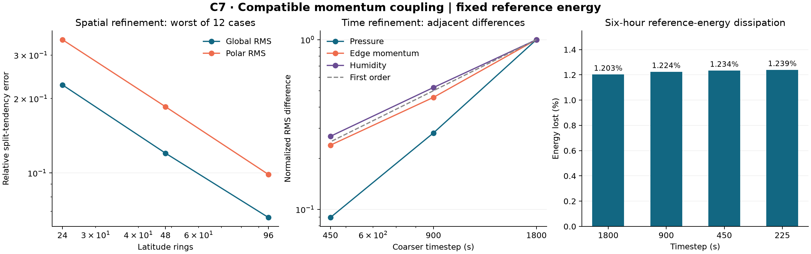

# C7: compatible reference-energy momentum coupling

This experiment closes a deliberately restricted nonlinear feedback loop:
pressure and Coriolis evolve C5 edge momentum; their integrated air transfers
drive shared water transport and a new covariant split-form momentum increment.
All state fields commit together. The existing C1-C6 evidence and application
default remain unchanged. This is not full compressible atmospheric dynamics.

## Equation and preserved information

C5 reconstruction R=M^-1 P' H is a metric adjoint, not an inverse. C6 showed
that replacement by P R j changes native edge momentum by0.386% and arbitrary
edge data by78.9%. The C7 transport substep adds an increment in range(P) to
the original j. Its H-orthogonal ker(R) component is preserved by that substep;
the complete acoustic update can change this component. No inverse assumption,
filtering or replacement of the authoritative edge state is used.

With layer thickness ds included once in both H and M, orient each signed
integrated air transfer from donor a to receiver b and put f=abs(F). The C6
short-great-circle connection T carries tangent vectors between the nodes.
The nodal integrated operator N has blocks N_aa=-f/2 I, N_bb=-f/2 I and
N_ba=f T. Consequently u' N u=-sum f |u_b-Tu_a|²/2. C7 solves

    j_new - j_old = P M^-1 N R (j_old+j_new)/2.

Its kinetic energy change is exactly the negative jump sum at the reconstructed
midpoint, up to the measured solve/rounding residual. The reduced fixed-point
iteration checks the original edge equation and rejects nonconvergence.
Implicit-midpoint energy stability does not guarantee Picard convergence for
arbitrarily large transfers. No hidden timesteps or state normalization is used.

N is the conservative donor momentum operator minus half the net-mass-change
diagonal. Its declared smooth single-layer limit at j=P U is

    -nabla_U U - div(pref U)/(2 pref) * U.

That half-divergence term is required by the fixed C5 reference metric. This
is different from C6's conservative actual-mass momentum equation and from
the full physical Eulerian advection tendency. Reusing C6 geometry and shared
transfers does not transfer C6's actual-mass energy theorem to this model.

## Coupling and roundoff handling

The sequence is rotation half, exact fixed-linear acoustics plus shared water
FCT, rotation half, then the compatible transport increment. Transport uses
the same integrated horizontal and sigma-vertical air transfers as pressure
and water. This is first-order nonlinear Lie composition, with C5's linear
Strang portion preserved. Strength0 exactly reproduces frozen C5; accepted
native runs use strength1. Integrated net transfers do not resolve all possible
within-step sign reversals, so no higher-order nonlinear claim is made.

The combined energy is C5's quadratic reference pressure potential plus edge
kinetic energy. This is not nonlinear physical total energy. Its decrease
matches the measured transport loss; pressure is certified positive throughout
each acoustic interval, not merely at the endpoints.

Independent review found that a relative-only complete-energy guard falsely
rejected exact and near-rest states when perturbation energy E0 vanished.
Regression tests reproduced this before the fix. The guard now allows

    1e-9 E0 + 256 eps * (sqrt(Eref)*sqrt(E0) + eps Eref),

where Eref is the unsubtracted reference-pressure quadratic energy. The second
part follows the linear-plus-quadratic variation of a quadratic energy under
pressure-scale rounding. It is a practical roundoff allowance, not an analytic
interval certificate. Absolute residual and allowance are exposed in the
ledger; no state values are changed. Native acceptance still independently
requires accumulated relative energy balance below1e-9. Checkpoint scheme
identity was bumped to distinguish the corrected acceptance semantics.

## Evidence

Independent Cartesian/Rodrigues dense edge midpoint comparison: relative
error3.28e-16; preserved-kernel residual2.21e-17; energy identity2.88e-16.
Spatial tests cover two axes, rotation/gradient3/mixed fields and constant or
varying reference pressure. Across24/48/96 rings, worst global edge-metric
RMS errors are0.22722/0.12023/0.06600; worst polar RMS errors are
0.34633/0.18542/0.09858. All12 sequences decrease globally and near the poles.

The small-grid full nonlinear ODE is checked against a dense Cartesian
operator and RK4, rather than another split solver. RK4 .001/.0005 reference
difference is5.88e-12. C7 .1/.05/.025/.0125 errors decrease with ratios
1.9756/1.9870/1.9934. Constant humidity, zero-strength C5 identity, late-step
rollback, identity mismatch and rebuilt four-step literal-bit restart pass.

All four corrected-source native runs completed six hours on 3,168 cells and
39,580 horizontal edges. They use the full strength 1 increment, fixed c2 of
82671.64740772452 and Earth rotation 7.292115e-5 rad/s. The 1800-second matrix
includes real, constant and sharp humidity; the finer runs use real humidity.
All three coarse checkpoints were rebuilt and advanced four steps with literal
UInt64 equality of pressure, momentum, water and time. Earlier native-v1 and
coupled-v1 runs are retained as history and excluded from final selection.

| Timestep (s) | Steps | Reference energy lost (%) | Accumulated energy residual | Maximum local mass residual |
| ---: | ---: | ---: | ---: | ---: |
| 1800 | 12 | 1.202764 | 1.11e-14 | 4.65e-14 |
| 900 | 24 | 1.224070 | 5.12e-15 | 1.35e-14 |
| 450 | 48 | 1.234305 | 2.44e-15 | 4.59e-15 |
| 225 | 96 | 1.239304 | 1.37e-15 | 3.19e-15 |

Across the complete matrix, the largest transport equation residual is
1.56e-16 and energy-identity residual 3.58e-16. Maximum absolute inventory
drifts are 3.78e-12 kg/m2 for air, 4.21e-13 mm for water, and 3.85e-12 kg/m2
for dry air. Humidity remains within its original global bounds to roundoff;
constant humidity differs by at most 3.65e-15. All steps satisfy the interval
pressure-positivity certificate, with minimum certified pressure ratio 0.8337.
There are no rejected or hidden substeps; the midpoint solve takes at most
12 iterations. Pressure and momentum are identical across humidity cases.

| Adjacent timesteps (s) | Pressure RMS (Pa) | H-scaled edge momentum (m/s) | Humidity RMS (kg/kg) |
| --- | ---: | ---: | ---: |
| 1800 / 900 | 16.83312 | 0.0438960 | 1.01305e-6 |
| 900 / 450 | 4.74557 | 0.0200540 | 5.29137e-7 |
| 450 / 225 | 1.50683 | 0.0104841 | 2.72897e-7 |

The edge-momentum ratios are 2.189 and 1.913; humidity ratios are 1.915 and
1.939. Pressure ratios are 3.547 and 3.149 on this sampled range, which does
not upgrade the first-order nonlinear method. Differences from the finest
discrete result also decrease in all three fields; no exact native solution
is claimed. Against a matched frozen C5 baseline at 1800 seconds, the pressure
RMS difference is 324.85 Pa and relative edge-momentum difference is 0.13612.
This establishes nonzero feedback, not improved physical fidelity.

Selected Julia tests pass 229 assertions, including 75 exact/near-rest
regressions. Seven source-binding checks, all 278 project tests, TypeScript
typechecking and the application build also pass. An independent reviewer
passes 64 additional numerical assertions and reports no unresolved actionable
findings. Its scope and exact reviewed-source hashes are recorded in code-review.md
and review-source-bindings.json.

## Remaining scope

Next physical work needs the correct pressure-dependent kinetic metric,
compressible momentum and pressure work, followed by thermodynamic energy
and physical moisture sources/sinks. C7 does not establish exact global angular
momentum, potential vorticity, second-order nonlinear transport, long climate
behavior or production performance. Substantial changes relative to a C5
baseline are an effect measurement, not evidence of improved climate realism.
No formal-default promotion or full-physics acceptance occurred.

All selected runs, failed/superseded attempts, source archives, input/output
bindings and project checks are retained. See verification.json and manifest.json
for machine-checked acceptance, and code-review.md for independent review scope.
