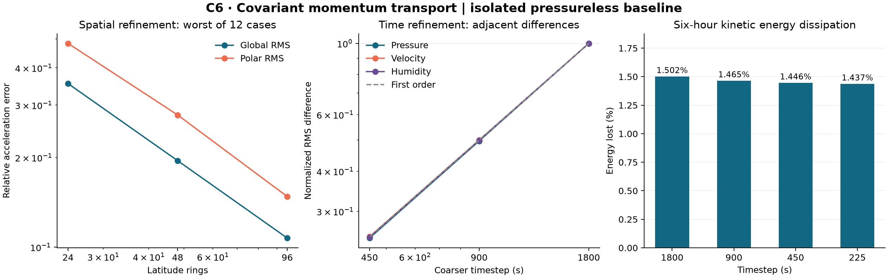

# C6: covariant momentum and nonlinear self-advection

This stage adds a signed tangent-momentum transport kernel and a separate,
first-order, pressureless nonlinear advection experiment. Horizontal and
same-column vertical motion use the same air transfers as pressure and water.
It does not add momentum advection to the C5 acoustic/Coriolis edge state,
and does not change the formal application default.

## Numerical contract

For unit positions x,y, the shortest-great-circle parallel transport is
T(v)=v-(v dot y)(x+y)/(1+x dot y). Its two-by-two representation uses orthonormal
east/north bases. Reverse transport uses its transpose. Same-position vertical
links become identity; near-antipodal links are rejected. Tests compare this
formula to independent three-dimensional Rodrigues rotations, including a
rigid rotation of the entire geometry and physical vector field.

With shared integrated air transfers F and positive old/new masses, solve

    (m_new + outgoing) u_new - sum incoming |F| T u_donor_new = m_old u_old.

Block Jacobi contracts with row factor incoming/(m_old+incoming). The solver
checks the original momentum equation, and rejects iteration failure. Two
signed velocity components are transported together; neither speed clipping
nor final radial projection is used. A zero-transfer step preserves velocity
bit-for-bit. Nonconvergence and invalid mass continuity cannot commit a state.

Multiplying the momentum equation by new velocity, summing over cells and
using local mass continuity plus T's isometry gives

    K_new - K_old = -1/2 sum m_old |u_new-u_old|²
                   -1/2 sum |F| |u_receiver_new-T u_donor_new|².

Both losses are evaluated independently of the energy difference. This is
controlled first-order dissipation, not exact kinetic-energy conservation.
K uses mass=steradian-area * sigma-thickness * pressure. Multiply by R²/g
to obtain the corresponding physical kinetic energy; reported fractional
losses and relative residuals are unchanged by that common scale.

The nonlinear step uses C4 geometric normal velocity and donor *actual*
surface pressure, updates column pressure with that flux, and calls frozen
C2 shared_transfers to impose sigma-layer vertical continuity. The same
transfers drive momentum and water FCT. Pressure, water, velocity and time
commit together only when all stages succeed. The step rejects nonpositive
pressure without hidden timestep changes or global inventory repair.

## Spatial and algebraic evidence

- Independent dense block solve: relative velocity error 2.51e-16; energy
  identity residual 1.27e-16. A two-level unequal-mass exchange also matches
  its hand-computable momentum and energy losses.
- Rigid-frame covariance: Cartesian velocity error 2.79e-16.
- 24/48/96-ring grids, two axes, rotation/degree-three-gradient/mixed fields,
  constant and varying pressure: all 12 global and polar error sequences
  decrease. Worst global acceleration relative RMS: 0.35434 / 0.19520 /
  0.10730. Worst polar RMS relative to global analytic scale: 0.48342 /
  0.27798 / 0.14794. The predeclared 96-ring global limit was 0.35.
- The reference is the analytic covariant advection tendency -nabla_U U, not a
  higher-resolution numerical result. Integrated angular-momentum torque
  diagnostics are retained per case; exact angular momentum is not claimed.

## Native six-hour evidence

The original native pressure and all eight native velocity layers initialize
the 3168-node graph. The 1800-second run has real, constant and sharp humidity;
900/450/225-second runs have real humidity. These are pressureless six-hour
advection tests, not C5's full-day rotating acoustic experiments.

| Timestep (s) | Explicit steps | Kinetic energy lost | Maximum local air/water/dry residual |
|---:|---:|---:|---:|
| 1800 | 12 | 1.50160% | 2.162e-15 |
| 900 | 24 | 1.46457% | 2.343e-15 |
| 450 | 48 | 1.44604% | 2.310e-15 |
| 225 | 96 | 1.43677% | 2.290e-15 |

Across all six runs: maximum local momentum residual 5.64e-16, per-step
energy-identity residual 5.59e-16 and accumulated energy-identity residual
4.20e-16. No step increased kinetic energy. Maximum absolute total inventory
drifts: air 3.78e-12 kg/m², water 3.84e-13 mm, dry air 4.17e-12 kg/m².
Minimum pressure stayed above 59464 Pa. Humidity stayed in its initial global
range to roundoff; constant-q error was 6.60e-17.

| Adjacent timesteps (s) | Pressure RMS (Pa) | Velocity RMS (m/s) | Humidity RMS (kg/kg) |
|---|---:|---:|---:|
| 1800 / 900 | 38.69427 | 0.00446154 | 1.08551e-6 |
| 900 / 450 | 19.23405 | 0.00223357 | 5.42007e-7 |
| 450 / 225 | 9.58957 | 0.00111751 | 2.70818e-7 |

Successive adjacent-error ratios are 2.0118/2.0057 for pressure,
1.9975/1.9987 for velocity and 2.0028/2.0014 for humidity, consistent with
first-order time refinement. Differences against the finest discrete result
also decrease; that finite-timestep reference is not an exact continuum solution.
The energy loss remaining under time refinement includes spatial upwind
dissipation and must not be interpreted solely as timestep error.

The three humidity cases at 1800 seconds have identical pressure and velocity
paths. All three rebuilt-core restarts reproduce four subsequent steps
bit-for-bit. Failure rollback covers nonpositive proposed pressure and a late
momentum-iteration failure. Checkpoint identity includes core geometry,
mapping matrices, spherical connections and the scheme version.

## Coupling boundary and next work

C5 R=M^-1 P' H is a metric adjoint, not an inverse. The H-weighted relative
edge error of replacing j by P R j is 0.00386279 for native imported winds
and 0.788954 for an arbitrary edge state. The present implementation exposes
no such feedback path. Full coupling needs a compatible edge formulation or
an explicitly validated lift that preserves unrepresented edge modes and
the correct energy metric. Simply multiplying the new nodal velocity by P
would invalidate C5's existing state and energy contract.

This baseline also lacks pressure forces, Coriolis, thermodynamic energy,
physical water sources and sinks, exact global angular momentum/PV preservation,
second-order momentum transport, long climate validation and production-scale
performance acceptance. Pressure positivity and successful finite-time
integration are established only for the tested six-hour matrix. These limits
are part of the acceptance record.

## Evidence handling

The two intentional no-op RED runs and one failed Julia parser run are retained.
All selected runs must match current source bytes, including transitive Julia
includes, protocol and runner. Archived source snapshots distinguish historical
attempts. Input/output SHA bindings and all run statuses are checked before
sealing. Selected Julia assertions: 144 passed; source-binding checks: 7 passed.
Project tests: 278 passed; typecheck/build passed. Frozen C1-C5,
105 native source files and the formal default retain their prior bytes.

See code-review.md for the independent C6 review; c5-review-addendum.md records
the independent C5 review completed after C5's immutable seal. The runtime
executable itself is not content-pinned; cross-runtime bitwise reproducibility
is not asserted.
