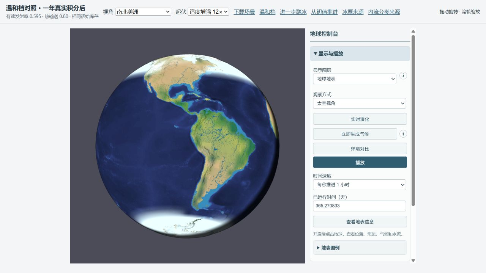
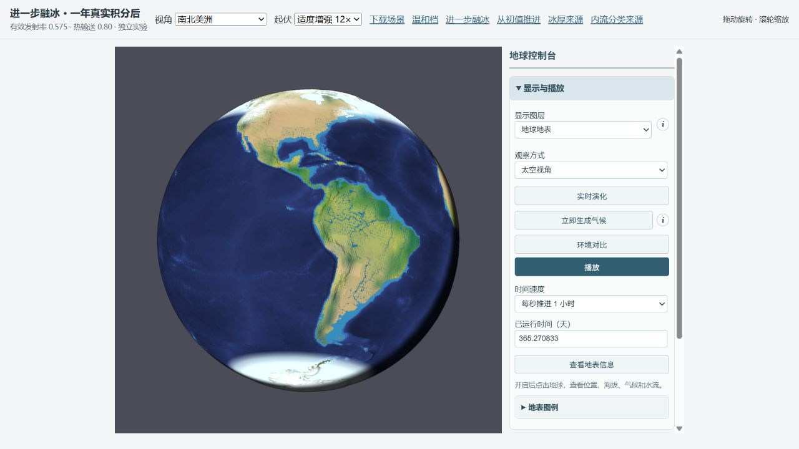

# 更直接的数值设置对照（2026-10-11）

采用第二个融冰实验档：仅把有效发射率从 0.595 改为 0.575，热输送仍为 0.80，蒸发比例仍为 0.50。初始水库、热容量、温度和焓完全相同；里海初值保留。正式 Earth 文件与默认设置不变。

这个设置改变实际长波能量收支，随后通过真实相变融冰；不改结冰温度、冰量或覆盖/显示阈值。它是简化模型的有效辐射系数，不是测得的温室气体浓度。候选也不是观测全面验收通过的配置。

## 完整地形年度对照

215348 地形单元、1800 s 步长；从相同初值真实积分 365.270833 天。温和档复用上一轮已完成的独立年度积分，其输入、库存和模型算法未变。两臂严格保存恢复与下一步完全一致检查通过。

库存（包括初始温度、全部有限水库、显热和焓）SHA256：952addee2268260c7acb5cee1f2fe576414c88539719b3b6559d624d5a89ceca。

同一 NSIDC 海域权重与 15% 阈值，月海冰范围 MAE 单位百万 km²：

| 半球 | 0.595 温和档 | 0.575 融冰档 | 误差减少 |
|---|---:|---:|---:|
| north | 9.81 | 9.65 | 1.7% |
| south | 22.17 | 19.82 | 10.6% |

年末全球面积平均实际海冰质量（水当量） 153.57 → 108.53 mm，积雪 1.46 → 1.45 mm。海冰覆盖仍由既有质量/0.5 m 规则诊断。

实际陆地降水与同支持 GPCC，单位 mm/年：

| 区域 | GPCC | 温和档 | 融冰档 |
|---|---:|---:|---:|
| Europe | 792.1 | 288.5 | 305.9 |
| East North America | 1056.0 | 557.8 | 592.3 |
| East Asia | 693.9 | 710.6 | 727.1 |
| West Siberia | 451.3 | 117.9 | 126.0 |
| India | 1138.1 | 626.3 | 640.5 |
| Himalaya foreland | 1120.4 | 1174.8 | 1253.6 |
| Tibet | 443.5 | 181.9 | 193.6 |
| Australia southwest | 489.0 | 581.2 | 723.3 |
| Australia north | 985.9 | 1464.3 | 1550.6 |
| Amazon | 2264.7 | 1667.2 | 1736.1 |
| Congo | 1385.3 | 1391.9 | 1491.8 |

前四温带区域等权绝对偏差均值 338.0 → 327.1 mm/年。副作用和剩余偏差应逐区读取；面积加权全球精度、狭窄山地雨影与季风不能用该均值代替。

完整地形下，欧洲、北美东部和西西伯利亚降水增加、干旱偏差缩小；东亚原本已略湿，进一步增雨会加重偏差。印度、西藏和亚马孙年总量更接近 GPCC；澳洲、喜马拉雅前缘和刚果偏湿加重。该强档适合检查进一步融冰，温和档在这些偏湿区域更接近观测。冰封绝对范围仍过大，两档都没有通过全面气候观测验收。

融冰档全球年均表温 15.80 °C，±30° 湿面海温 25.28 °C，均为本模型一年瞬态诊断。

## 单项设置与失败方向

以下都是同水/温度/显热初值的粗路由年度真实积分，用于敏感性筛选，不是全部配置的完整地形验收。前一轮温和档的 coarse 结果作为本轮 current 对照复用。

| 配置 | 北冰范围 MAE | 南冰范围 MAE | 欧洲雨 | 西西伯利亚雨 | 西南澳雨 | 北澳雨 |
|---|---:|---:|---:|---:|---:|---:|
| current | 9.82 | 22.18 | 277 | 104 | 579 | 1464 |
| evap065 | 10.27 | 22.33 | 361 | 168 | 774 | 1691 |
| air065 | 9.61 | 19.60 | 395 | 142 | 951 | 1699 |
| heat11 | 9.85 | 19.01 | 327 | 107 | 789 | 1505 |
| air035 | 10.23 | 23.39 | 200 | 73 | 311 | 1343 |
| evap080 | 10.39 | 22.33 | 428 | 224 | 909 | 2070 |
| soil250 | 9.81 | 22.18 | 277 | 102 | 580 | 1463 |
| wind13 | 9.88 | 22.17 | 296 | 109 | 575 | 1537 |
| air055 | 10.18 | 21.91 | 310 | 116 | 691 | 1543 |
| wind16 | 9.99 | 22.17 | 317 | 115 | 571 | 1604 |
| wind13evap060 | 10.29 | 22.27 | 356 | 152 | 710 | 1692 |
| warmAir | 9.24 | 16.14 | 314 | 104 | 873 | 1954 |
| warmAir060 | 9.55 | 19.40 | 254 | 96 | 619 | 2335 |
| prescribedWind | 10.12 | 18.47 | 668 | 282 | 18 | 1061 |
| prescribedEvap060 | 10.05 | 18.18 | 754 | 320 | 41 | 1234 |
| direct058 | 9.93 | 21.33 | 290 | 97 | 676 | 1534 |
| direct0575 | 9.64 | 19.82 | 295 | 95 | 718 | 1555 |

- 增大蒸发比例能明显增雨，但蒸发冷却会加重结冰，澳洲更湿。
- 增大气层长波散热份额能暖地表、减少海冰，但也加重西南澳偏湿；这不是短波吸收份额。
- 土壤容量 150 → 250 mm 对年降水影响很小，不能当作降水旋钮。
- 风带强度 10 → 13/16 的收益小，北澳继续偏湿。增加上限的实验仅重新表达模板偏差记忆，保留每个初始实际风速；不重新生成气候。10 → 8 无法保持现有初始风速上限，拒绝纳入同状态对照。
- 关闭动态环流会改善欧洲/西西伯利亚，却使印度、东亚、北美东部和西南澳明显少雨，因此不采用。
- 0.58 单项在这个粗网格上并非两半球范围误差都改善；选择 0.575 作为显式第二档进行完整地形对照。

完整对照预算最大残差：总水 2.297e-7 mm；焓 2.204e-4 J/m²；单元水汽 4.638e-11 mm。900 s 粗路由复验：年均表温差 0.00700 °C，区域年雨量最大差 0.642%。此步长检查不冒充完整地形 900 s 年度积分。

## 真实画面对照

相同第 365.270833 天、南北美洲中心、太空视角、12× 起伏、地球地表、关闭云层、保留真实昼夜。截图只用于形态检查；降水改善看全年积分。

## 复现与边界

screen.ts/full.ts 使用 esbuild 打包为 Node ESM，PARAM_PROFILE 指定 profiles.json 中的配置名；PARAM_DT 可设 900。full.ts 读取上一轮 lake-day0.json。运行 analyze.mjs 归档完整、严格续算通过的结果；preview.mjs 生成忽略目录下独立交互场景。完整初值与年末快照均保留，场景上方可返回温和档或从初值推进。

- One transient physical orbital year, not a converged climate.
- Global coefficients do not independently control temperate storms and regional monsoons.
- The stronger melting profile is a tradeoff; it is not a uniformly better Earth calibration.
- No independent ice concentration/thickness or full downwelling atmospheric radiation closure.

观测：[GPCC v2022](https://opendata.dwd.de/climate_environment/GPCC/gpcc_normals_v2022/)、[NSIDC G02202 v2](https://doi.org/10.7265/N55M63M1)。缓存和支持定义沿用上一轮，不重新挑选区域来排除副作用。
