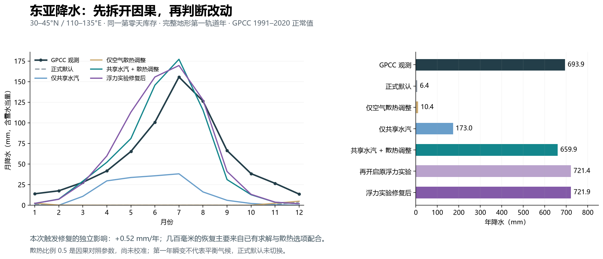
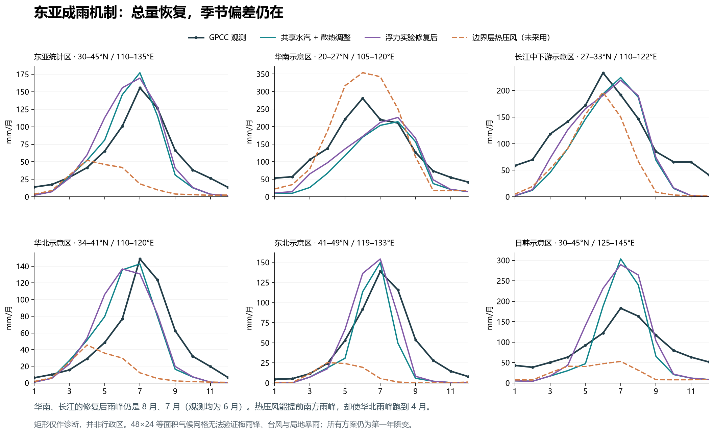

# 东亚降水机制核查与浮力对流修复

2026-10-15。基线提交 `104e7fef5594636cd437e5fa64cc0c90933a7cc6`。

本次完成了八组同起点全年对照，修复已有浮力对流实验中重复要求日照的触发条件，并加入保留当前状态的界面开关。**没有任何一组通过区域雨量与雨季的综合判断，正式默认及正式地球存档未切换。** 年降水接近观测，不代表季风已正确。

## 查明的因果关系

东亚统计矩形为 30–45°N、110–135°E；以下均是同一有效陆地支持上的第一轨道年累计降水，含雪的水当量。GPCC 正常值为 693.9 mm/年。

| 对照 | 东亚年降水（mm） | 月 MAE（mm） | 作用 |
| --- | ---: | ---: | --- |
| 正式默认 `control` | 6.4 | 57.3 | 基线 |
| 仅调整空气辐射散热比例 `radiation-only` | 10.4 | 57.0 | 单独调整几乎不能恢复降水 |
| 仅启用共享水汽求解 `transport-only` | 173.0 | 43.4 | 有夏季降水，仍明显偏少 |
| 两者配合 `shared-core` | 659.9 | 18.5 | 恢复大部分降水，仍有区域及季节偏差 |
| 再启用原有浮力实验 `buoyancy-old` | 721.4 | 20.4 | 这是已有选项的作用，不是本次代码修复的贡献 |
| 浮力实验修复后 `buoyancy` | 721.9 | 20.3 | 本次代码差异独立增加 **0.52 mm/年** |



这里的 `airRadiationFraction=0.5` 是拆分上一轮实验组合的对照值，并未完成热力学或观测校准。`shared-core` 仅组合水汽求解和空气散热；上一轮约 645 mm 的 `transport` 还打开了液态海面蒸发、海冰传热、水下储热和独立反照率，不能混为同一个实验。

## 修复内容和物理边界

`water.ts` 的浮力实验已用地表与空气温差作为不稳定度代理，却仍把对流项乘以日照因子。在隔离试验中，即使暖陆地或暖海面高于空气 8 K、柱相对湿度为 0.9，只要太阳通量为零，对流降水就完全被禁止。

现在仅在 `buoyantConvection=true` 时移除这项日照乘子。地表较冷、空气干燥时仍抑制对流；降水仍受实际水汽库存约束，凝结潜热沿原有账本计算一次。未设置或关闭该选项时，原公式及运算顺序保持不变。已有明确开启该实验的旧存档会使用修复后的演化公式，因此不能承诺它们跨代码版本逐步复现旧轨迹；同一版本的严格恢复续算已通过。

这个修改是对当前简化闭合的修复，不是引入垂直湿绝热过程、CAPE/CIN 或完整对流云方案。作为机制参考，SPEEDY 的对流诊断采用条件不稳定、湿静能与湿度条件；没有用瞬时太阳通量作为直接触发开关。这里只借鉴其区分热力状态和太阳强迫的思路，没有实现 SPEEDY 的质量通量方案。[SPEEDY 一手源码](https://pyspeedy.readthedocs.io/en/latest/speedy_f90/sourcefile/convection.f90.html)、[物理方案说明](https://users.ictp.it/~kucharsk/speedy_description/km_ver40_appendixA.pdf)。

界面位于 **行星与气候 → 水循环 → 浮力驱动对流（实验）**。需要共享水汽求解及独立储热层。新开关会暂停并回到最后显示的状态，再改变闭合选项，不重置水量、温度、预算起点或时钟；开关、存档及严格恢复均有验证。原有“共享水汽求解器”开关仍按原逻辑重启环境，不能把两者的切换语义混淆。

## 为什么没有把实验升为正式默认



| 区域 | GPCC 年量 / 雨峰月 | 共享水汽 + 散热 | 修复后浮力实验 | 边界层热压风 |
| --- | --- | --- | --- | --- |
| 华南示意区 | 1584 mm / 6 | 1050 mm / 8 | 1187 mm / 8 | 1755 mm / 6 |
| 长江中下游示意区 | 1390 mm / 6 | 990 mm / 7 | 1074 mm / 7 | 753 mm / 6 |
| 华北示意区 | 580 mm / 7 | 547 mm / 7 | 568 mm / 6 | 168 mm / 4 |
| 东北示意区 | 550 mm / 7 | 379 mm / 7 | 478 mm / 7 | 90 mm / 4 |
| 日韩示意区 | 1068 mm / 7 | 942 mm / 7 | 1142 mm / 7 | 285 mm / 7 |
| 澳洲西南 | 448 mm / 7 | 522 mm / 1 | 769 mm / 1 | 344 mm / 3 |
| 澳洲北部 | 872 mm / 1 | 1265 mm / 3 | 1262 mm / 3 | 2010 mm / 1 |

浮力实验能改善部分南方年总量，但华南、长江雨峰仍晚于观测，秋冬雨偏少。华北雨峰反而提前一个月；澳洲西南的错误夏季湿峰进一步增大。仅就东亚整体月 MAE，`shared-core` 比浮力组合更低，不能宣称全面提升。

另两组直接检查已有低层热压环流闭合，均以 `shared-core` 为基础，没有同时开启浮力选项：`balanced-pressure` 令东亚年量降到 229 mm、整体雨峰提前到 4 月；`boundary-pressure` 能使华南和长江峰值落在 6 月，却让华北、东北峰值移到 4 月，东亚总量降到 224 mm，并让澳洲北部过湿。两组均未采用为改进预设。

已有文献显示东亚雨季涉及南北气流、水汽、青藏高原附近西风及雨带季节迁移，区域平均总量不足以验证这些机制。[Chiang et al. (2020), Origins of East Asian Summer Monsoon Seasonality](https://atmos.uw.edu/~david/Chiang_etal_2020.pdf)。这支持下一步同时检查环流与热力状态，但不能据此断言本模型误差已经归因于其中某一项。

下一项有价值的工作是加入同一网格上的月均低层风、海温、近地面气温观测对照，并检查逐月水汽收支与多年漂移；先判明风向、热力季节相位还是降水闭合占主导，再调整参数。继续只追逐东亚年总量容易掩盖季节和其他区域的退化。

## 审计口径和限制

- 使用完整 215348 个地形三角形、原始河网/湖泊/冰川及 48×24 等面积气候网格；经向格宽 7.5°，纬向等间隔的是 sin(纬度)，不是纬度本身。
- 时间步 1800 s；从正式第零天同一库存运行一个实际轨道年 31558148.6231576 s。历法从 3 月 20 日开始，将非闰年月份映射到轨道年；跨月通量按重叠时段累计，统计覆盖恰好一年。
- 全部八组初始温度、水、冰、预算起点一致；每组记录了 `initialInventoriesSha`。整个恢复快照的 `initialStockSha` 因共享求解器额外序列化 `water.landPrecipitationKgM2S` 诊断量而分成两组；独立的 `verify-start.ts` 核对了去掉该诊断量后，其余状态逐字段完全相同。不按地域或月份直接乘降水系数，不向观测拟合本次参数。
- GPCC 为冻结的 `normals_1991_2020_v2022_25.nc.gz`：1991–2020、2.5°雨量站格点正常值。比较共用 `matchedSupport` 的有效陆地/面积权重。完整区域边界、有效格数、全部八组的年偏差、月 MAE、峰值月、JJA 占比见 [METRICS.md](METRICS.md)；未只挑选改善区域。
- 13 个矩形是诊断支持，不是行政边界。日韩框含相邻陆地；华南与华北仅各 4 个正权重模型格。外部区域边界以本次预先固定的 `audit.ts` 为准，不与旧报告的不同矩形直接比较。
- 第一轨道年是共同初值的瞬变试验，不能与 30 年正常值等同为平衡气候检验；没有多年自旋、独立留出样本、温度/风场/SST 联合校准，也没有台风、梅雨锋及局地极端事件验证。

观测产品定义和下载见 [DWD GPCC v2022](https://opendata.dwd.de/climate_environment/GPCC/html/gpcc_normals_v2022_doi_download.html)，分辨率对应 DOI 为 [10.5676/DWD_GPCC/CLIM_M_V2022_250](https://doi.org/10.5676/DWD_GPCC/CLIM_M_V2022_250)。季节参考的完整笔记在[上一轮 SOURCES.md](../earth-east-asia-rainfall-20261015/SOURCES.md)。

## 验证与证据

本次单元回归先复现暖地表在黑暗中不成雨的失败，再验证暖陆地、暖海面能成雨，冷地表与干空气不成雨，水量和凝结潜热有限且只记一次。运行时回归覆盖保库存切换、非法输入原子拒绝、旧求解器拒绝、序列化与严格续算。实际浏览器回归也先在旧面板得到缺少开关的失败，再在新面板通过。

- Node 完整测试 **290/290**，类型检查与构建通过。
- 实际浏览器控制测试 **43 项通过，0 失败**，包括播放中存在未显示进度时切换，验证回到可见帧且保留其全部状态。记录见 [browser-controls.txt](browser-controls.txt)。
- 地球预览实际加载完成，中文开关可用且勾选，控制台未记录 error/warn；见 [preview-dom.txt](preview-dom.txt)、[preview-console.json](preview-console.json)、[预览截图](preview.jpg)。截图是第零天界面，不是全年降水结果；全年结果来自上述八组积分。
- 八组均完成月降水分量和校验（误差 < 1e−7 mm）以及完整地形严格恢复后的下一步逐字段一致性检查。
- 预算在 0、90、180、270 天与轨道年结束采样。八组最大绝对水量残差 **2.531e−7 mm**，热量残差 **2.684e−4 J/m²**，河网分配残差 **7.337e−3 m³**；分别小于阈值 5e−6 mm、0.005 J/m²、1 m³。这是采样点最大值，不是所有内部步骤的最大值。
- 独立代码审查未发现阻塞实现问题；建议补充的暖海面黑暗对流回归已加入并重跑全套测试。审查不等于气候准确度通过。

## 复现与版本来源

八组参数见 [profiles.json](profiles.json)。原始结果是同目录的八个 `<profile>.json`；指标由 `summarize.py` 直接计算，图由 `plot.py` 读取原始结果绘制。完整来源与 SHA-256 见 [manifest.json](manifest.json)。

旧、新浮力实验参数故意完全一致，只改变执行代码。`bundles/baseline.mjs.gz` 保存修复前的实际审计程序，供除 `buoyancy` 之外的七组使用；`bundles/buoyancy.mjs.gz` 保存修复后的实际程序。解压字节的 SHA-256 必须等于结果内 `bundleSha256`。新程序构建于物理修复后、界面迁移入口补充前；界面入口不参与这份积分。重新用当前源码构建不能用于重现 `buoyancy-old`，应使用归档程序。

在仓库根目录运行（已安装项目依赖）：

```powershell
node docs/evidence/earth-east-asia-mechanisms-20261015/reproduce.mjs buoyancy
python docs/evidence/earth-east-asia-mechanisms-20261015/summarize.py
python docs/evidence/earth-east-asia-mechanisms-20261015/plot.py
python docs/evidence/earth-east-asia-mechanisms-20261015/verify.py
node docs/evidence/earth-east-asia-mechanisms-20261015/preview.mjs
npm start
```

`reproduce.mjs` 写入 `build/earth-east-asia-mechanisms/<profile>.json`，不覆盖已归档证据。汇总与绘图读本证据目录中的归档结果；要汇总新运行，应明确复制经过核查的新结果到独立目录。绘图需要 NumPy/Matplotlib 环境及微软雅黑字体（当前脚本支持本机已有依赖目录）。

预览地址：[浮力对流实验](http://localhost:8000/build/earth-east-asia-mechanisms/preview.html)。预览生成器只在正式存档的副本中设置共享水汽、浮力实验和散热比例，断言初始状态完全相同，再加载实际页面和面板。此链接依赖本地服务，供检查实验开关和实时演化，不替代全年气候验证。
