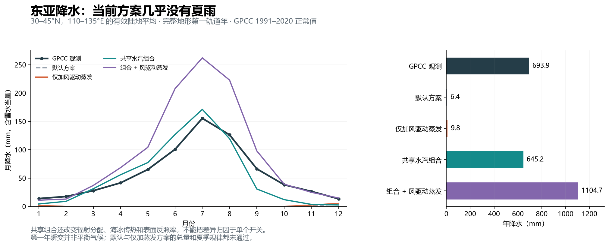
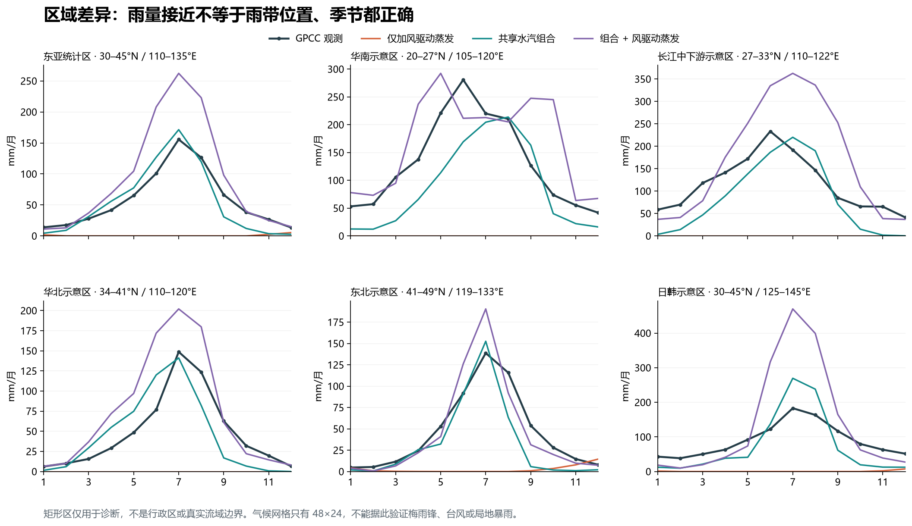

# 东亚降水检查：缺失夏雨，实验组合尚未恢复区域季节规律

2026-10-15；代码基线 `104e7fef5594636cd437e5fa64cc0c90933a7cc6`。本轮只增加诊断资料，没有修改物理代码或正式地球默认配置。

**完整地形第一轨道年的默认东亚降水只有 6.4 mm；仅开启风驱动海面蒸发后为 9.8 mm，且两者夏季降水都为零。** 启用已有共享水汽及表面物理组合后，总量接近观测，但华南、长江的雨峰偏晚，秋冬过干。组合再加新蒸发则大范围偏湿，不能据此采用新默认值。

## 真实规律与观测对照

东亚雨季有明显的季节推进：华南春季持续降水，约 5 月进入前汛期；约 6 月雨带移至长江一带，约 7 月再向华北和朝鲜半岛推进。具体日期随年份变化，雨带进入日期也不等于区域月降水最大值的月份。[Chiang 等，2020，摘要与引言](https://atmos.uw.edu/~david/Chiang_etal_2020.pdf)。

日本还有梅雨、秋雨和台风降水；日本海一侧冬季多雪，不能把整个东亚都简化成“冬季无降水”。[日本气象厅气候概览](https://ds.data.jma.go.jp/gmd/cpd/longfcst/en/tourist_japan.html)。

对照使用冻结的 GPCC v2022 **1991–2020、2.5°陆地月降水正常值**，不是 v2022 主产品的 1951–2000 时段。雨量均包含降雪水当量。[DWD 产品说明](https://opendata.dwd.de/climate_environment/GPCC/html/gpcc_normals_v2022_doi_download.html)，[2.5°产品 DOI](https://doi.org/10.5676/DWD_GPCC/CLIM_M_V2022_250)。下列数字是按本次模型有效陆地支持域重加权后的矩形区平均，不能当成行政区或整个流域的官方年雨量。

| 示意区 | 经纬度范围 | GPCC 年降水 mm | 最湿月 | 6–8 月占全年 |
|---|---|---:|---:|---:|
| 东亚统计区 | 30–45°N，110–135°E | 693.9 | 7 月 | 55.2% |
| 华南 | 20–27°N，105–120°E | 1583.5 | 6 月 | 44.9% |
| 长江中下游 | 27–33°N，110–122°E | 1390.1 | 6 月 | 41.2% |
| 华北 | 34–41°N，110–120°E | 580.0 | 7 月 | 60.2% |
| 东北 | 41–49°N，119–133°E | 549.6 | 7 月 | 63.0% |
| 日韩方向 | 30–45°N，125–145°E | 1067.6 | 7 月 | 43.9% |

这些矩形会包含邻国或邻区陆地，且彼此有重叠。东亚统计区不含华南，也不覆盖全部日本。观测呈现南方较湿、北方夏雨更集中的差别；日韩方向冬春降水也占有一定比重。东亚统计区的 5–9 月降水占全年 74.1%，7 月为 155.6 mm。

## 四组完整地形结果

| 东亚统计区方案 | 年降水 mm | 相对观测偏差 | 最湿月 | 6–8 月占全年 |
|---|---:|---:|---:|---:|
| GPCC 正常值 | 693.9 | — | 7 月 | 55.2% |
| 默认 control | 6.4 | −99.1% | 12 月 | 0% |
| 仅加风驱动蒸发 bulk | 9.8 | −98.6% | 12 月 | 0% |
| 共享水汽组合 transport | 645.2 | −7.0% | 7 月 | 64.8% |
| 组合加风驱动蒸发 transport-bulk | 1104.7 | +59.2% | 7 月 | 62.8% |



`bulk` 只增加海面交换系数 0.0012。`transport` 同时启用共享水汽输送、液态海洋蒸发、海冰传热、冰下海洋及独立表面反照率，并把空气辐射份额设为 0.5；`transport-bulk` 在此基础上增加 0.0012。参数原文保存在每组 JSON 的 `parameters` 和前一轮的 [profiles.json](../earth-bulk-evaporation-20261015/profiles.json)。因此 control→transport **不是单一机制的因果实验**；control→bulk 与 transport→transport-bulk 才分别隔离新增蒸发开关在各自背景配置下的响应。

| 分区 | 观测年雨量 / 峰月 | 仅加蒸发 | 共享组合 | 组合加蒸发 |
|---|---:|---:|---:|---:|
| 华南 | 1584 / 6 月 | 0 / 无雨 | 1060 / 8 月 | 2028 / 5 月 |
| 长江中下游 | 1390 / 6 月 | 0 / 无雨 | 976 / 7 月 | 2056 / 7 月 |
| 华北 | 580 / 7 月 | 0 / 无雨 | 534 / 7 月 | 882 / 7 月 |
| 东北 | 550 / 7 月 | 32 / 12 月 | 386 / 7 月 | 551 / 7 月 |
| 日韩方向 | 1068 / 7 月 | 11 / 12 月 | 874 / 7 月 | 1643 / 7 月 |

单位 mm。共享组合没有正确恢复南方早于北方的月雨峰顺序；东北即使在组合加蒸发下年总量几乎吻合，夏雨占比仍达 74.2%，高于观测 63.0%。日韩方向共享组合的夏雨占比 73.7%，观测只有 43.9%，存在明显的季节分配错误。各区纵轴范围不同：



## 代码与诊断能说明什么

1. [water.ts](../../../water.ts) 的默认分支用整层水汽超过当前空气温度所对应容量的部分产生降水；共享分支另有对流、辐合抬升、锋面及地形过程。默认与 bulk 的降水分项也确实全部来自饱和项，夏季为零。bulk 在东亚 6/7/8 月的整层湿度比为 0.416/0.331/0.338，表明当前模型没有达到整层饱和条件；**这不是观测近地面相对湿度**。
2. 共享组合东亚年降水分项约为对流 309.5、锋面 155.2、辐合 82.9、地形 97.6 mm；饱和项为零。这说明实验降水由这些参数化产生，不能证明模型已经模拟出了真实梅雨锋或中尺度对流。
3. 东亚有效陆地权重下，7 月整列水汽净输入诊断由 control 的 −0.564、bulk 的 −0.358，变为 transport 的 +2.074、transport-bulk 的 +3.973 mm/day。供水、输送和成雨有共同变化；这个诊断是按陆地权重抽样的整列通量，**不是独立陆地水量收支、海洋来源示踪或观测值**。
4. 共享组合及叠加蒸发后的东亚 7 月平均北向风速仍分别为 −0.56、−0.20 m/s。区域平均风不等于水汽输送方向，也不能代替风场图；但它提醒我们，单凭 7 月雨量峰值不能宣布夏季风环流已经正确。本轮没有同网格观测风或温度误差验证。

**下一步建议（尚未实施）：**先分开检验空气/海面温湿状态、水汽输送及抬升成雨参数化，做单开关消融；用华南春雨、长江 6 月峰、华北 7–8 月雨季、日韩秋冬降水共同约束。随后用多年度稳定统计及更细纬向雨带诊断验证，避免靠单个蒸发系数拟合东亚年总量。

## 方法、限制和数值检查

- 四组从同一正式地球第 0 天状态出发，保留 215,348 三角形真实地形、湖泊、排水和冰库存，步长 1800 s，累计一个真实轨道年 31,558,148.623 s。没有时间跳转、重新生成地形或用观测修改运行场。
- 降水气候网格仍只有 **48×24**，经度间隔 7.5°，纬向按纬度正弦等分，格点面积相等。六区分别只有 15/4/6/4/9/10 个有权重的模型格点。完整地形不等于高分辨率大气，无法解析梅雨锋、台风或城市暴雨。
- 使用 [climate-diagnostics.ts](../../../climate-diagnostics.ts) 的球面重叠面积、GPCC 有效观测掩膜及模型陆地比例匹配权重。共享方案的陆地雨量先除以陆地比例；默认方案采用均匀列降水。逐月降水分项求和与总降水误差小于 1e−7 mm。
- 日历从 3 月 20 日开始，以平年各月长度映射到轨道年并连续积分；3 月合并了运行开头和结尾的部分。年度覆盖断言通过。这是**初始第一年瞬变与 30 年正常值的对照，并非平衡气候准确度评估**；启动记忆可能影响季节形态。
- 四组在第 0、90、180、270 天及年终的采样检查均通过：所有记录中水量残差绝对值最大 1.09e−7 mm、焓残差最大 2.43e−4 J/m²、排水分配残差最大 0.00431 m³。阈值分别为 5e−6 mm、0.005 J/m²、1 m³；不是逐步最大值。四组年末存档严格恢复并续跑一步，与原运行快照逐字段相等。数值守恒不代表气候真实。
- control/bulk 使用最初的审计 bundle，启动状态哈希一致。transport 两组使用增强启动检查的 bundle：直接核对温度、水量和预算起点与原存档一致；启用独立表面反照率时允许该诊断数组按配置变化。两版 bundle 的差异经文本比较只涉及启动断言和额外的库存哈希输出，积分及统计代码相同。每组结果保留了实际执行 bundle 哈希，没有回填前两组未记录的字段。

正式地球 SHA-256：`afb80a8ab730785eed0cb709a66d938ad20a9690b04ecfa1246d1deb393adca6`。冻结 GPCC JSON SHA-256：`01ed704dd31cec9376d27fafd902cfeb5c77862f7d8b3cf2e9e6b5d4226dbbc4`。原始 2.5°压缩资料 SHA-256：`6e08db25ba4eebb0affe9e2519907aa66e24f8e0177d25c3084a7e2085ef0d0b`。引用详见 [SOURCES.md](SOURCES.md)。

## 复现与原始结果

从仓库根目录使用已有依赖运行；本轮没有重新下载观测。脚本只写入 build 目录：

```powershell
npx esbuild docs/evidence/earth-east-asia-rainfall-20261015/audit.ts --bundle --platform=node --format=esm --outfile=build/earth-east-asia-rainfall/audit.mjs
foreach ($profile in @('control','bulk','transport','transport-bulk')) {
    $env:PARAM_PROFILE=$profile
    node build/earth-east-asia-rainfall/audit.mjs
    if ($LASTEXITCODE -ne 0) { throw "Audit failed: $profile" }
}
Remove-Item Env:PARAM_PROFILE
```

保存结果为 [control.json](control.json)、[bulk.json](bulk.json)、[transport.json](transport.json)、[transport-bulk.json](transport-bulk.json)，每份含完整逐月降水、温湿风诊断和降水分项。[metrics.json](metrics.json) 由 `python docs/evidence/earth-east-asia-rainfall-20261015/summarize.py` 生成。`plot.py` 绘制目录内已保存 JSON；需要 numpy、matplotlib 及 Windows 微软雅黑字体，本机优先使用已有 `build/earth-moisture-p0/python` 库。可导出 PNG 和 SVG。
