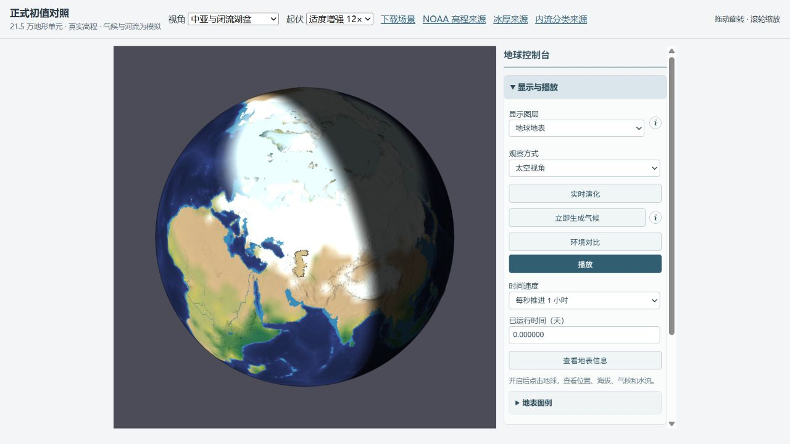

# 湖泊、冰封带与温带干旱：修复与验收（2026-10-11）

里海的空湖盆和湖岸/水力水位不一致已修复。冰封带和温带降水仍未通过观测验收；本轮没有把它们写成已解决。正式默认、地球源文件及其初始库存未改，新闭合项可分别启用。

## 已修的机制

1. 里海原有 166 个内陆湖地形单元，但水库体积为零。新增显式历史水位初始化，按同一三角形地形储水积分计算体积，从有限海洋库存扣除。候选初始水位为 -28 m，体积 73987.8 km³。该水位来自 2017 年历史值，并非 2026 年岸线。物理路由与可见湖岸共用储水关系，避免同一水面因不同湖底倾斜产生假水流。
2. 混合海岸的陆地积雪原本会提高邻接海水的反照率。实验项 separateSurfaceAlbedo 让陆地和海水分别吸收阳光，粗网格与细化表面均实现，并保留实际辐射预算。
3. 海水低于 0 °C 时原有淡水温度闸门把蒸发压为零。实验项 liquidOceanEvaporation 允许未结冰的低温海水蒸发，仍扣除有限水和汽化潜热。湖泊保持淡水温度约束。
4. 开关可在当前状态迁移，保持水、温度、时间和预算起点，完整保存后可逐步精确续算。

## 对照口径

所有气候臂从相同库存出发，SHA256 94713a0b67d9992c0432ee3af7109ca4bc0246bab5ded607f0d02d4d75160630。真实推进 365.270833 天，月统计恰好覆盖一个物理轨道年；全程 1800 s 步长、完整地形路由，未重新生成气候、未跳转季节。

- before：正式旧水汽运行方式。
- transport：已有共享水汽、独立气/陆/海温度、导热海冰和冰下输送对照。
- albedo / evap / after：在 transport 上分别打开陆海反照率、低温海水蒸发、两项同时打开。

湖泊水位初始化另做 0、2、24 天真实积分，因此湖泊前后局部库存不同，但全球总水不变；没有把湖泊初始水分配混进相同库存气候对照。

## GPCC 区域结果

单位 mm/年。相同 GPCC 有效陆地面积支持，记录真实落到陆地的降水。观测为 GPCC v2022 1991–2020 normals。

| 区域 | GPCC | before | transport | albedo | evap | after |
|---|---:|---:|---:|---:|---:|---:|
| Europe | 792.1 | 333.1 | 250.7 | 247.7 | 262.6 | 264.4 |
| East North America | 1056.0 | 44.1 | 474.5 | 478.8 | 482.1 | 486.5 |
| East Asia | 693.9 | 6.4 | 623.4 | 627.4 | 642.0 | 645.2 |
| West Siberia | 451.3 | 221.4 | 119.3 | 121.0 | 119.3 | 119.3 |
| India | 1138.1 | 0.0 | 541.4 | 548.5 | 548.3 | 555.5 |
| Australia southwest | 489.0 | 0.0 | 339.8 | 323.7 | 346.4 | 336.3 |

已有共享水汽显著改善了北美东部和东亚的旧运行时断雨，但欧洲与西西伯利亚比正式旧运行方式更干，仍明显低于观测。新海水蒸发只带来有限增量，澳洲西南并非各臂都改善，不能据此宣称温带问题已解决。

## NSIDC 同网格海冰结果

同一缓存 G02202 v2 月浓度气候态、同一有效海域面积权重、同一 15% 阈值。以下为月范围平均绝对误差，单位百万 km²。

| 臂 | 北半球 MAE | 南半球 MAE |
|---|---:|---:|
| before | 13.84 | 24.23 |
| transport | 11.01 | 23.87 |
| albedo | 11.78 | 23.89 |
| evap | 11.56 | 24.73 |
| after | 12.18 | 24.74 |

开放海水蒸发增加了潜热损失，供水改善同时让部分海冰扩大。海冰质量仍用原有 0.5 m 标度诊断覆盖率，缺少独立浓度与厚度演化；辐射仍是有效整柱闭合。它们是下一步结构性修复对象，不能靠改显示颜色或覆盖阈值掩盖。

## 预算与可恢复性

气候臂检查点最大总水残差 2.021e-7 mm，焓残差 2.424e-4 J/m²，每单元水汽残差 3.388e-11 mm。五臂都通过严格保存恢复及下一步逐字段一致性。

湖泊 24 天总水残差 2.317e-8 mm，焓残差 1.952e-4 J/m²；水位随真实收支变化，不自动补水。湿三角形面积并不等同于精确岸线面积。

257 项 Node 回归、类型检查和构建通过；浏览器控制器与 WebGL 验证记录见 browser-checks.json。截图为真实 WebGL、同一天/相机/显示设置；湖泊截图仅证明初始水面恢复，不证明气候已收敛。

## 复现与边界

用 esbuild 把本目录 integrate.ts 打包为 Node ESM，依次设置 EARTH_ARM=before/transport/albedo/evap/after 后运行；lake.ts 独立产生 lake-day0/2/24.json。运行 analyze.mjs 复算同网格验收，preview.mjs 从正式页面生成忽略目录下的独立预览。

正式输入 SHA256：afb80a8ab730785eed0cb709a66d938ad20a9690b04ecfa1246d1deb393adca6。全部预算、月字段、观测绑定及边界说明保存在 acceptance.json 和 manifest.json。本轮结果是守恒的机制修复与可检查的实验，仍缺少独立海冰面积、完整湖泊热力和更完整的辐射/风暴降水过程。

来源：[历史里海水位研究](https://doi.org/10.1051/e3sconf/202128801064)、[GPCC normals v2022](https://opendata.dwd.de/climate_environment/GPCC/gpcc_normals_v2022/)、[NSIDC G02202 v2](https://doi.org/10.7265/N55M63M1)。NSIDC 复用前轮已经缓存并同网格化的历史 NASA Team 月浓度字段，与合并后的官方 CDR 并非同一变量；版本、无效区和面积支持详见 acceptance.json。历史水位并非当前观测，粗网格岸线仍需改进。
