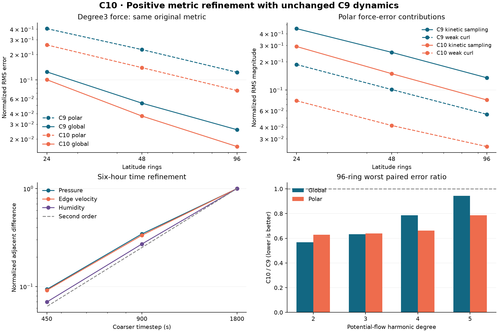

# C10: positive graph-metric moment refinement

C10 reduces the predeclared degree3 potential-flow polar error using the
same original error norm and unchanged C9 dynamics. The finest-grid worst
polar error changes from 0.1234337 to
0.07499363 (39.24% lower).
This is a bounded numerical experiment, not a replacement application default.
All held-out comparisons, including regressions, are retained below and in CSV.

## Construction and scope

Base: a3a6934b6c9135ddfd912b86197f54026b615e05. Only fixed graph conductances
change. Every original node, area, coordinate, distance, edge index/order and
velocity degree of freedom is retained. The exact sealed C8 pressure-core and
C9 vector-core implement dynamics; no vorticity term or state is suppressed.

The C9 decomposition identifies sampled kinetic energy as the main degree3
polar defect: at 96 rings/axis1/constant pref its normalized contribution is
0.1351076, versus 0.003905051 for differentiating exact kinetic potential and
0.00001260479 for pressure. Weak curl contributes 0.05471404 and partly
cancels sampling error. These are vector-component norms, not additive errors.

The frozen [protocol](protocol.md) penalizes cubic tangent moments with
lambda=0.01 while retaining low moments to measured tolerance and enforcing
w >= 0.01 w0. Symmetric tensor weights make the penalty invariant under
orthogonal changes of each tangent basis. A trace-scaled ridge regularizes the
dual solve; violating weights are pinned and free weights refitted. This
one-way active set is a feasible heuristic, not a constrained-optimum proof.
No final metric/state clipping, adaptive timesteps or edge deletion occurs.

Hard moment fitting and early soft alternatives are retained in
[exploration](exploration/README.md). They selected the coarse-grid penalty;
their own-metric norms and absent before/after wrappers do not support final
acceptance. The final positive floor, common norm and gates were frozen before
the accepted fits and fine-grid force results. No post-result retuning occurred.

| Rings | Cells / edges | Solves / pinned | Cubic norm before / after | Low-order residual | Max w/w0 | Seconds |
| --- | --- | --- | --- | --- | --- | --- |
| 24 | 1008 / 12612 | 4 / 112 | 20.27913 / 12.04125 | 1.665329e-11 | 8.811455 | 7.643939 |
| 48 | 3168 / 39580 | 3 / 96 | 20.10367 / 11.70577 | 3.057351e-11 | 8.612858 | 53.00252 |
| 96 | 10944 / 132948 | 3 / 96 | 21.07605 / 12.30965 | 3.519496e-10 | 8.940432 | 1152.512 |

All retained weights meet the product bound exactly (the printed minimum
ratio can round to 0.009999999999999998). All low residuals are below 1e-7.
Fit timing is wall time under concurrent validation, not a performance benchmark.

## Spatial evidence

For potential flows, global RMS uses original h=w0*d^2; polar RMS uses the
same h on edges with either endpoint beyond 75 degrees, divided by the same
global exact-force RMS. Samples, geometry and reference are identical for C9
and C10. Tables aggregate constant/varying pref and the two original oblique
axes unless stated otherwise. Candidate degree3 errors decrease across all
three grids, each finest polar pair meets the 20% reduction gate and worst
polar <=0.09, and no benchmark global pair increases.

| Rings | C9 global | C10 global | C9 polar | C10 polar |
| --- | --- | --- | --- | --- |
| 24 | 0.1247379 | 0.1007578 | 0.4059637 | 0.2602566 |
| 48 | 0.05315259 | 0.03740000 | 0.2291727 | 0.1400547 |
| 96 | 0.02576075 | 0.01627715 | 0.1234337 | 0.07499363 |

| 96-ring component | C9 max polar | C10 max polar |
| --- | --- | --- |
| force | 0.1234337 | 0.07499363 |
| pressure | 0.00001846280 | 0.00001846280 |
| kineticSampling | 0.1351076 | 0.07819172 |
| exactKGradient | 0.003905051 | 0.003905051 |
| curlForce | 0.05489287 | 0.02477050 |

These component magnitudes include cancellation and must not be summed.
The pressure gradient and gradient of exact kinetic potential do not depend
on conductance; the changed sampling and weak-curl metric drive the difference.

At 96 rings, held-out degrees 2/4/5 and the third oblique axis are included here:

| Degree (all 3 axes) | C9 max global | C10 max global | C9 max polar | C10 max polar | Worst paired global ratio | Worst paired polar ratio |
| --- | --- | --- | --- | --- | --- | --- |
| 2 | 0.02211005 | 0.01139400 | 0.08996719 | 0.05467243 | 0.5686534 | 0.6290212 |
| 3 | 0.02576075 | 0.01627715 | 0.1234337 | 0.07499363 | 0.6320409 | 0.6380999 |
| 4 | 0.02338198 | 0.01679358 | 0.1003831 | 0.06278879 | 0.7869850 | 0.6631711 |
| 5 | 0.02363775 | 0.01770547 | 0.03955200 | 0.02622999 | 0.9426303 | 0.7861929 |

Original rotating, mixed and unequal-layer sheared fields use original
pressure-weighted H and the same semidiscrete vertical reference:

| Rings / field | C9 max global | C10 max global | C9 max polar | C10 max polar |
| --- | --- | --- | --- | --- |
| 24 / rotation | 0.03034478 | 0.02834792 | 0.05194395 | 0.03408983 |
| 24 / mixed | 0.03110093 | 0.02394125 | 0.1024888 | 0.06251358 |
| 24 / sheared | 0.03268018 | 0.02818166 | 0.08888472 | 0.05686735 |
| 48 / rotation | 0.009634864 | 0.008135143 | 0.02756338 | 0.01218858 |
| 48 / mixed | 0.01302382 | 0.008639202 | 0.05551168 | 0.03296183 |
| 48 / sheared | 0.01221017 | 0.009133739 | 0.04714838 | 0.02820977 |
| 96 / rotation | 0.003900845 | 0.002640378 | 0.01494473 | 0.006986559 |
| 96 / mixed | 0.007729411 | 0.003880715 | 0.02914251 | 0.01762869 |
| 96 / sheared | 0.006246420 | 0.003611250 | 0.02459800 | 0.01475192 |

Every strict paired increase is counted, including tiny differences:

| Matrix / metric | Regressions | Largest ratio: rings, pref, axis, field | C9 -> C10 | Ratio |
| --- | --- | --- | --- | --- |
| Potential (72) / globalError | 0 | none | - | - |
| Potential (72) / polar | 0 | none | - | - |
| Primary (36) / globalError | 0 | none | - | - |
| Primary (36) / polar | 0 | none | - | - |

The complete, unrounded 72 potential rows with all five force contributions
are in [potential-comparison.csv](raw/potential-comparison.csv); all 36 primary
rows are in [primary-comparison.csv](raw/primary-comparison.csv). These records
identify every regression by grid, pref, axis and field, rather than hiding
it behind an aggregate. C10 does not establish universal spatial improvement.

Scalar Laplacian and Rayleigh proxies, degrees2-5/all axes/both pref:

| Rings | C9 worst global | C10 worst global | Ratio | C9 worst Rayleigh | C10 worst Rayleigh |
| --- | --- | --- | --- | --- | --- |
| 24 | 0.03671582 | 0.03550759 | 0.9670923 | 0.03520121 | 0.03485013 |
| 48 | 0.01026859 | 0.01005751 | 0.9794443 | 0.009829460 | 0.009877049 |
| 96 | 0.003051813 | 0.002929478 | 0.9599140 | 0.002853969 | 0.002854880 |

Each grid meets the predeclared worst-global <=1.10 times old-worst gate.
This aggregate gate permits individual regressions. The full 90-row matrix,
including degree1 and polar maxima, is in
[pressure-proxy-comparison.csv](raw/pressure-proxy-comparison.csv).
Across those 90 rows there are no relative-L2 or polar-maximum increases,
but 42 Rayleigh-error increases: 24 at 48 rings and 18 at 96 rings. The
largest paired ratio is 1.008068095 (48 rings, constant pref, axis1, degree3),
an approximately 0.81% increase. The largest absolute increase is
0.00006358702 (48 rings, constant pref, axis1, degree5). All 42 cases are
enumerated in the independent review's final-evidence-audit-v1.json.
These are operator proxies; no integrated gravity-wave dispersion validation
or general stability claim follows from them.

## Six-hour native dynamics

The new 48-ring metric uses the exact native geometry, C9 rotating barotropic
sigma dynamics, three layers, real initial humidity, c2=82671.64740772452 and
Earth rotation 7.292115e-5. Every requested timestep is used literally.

| dt (s) | Steps | Max local budget residual | Max equation residual | Accumulated energy drift | Max neutral / pressure iterations |
| --- | --- | --- | --- | --- | --- |
| 1800 | 12 | 2.200548e-15 | 2.887629e-14 | 8.965017e-16 | 13 / 3 |
| 900 | 24 | 2.219086e-15 | 1.315849e-14 | 1.045919e-15 | 10 / 3 |
| 450 | 48 | 4.913374e-15 | 3.799312e-15 | 2.390671e-15 | 9 / 3 |
| 225 | 96 | 2.294030e-15 | 3.066826e-16 | 1.195336e-15 | 7 / 2 |

All runs have zero rejected steps, positive pressure, original local/global
air/water/dry budget bounds and humidity bounds. At 1800s, real, constant and
sharp humidity cases share identical dynamics. Each rebuilt checkpoint
continues four steps with literal bit equality; loading a new-metric checkpoint
with the old-metric model is rejected by existing version9 identity.
The complete solver traces remain in
raw; changing the metric changes the model identity and its numerical solution.

| Adjacent dt (s) | Pressure (Pa) | Velocity (m/s) | Humidity (kg/kg) |
| --- | --- | --- | --- |
| 1800 / 900 | 83.07905 | 0.1944236 | 7.529717e-7 |
| 900 / 450 | 28.62782 | 0.06488880 | 2.045739e-7 |
| 450 / 225 | 7.771525 | 0.01779834 | 5.231200e-8 |

Successive adjacent-error ratios (pressure / velocity / humidity) are
2.902039 / 2.996258 / 3.680684, then
3.683681 / 3.645779 / 3.910649.
All adjacent and 225s-reference differences decrease. The trend approaches
second order, but 225s is a discrete reference, not an exact physical solution.

## Validation, provenance and next work

The no-op RED fitter fails the required cubic reduction and guard assertions;
the final Python suite passes seven groups (bounds, exact graph preservation,
invalid data/options, covariance, determinism and exhaustion). Three graph fits,
141 selected Julia assertions, 14 recursive source-binding checks, 278 project tests,
typecheck and build are recorded in raw. verification.json records the final
assertion count and all attempts after the one-time seal.

Fourteen canonical attempts are retained: twelve selected successful runs,
the no-op RED, and failed spatial-v1. Spatial-v1 exposed a test-harness shape
error when adding a shared pressure-gradient vector to a three-layer force
matrix. Both additions now broadcast across layers; spatial-v2 reran the
entire 54-assertion matrix successfully. No fit, dynamics, norm or acceptance
threshold changed, and failed source bytes/logs remain available.

The [independent review](code-review.md) checks a separately assembled primal
KKT formulation, random per-node O(2) basis changes, invalid/near-zero inputs,
new-metric algebra and rebuilt checkpoint identity, and the final evidence.
Review source/output bindings and exact artifacts are archived. The manifest
binds every experiment file; Git-byte verification occurs after commit/merge.
Sealed C1-C9 evidence and the formal default are preserved. Runtime executables
are recorded by path/version, not content-pinned, so bitwise restart is scoped
to this environment. Integration results live in Git and build/c10-integration.

Remaining work: investigate residual polar sampling/curl compatibility across
held-out flows before changing the default; test integrated waves and wider
resolution/time ranges; establish curl-grad, potential-vorticity and angular
momentum properties. Nonuniform-layer vertical spatial order is unproved.
Thermodynamic pressure/geopotential, thermal energy and physical water sources
remain absent. No full-atmosphere or climate acceptance is claimed.
