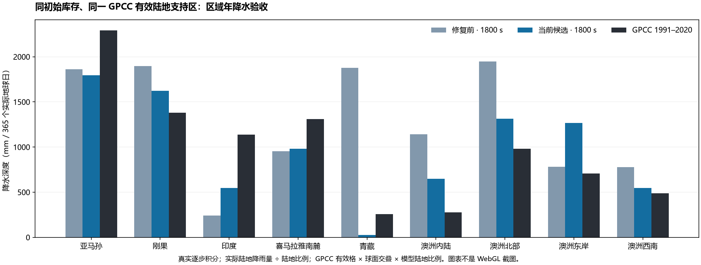
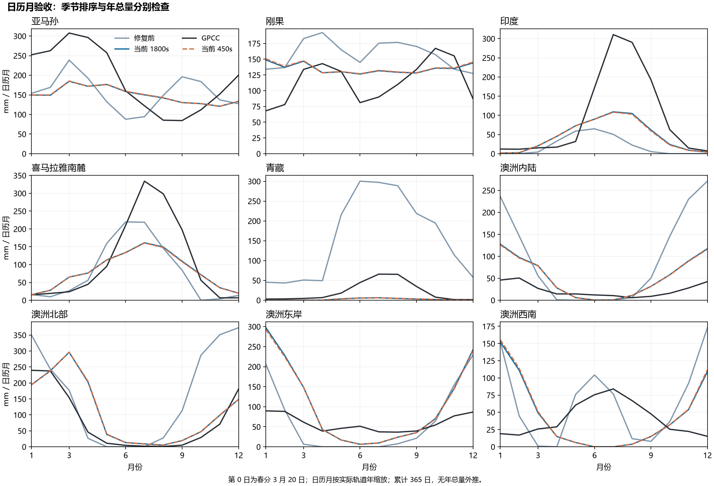
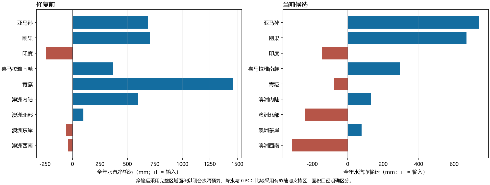
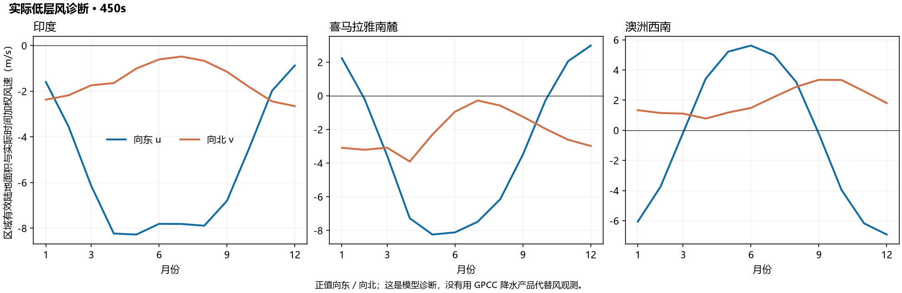
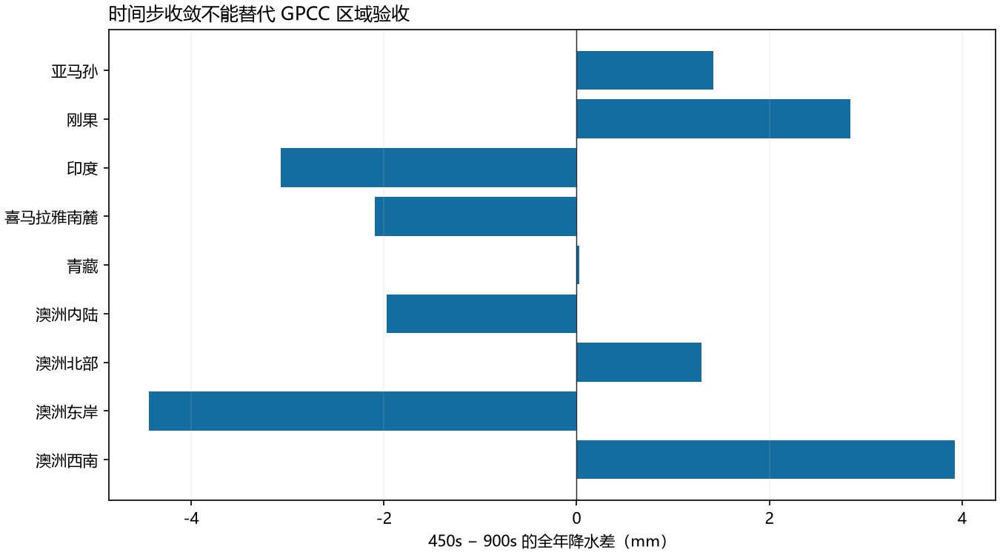

# 低层环流与抬升闭合：数值验收

**结论：同库存真实积分、预算和恢复检查通过；区域整体验收未通过，正式默认保持原样。** 印度海到陆供水仍不足，澳洲西南仍未形成冬雨。保留当前实验 transport 修复及所有失败证据，不提升为正式默认，不用年总量改善掩盖季节错误。

## 已完成的结构与诊断改动

- 实验环流保留海洋纬向虚温背景、局地浮力和精确旋转阻力积分，让热力梯度控制低层经向响应；缺少海洋的纬度行采用相邻海洋行插值或陆地纬向回退。保存的风仍使用原模板偏移，兼容原库存。
- 有限水汽平流采用对称顺序；涡旋交换保留两股有限供体，按同高度空气温差诊断锋面交换。上坡凝结只从交换水汽包扣除，海洋供体的山地雨落到受体陆地，陆地供体的迎风截留留在供体。
- 列云按陆海表面温度分别诊断浮力与抬升，使用共享气柱水汽、湿度与辐合，避免热但干的地面凭空触发深对流。实际陆地和海洋沉降分别入库；总降水五项份额与陆地降水五项份额均独立求和检查，水汽、潜热只记一次。
- GPCC 比较使用实际陆地沉降量除以陆地面积比例；全区水汽账仍使用完整格面积上的总降水。探针明确区分初始估计、最近实际步与旧细分存档的分配未知。
- 修复首次启用细分丢失陆海雨量分配、质量切换后丢失新诊断、旧 transport 细分存档 load-save-load 及呈现帧回滚。旧重分区的陆海分配不能精确反推，未知状态不持久化伪造分配；下一次真实步生成实际记录。

## 同一初态和验收口径

基点 `e3222280a0ceddd597245f3c45d75f75d2def9f5`。修复前是此前 P0 实现的冻结 circulation/water/reference-moisture 三文件，**不是正式 legacy 默认的另一套初态**。从正式 Earth 日零存档严格恢复同一空气、陆地、海洋温度及全部有限水库存，仅在内存副本启用 transport、airRadiationFraction=0.5 并设置步长。未重新生成气候，未改季节跳转，未重置初始水量或热量账。

所有比较连续推进 365 个实际地球日；完整 Earth 地形 215348 个三角形，48×24 大气母格，原有陆海热交换、动态风、地形径流、冰川和植被同时运行。第零日为 3 月 20 日；月份按实际轨道年缩放并按每一步时间交叠积分。没有年总量外推。这是一年瞬态结果，还不是多年稳定气候。

GPCC：DWD v2022、1991–2020 正常值、2.5°、3638 个有完整 12 月值的陆地格。模型和观测均使用相同有效格交集、球面区域交叠与模型陆地比例权重。数据文件来源与 SHA 见 [gpcc-grid.json](gpcc-grid.json) 和 [comparison.json](comparison.json)。山区观测与粗地形代表性差异仍存在，不能因此免除偏差报告。

正式 `earth-simulation.json` SHA-256 仍为 `afb80a8ab730785eed0cb709a66d938ad20a9690b04ecfa1246d1deb393adca6`；其 transport、airRadiationFraction、refinement 仍未设置。scene-config、config.js、environment.ts、surface-grid.ts、climate.ts 与基点逐字节一致。[bindings.json](bindings.json) 校验原始物理库存及初态字段（步长除外）、相同库存 SHA、积分 bundle 和保存状态 SHA。基线旧 harness 未直接记录库存 SHA，验证脚本从保留的 day0 状态独立重算，结果与三个候选运行的原始记录一致。末轮旧存档/诊断修复后另以最终源实际重跑 24 日，与冻结主积分的同日完整运行态逐字段相等；见 [final-source-equivalence.json](final-source-equivalence.json)。

## GPCC 区域验收

下表单位 mm / 365 实际日，观测为 12 月正常值合计。

| 区域 | 修复前 1800s | 当前 450s | GPCC | 当前偏差 |
| --- | ---: | ---: | ---: | ---: |
| 亚马孙 | 1862.3 | 1798.9 | 2292.7 | -21.5% |
| 刚果 | 1897.2 | 1630.6 | 1378.2 | +18.3% |
| 印度 | 240.6 | 537.6 | 1138.1 | -52.8% |
| 喜马拉雅南麓 | 954.2 | 972.8 | 1307.8 | -25.6% |
| 青藏高原 | 1877.3 | 26.1 | 257.4 | -89.9% |
| 澳洲内陆 | 1142.8 | 641.1 | 276.0 | +132.2% |
| 澳洲北部 | 1949.0 | 1316.2 | 981.9 | +34.0% |
| 澳洲东岸 | 780.7 | 1254.4 | 707.9 | +77.2% |
| 澳洲西南 | 776.5 | 559.1 | 489.0 | +14.3% |

印度 JJA/DJF 为 **300.8/8.3 mm**，夏季更湿且较修复前改善；但全年全区域净水汽输运 **-151.2 mm**，仍不是净输入，海到陆供水验收失败。

喜马拉雅南麓年雨大于青藏，雨影方向通过；青藏仅 **26.1 mm**，对 GPCC **257.4 mm** 过干，不能把方向通过称为幅值通过。

澳洲内陆比东岸和北部干，北部 DJF/JJA 为 **582.0/27.5 mm**，方向通过。西南 JJA/DJF 为 **3.8/381.5 mm**，冬季偏干、季节排序失败；东岸与北部仍偏湿。

热带退化明确量化：Amazon 绝对年偏差变化 +63.3 mm（GPCC 的 +2.76%）；Congo 绝对年偏差变化 -266.6 mm（GPCC 的 -19.34%）。没有事后添加宽松阈值来宣称“热带未变差”。

沿岸代理量：阿拉伯海/孟加拉湾分支全年为 **-3136.5/-583.4 Gt**。这是 5–27°N、60–100°E 范围净面通量乘陆地比例差，包含受体海岸凝结、排除供体迎风截留；不是历史海洋来源追踪，也不是严格印度国界的净输入。正负净面通量的分项不是双向 parcel 总交换量。

| 450s 实际低层风 m/s | JJA 向东 / 向北 | DJF 向东 / 向北 |
| --- | ---: | ---: |
| 印度 | -7.84 / -0.58 | -1.95 / -2.41 |
| 喜马拉雅南麓 | -7.24 / -0.60 | +1.74 / -3.09 |
| 澳洲西南 | +4.59 / +2.20 | -5.64 / +1.44 |

风诊断来自同一实际步，按有效陆地面积与实际月份时长加权。印度夏季仍向西、向南，因此 JJA 更湿并未代表低层季风供水闭合。西南澳冬季已有向东风分量，降雨却极少；仅风向季节变化不足以验收供水与抬升。这里没有使用 GPCC 作为风速观测产品。

## 实际步长差异与独立预算

| 区域 | 1800s | 900s | 450s | 450−900 | 差异 / 450s |
| --- | ---: | ---: | ---: | ---: | ---: |
| 亚马孙 | 1794.79 | 1797.52 | 1798.94 | +1.42 | 0.08% |
| 刚果 | 1622.23 | 1627.74 | 1630.58 | +2.84 | 0.17% |
| 印度 | 546.43 | 540.64 | 537.57 | -3.07 | 0.57% |
| 喜马拉雅南麓 | 978.83 | 974.85 | 972.76 | -2.09 | 0.22% |
| 青藏高原 | 25.96 | 26.02 | 26.05 | +0.03 | 0.11% |
| 澳洲内陆 | 646.65 | 643.03 | 641.05 | -1.97 | 0.31% |
| 澳洲北部 | 1312.27 | 1314.86 | 1316.16 | +1.30 | 0.10% |
| 澳洲东岸 | 1267.15 | 1258.89 | 1254.45 | -4.44 | 0.35% |
| 澳洲西南 | 547.79 | 555.17 | 559.10 | +3.93 | 0.70% |

450/900s 区域年雨最大差 **4.44 mm**，最大相对差 **0.70%**。全部方向验收在三个步长下相同，印度供水和西南澳季节性失败不随步长翻转。差值缩减只报告实测结果，不声称非线性系统的收敛阶已证明，也不以时间步差异小替代 GPCC 验收。

| 积分 | 最大记录水残差 mm | 最大记录焓残差 J/m² | 最大单格水汽账差 mm | 最大全球净输运 mm |
| --- | ---: | ---: | ---: | ---: |
| baseline-1800 | 3.244e-07 | 2.230e-04 | 6.185e-11 | 1.229e-13 |
| coastal-deposition-v2-1800 | 5.821e-08 | 2.120e-04 | 2.387e-11 | 9.494e-14 |
| coastal-deposition-v2-900 | 2.041e-07 | 2.260e-04 | 3.433e-11 | 5.412e-14 |
| coastal-deposition-v2-450 | 2.044e-07 | 2.358e-04 | 5.639e-11 | 4.314e-14 |

水、焓分别从所有库存与辐射输入重新求和；逐格水汽满足 ΔW=E−P+净输运；逐面 incidence 独立构造，凝结份额每一步独立相加。上述最大值来自 0/24/90/180/270/365 日记录，逐步断言另覆盖面通量与份额；未声称每个物理步都保存了独立全库存预算。四组全年保存后下一步快照逐字段完全相等。

## 未采用的结构假设

隔离版本通过同库存真实全年积分检验，均没有写入产品主实现：

| 隔离假设 · 1800s | 印度年雨 mm | 印度净输运 mm | 刚果年雨 mm | 澳洲北部年雨 mm | 西南澳 JJA / DJF mm |
| --- | ---: | ---: | ---: | ---: | ---: |
| surface-anomaly | 1523.6 | +473.4 | 2317.3 | 2627.9 | 53.3 / 422.5 |
| boundary-anomaly | 609.4 | -119.5 | 2158.2 | 1158.5 | 9.2 / 303.6 |
| friction-balance | 1121.1 | +217.9 | 2768.4 | 2635.1 | 64.1 / 102.9 |

surface-anomaly 去除重复 SST 压力异常后虽使印度净输入，但刚果和澳洲过湿；boundary-anomaly 扣除纬向海洋浮力背景未解决印度；friction-balance 以海洋平衡力驱动实际风、保留陆地摩擦后使印度接近 GPCC，却严重放大刚果和北澳湿偏，西南仍没有冬雨。另有 boundary-parcel、marine-friction 的两轨道 reference 探针，仅作为否决候选的机制诊断，未冒充全年区域验收。失败的 coastal-deposition v1 存档校验也保留原始文件，未混入已完成数据。

当前压力势仍为诊断近似，没有预报空气质量、气压或动能预算。固定直减率、锋面抬升、水汽容量和粗地形均有结构局限。植被反馈仍沿用母格总列降水输入，切换为实际陆地沉降需要另行重跑耦合积分。下一步应同时闭合背景压强梯度、陆地摩擦导致的跨等压线流及温带锋面抬升；仅增大季风供水或海洋压力异常的全局系数已被热带/澳洲反例否决。

## 代码与图形验证

`npm run typecheck`、`npm test` **241/241**、`npm run build` 全部成功，`git diff --check` 无空白错误。修复前 RED、修复后 GREEN、真实冻结旧源复现（含不规则海岸重分区、回滚、下一步相等）及独立复核见日志和 [REVIEW.md](REVIEW.md)。

WebGL2 初始化仍失败，健康 Earth 前后截图未完成。自动安全审查拒绝了 `chrome://gpu`（仅允许 HTTP/HTTPS）；用户选择先继续数值验收，因此没有重启 Chrome。保留 [失败画面](webgl-blocker.jpg) 仅用于记录阻塞。本文 PNG/SVG 是实际积分数值图，不能替代 WebGL 前后截图。图形恢复后，仍须以绑定的同日保存状态、同视角和图层补图并检查像素。
