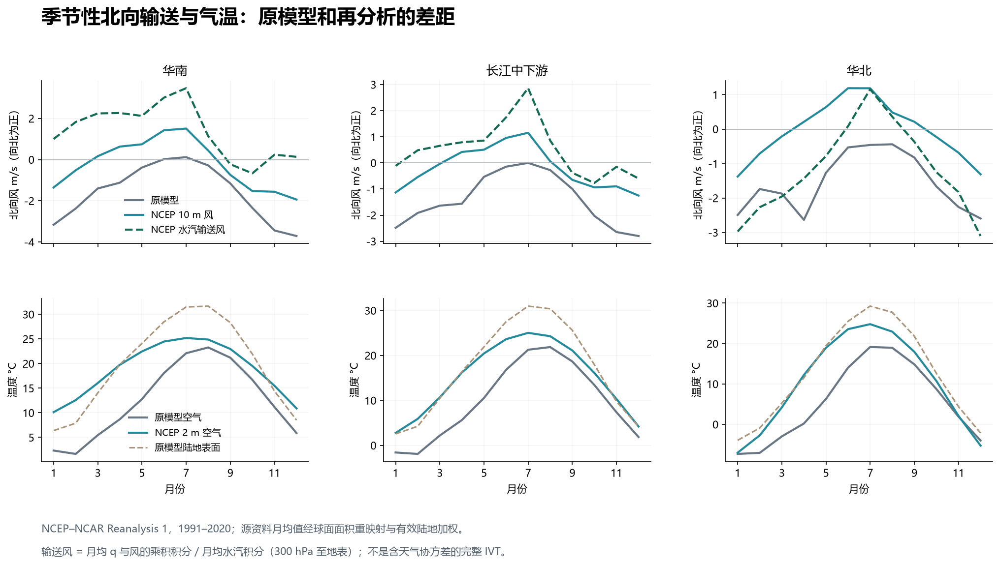
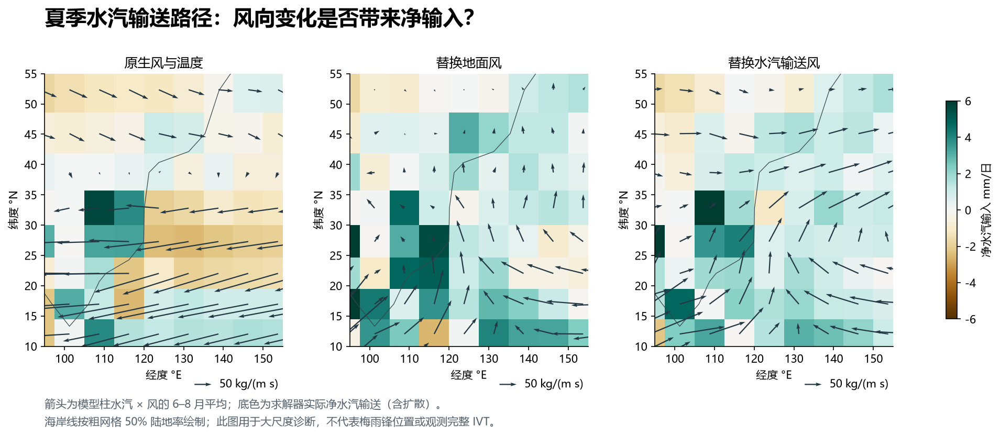
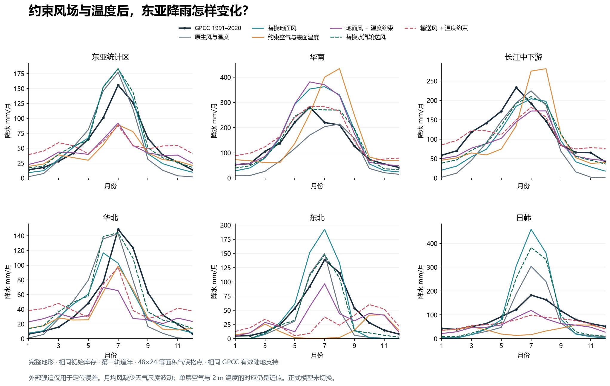

# 东亚季风诊断：输水汽环流值得优先改，平均风温约束仍不足以恢复梅雨

2026-10-15；模型基线 `6bbbad414f5602cf532e41adbcc6a46a5286b9b3`。

六组完整地形、相同初态的全年试验已经完成。**替换水汽加权输送风后，华南雨峰从 8 月提前到观测的 6 月，月降水平均绝对误差从 50.18 降到 24.36 mm；东亚六区平均误差下降 24.37%。** 这给“先修季节性水汽输送环流”提供了量化支持。但长江雨峰仍晚一个月，日韩夏季降水过强；外加温度约束也没有普遍改善雨季。这些结果不支持继续仅靠一个对流强度系数修正东亚。

本轮新增离线诊断与可复跑证据，没有更换正式物理公式、默认参数或地球存档。研究资料与代码结构核查见[前一轮审计](../east-asia-monsoon-formation-20261015/MODEL-AUDIT.md)。

## 对照方法

全部试验使用完整 215,348 个地形三角形、48×24 等面积气候网格、1800 秒步长，从正式地球的同一第零天库存积分一个轨道年。共同基线是上一轮 `shared-core` 实验：共享水汽求解、空气散热比例 0.5；它不是正式默认。这是首年瞬变诊断，没有进行多年平衡气候验收。

采用 [NOAA PSL 的 NCEP–NCAR Reanalysis 1](https://psl.noaa.gov/data/gridded/data.ncep.reanalysis.html) 1991–2020 月气候态，与 GPCC 降水正常值时段一致。再分析融合观测与模式，不等于直接风温观测。下载八个文件并保存单位、有效年数、原始 SHA-256；比湿的 grams/kg 转换为 kg/kg。降水比较沿用同一 GPCC 有效陆地支持，没有注入观测降水或湿度。[资料清单](inputs.json)、[GPCC 来源](https://opendata.dwd.de/climate_environment/GPCC/html/gpcc_normals_v2022_doi_download.html)。

主要 2×2 对照是：原生 / 10 m 风 × 原生 / 温度约束。另以从地表到 300 hPa 的水汽加权平均风作敏感性试验，积分的是月均 q 与月均风的乘积，不含天气尺度协方差，也不含更高层水汽，因此称为输送风代理，不能称作观测完整 IVT。

温度约束以一天时间尺度将单层空气拉向 2 m 气温，将陆面拉向皮肤温度，将海水拉向不低于 271.35 K 的皮肤温度。海水温度下界避免把海冰顶部温度误施加到液态混合层。皮肤温度不是独立 SST 产品，混合海岸格点也不能区分两种表面。当前单层空气没有严格定义的观测高度，不能把它与 2 m 的差值直接定性为真实大气偏冷；这里是在检验一个明确但近似的观测约束映射。[完整协议](PROTOCOL.md)。

## 环流信号与水汽通道

原模型华南 6–7 月北向风约为 0.02–0.12 m/s，重映射后的 NCEP 10 m 风约为 1.42–1.51 m/s；长江相应约为 −0.14–0.00 与 0.96–1.15 m/s。原模型没有重现该支持上的季节性偏南风强度。区域均值会抵消相反方向气流，因此同时检查了柱水汽乘风的通量与求解器净输入。

在 `windColumn` 对照里，华南夏季平均北向水汽通量由 −1.17 变为 +51.59 kg/(m·s)，求解器净水汽输入由 2.27 变为 3.00 mm/日，本地蒸发仅由 2.74 变为 2.77 mm/日。水汽供应与方向的变化与雨季改善相符。**这仍不是纯平流归因**：风也改变蒸发、海洋输热和随后的温度反馈；底图净输入还包括扩散。

长江夏季北向水汽通量由 −2.20 变为 +35.42 kg/(m·s)，但净输入由 3.77 降到 3.45 mm/日。年降水却增加了，提示季节分配、储存、蒸发和成雨条件都必须同时检查，不能直接把“北向风更强”解释为“该区全年净输入必然更多”。

## 雨量与雨季的实际结果

下表比较原生基线与只替换输送风的试验。年量单位 mm；误差是 12 个月的平均绝对误差，单位 mm/月。区域矩形是诊断支持，不是行政区。

| 区域 | GPCC 年量 / 雨峰 | 原生年量 / 雨峰 | 输送风年量 / 雨峰 | 月误差：原生 → 输送风 |
|---|---:|---:|---:|---:|
| 华南 | 1583.5 / 6 月 | 1049.6 / 8 月 | 1714.8 / 6 月 | 50.18 → 24.36 |
| 长江 | 1390.1 / 6 月 | 990.0 / 7 月 | 1226.5 / 7 月 | 45.53 → 28.81 |
| 华北 | 580.0 / 7 月 | 547.2 / 7 月 | 664.5 / 7 月 | 23.30 → 15.67 |
| 东北 | 549.6 / 7 月 | 379.2 / 7 月 | 464.2 / 7 月 | 19.68 → 11.75 |
| 日韩 | 1067.6 / 7 月 | 941.9 / 7 月 | 1271.0 / 7 月 | 54.21 → 66.52 |

六个东亚诊断区包括上述五区和一个 30–45°N、110–135°E 的东亚统计框。它们有空间重叠，六区平均是等权诊断分数，不是独立样本的统计显著性检验。另检查欧洲、北美东部、印度、澳洲西南、澳洲北部、亚马孙、刚果，共 13 区。

| 试验 | 东亚统计框年量 | 六区月误差均值 | 十三区月误差均值 |
|---|---:|---:|---:|
| 原生基线 | 659.9 | 35.23 | 40.44 |
| 仅地面风 | 730.5 | 38.13 | 50.73 |
| 仅温度约束 | 489.8 | 43.62 | 48.56 |
| 地面风 + 温度约束 | 531.3 | 30.33 | 47.43 |
| 仅输送风代理 | 800.2 | 26.64 | 36.88 |
| 输送风代理 + 温度约束 | 639.5 | 29.88 | 29.83 |

仅替换地面风改善了东亚统计框，却使日韩与部分外部区域更差。两种风的效果不同，进一步提示“地面摩擦层风”和“承担整层水汽输送的风”不宜混为一个自由度，但该试验尚未证明某种两层设计足够。

输送风再加温度约束时，东亚统计框年量 639.5 mm 比仅换输送风的 800.2 mm 更接近观测 693.9 mm；**其月误差却从 12.76 升至 32.40 mm/月**，东北雨峰还移到 10 月。总量接近会掩盖严重季节误差。十三区平均分数改善也不能抵消这一缺陷。

现有闭合中的机制分项只是内部诊断。例如华南只换输送风后，年度对流项约从 595 增到 1094 mm，辐合项从 123 增到 245 mm，而地形项从 239 降到 185 mm。这不等于观测已验证这些降雨分别属于对应物理机制。[多区域汇总](METRICS.md)、[原生组逐月及分项](native.json)、[输送风组逐月及分项](windColumn.json)。

## 应优先改哪里

1. **先把季节性水汽输送环流作为明确验收目标。** 要求模型自主产生华南—长江向北的水汽通道及其季节变化，而不仅是调对降水年量。地面风与整层水汽输送风需要各自的物理含义；再分析风只保留为诊断参照，不能成为任意行星或改地形后的固定答案。
2. **补一致的大气热平流与垂直热力结构。** 原运行路径没有随风的大气显热输送，也不能同时描述低层湿气流和中高层西风。先明确空气温度的层次与热量收支，再讨论观测温度约束；本试验表明直接拉向 2 m 温度并不能普遍修好雨季。
3. **对长江剩余误差单独检验抬升机制。** 月均输送风尚未使 6 月雨峰出现，值得依次检查高原—西风的下游作用、中层暖平流上升、湿度锋及天气扰动。现有文献支持这些候选机制，但本次没有单独切换它们，不能给出各机制贡献比例，也不能据失败断言成雨公式一定是唯一问题。[Sampe & Xie 2010](https://iprc.soest.hawaii.edu/users/xie/meiyu-jc10.pdf)、[Chiang 等 2020](https://atmos.uw.edu/~david/Chiang_etal_2020.pdf)。

## 验证与边界

六组共享同一库存、资料和执行程序指纹；无外部水源。原生组的全部区域月降水与共有诊断字段逐值复现上一轮冻结结果。包括初态在内的 30 次账本检查中，最大水量残差为 **2.78×10⁻⁷ mm**，扣除外部热源后的耦合焓残差 **2.29×10⁻⁴ J/m²**，地形路由分配残差 **0.00233 m³**；逐格水汽账最大残差 **3.23×10⁻¹¹ mm**。

温度约束的全球全年平均净外加热为 11.39–11.71 W/m²，各格净加热/冷却绝对值的时空平均为 119.59–127.85 W/m²，局地补偿相当大，不能忽略。账本单独记录它，没有计入辐射或改写初始能量。生产存档格式不包含这种外部强迫，因此本实验没有导出普通可严格续算的模型存档。

为保持原模型风速限制，输入每个分量限制在 ±10 m/s。地面风的全球分量采样裁剪率约 0.00085%；输送风代理约 5.10%，最大裁剪约 7.97 m/s。东亚六区夏季没有裁剪，部分北方区域冬季有裁剪，因此不能把全年的试验称为未经修改的再分析强迫。

源资料、积分与图形检查均已完成；重映射、地下层排除、月历插值、外加热账本有针对性测试及[独立审查](REVIEW.md)。[复跑说明](REPRODUCE.md)与 `verify.py` 提供完整一致性验证；`manifest.json` 保存归档指纹。48×24 网格和月均强迫不能验证梅雨锋精细位置、天气尺度涡旋或极端降雨，正式默认尚无升级依据。
