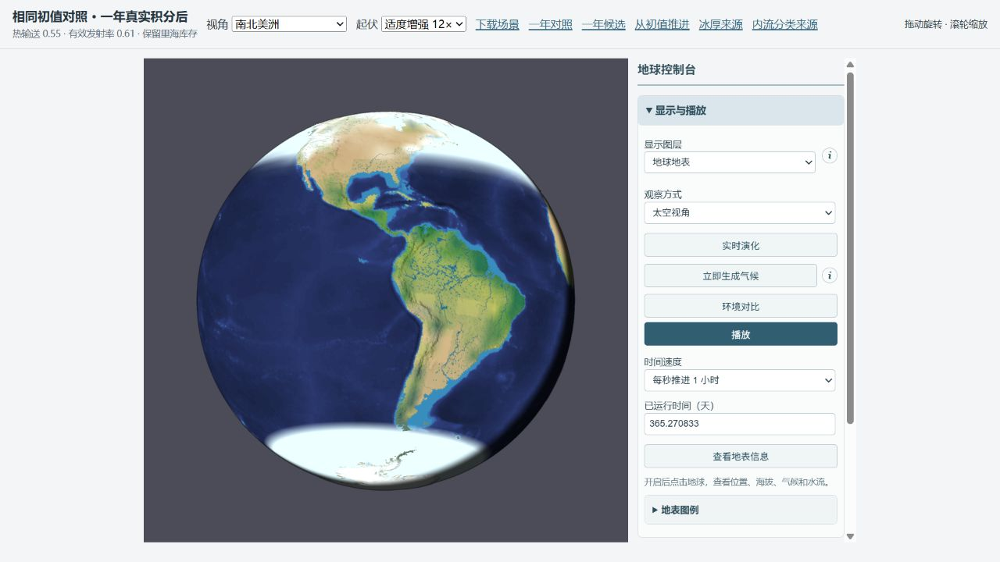
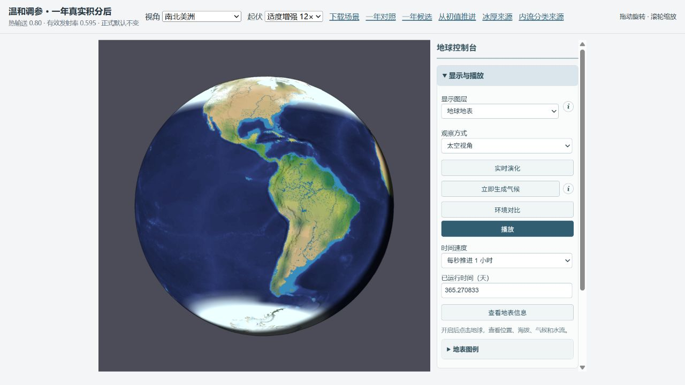

# 冰封与温带降水参数对照（2026-10-11）

正式默认与 authored Earth 输入不变。候选配置只保存于独立实验与预览。所有正式验收从同一份含里海初值的完整状态出发；未重新生成温度、补水或跳转季节。

## 参数与方法

候选参数：{"thermal":{"diffusion":0.8,"emissivity":0.595}}。热容量、海洋有效深度、所有初始水库与温度均保持一致。公共物理基线启用既有共享水汽、0.5 气层辐射份额、导热海冰、冰下输送、独立陆海反照率和低温未结冰海水蒸发。基线与候选仅参数不同，因此不能把共同启用的机制收益归到此次调参。

全地形 215348 单元，步长 1800 s，实际积分 365.270833 天；月通量恰好裁到一个物理公转年。日历以 3 月 20 日为起点。记录实际陆地降水，GPCC 共享有效陆地支持；海冰使用既有 15% 阈值与同一 NSIDC 海域权重。每一臂均通过严格保存恢复及下一步完全一致检查。

库存/初始显热与焓 SHA256：952addee2268260c7acb5cee1f2fe576414c88539719b3b6559d624d5a89ceca。

## 同网格结果

海冰月范围 MAE，单位百万 km²：

| 半球 | 对照 | 候选 | 减少 |
|---|---:|---:|---:|
| north | 12.18 | 9.81 | 19.4% |
| south | 24.74 | 22.17 | 10.4% |

陆地降水，单位 mm/年；前四区域用于温带筛选，其余区域检查副作用：

| 区域 | GPCC | 对照 | 候选 |
|---|---:|---:|---:|
| Europe | 792.1 | 264.8 | 288.5 |
| East North America | 1056.0 | 485.1 | 557.8 |
| East Asia | 693.9 | 645.0 | 710.6 |
| West Siberia | 451.3 | 122.7 | 117.9 |
| India | 1138.1 | 556.0 | 626.3 |
| Himalaya foreland | 1120.4 | 1038.2 | 1174.8 |
| Tibet | 443.5 | 160.6 | 181.9 |
| Australia southwest | 489.0 | 336.3 | 581.2 |
| Australia north | 985.9 | 1347.8 | 1464.3 |
| Amazon | 2264.7 | 1708.7 | 1667.2 |
| Congo | 1385.3 | 1566.2 | 1391.9 |

四个温带区域等权年降水绝对偏差均值：368.9 → 338.0 mm/年。这不是全球或面积加权误差。

欧洲、北美东部与东亚更接近观测；西西伯利亚略更干。印度、喜马拉雅前缘、西藏、西南澳、刚果的年总量偏差缩小，北澳偏湿加重、亚马孙略更干。候选全球年均表温 14.21 °C，±30° 湿面年均海温 23.71 °C；这些是本模型的一年瞬态诊断，不是对观测海温的校准。

## 筛选与边界

各臂共同粗路由、同初始温度/水库/显热的一年真实积分，仅用于参数敏感性筛选；下表不是完整地形最终验收。

| 配置 | 北海冰范围 MAE | 南海冰范围 MAE | 全球年均表温 °C | ±30° 湿面年均海温 °C |
|---|---:|---:|---:|---:|
| control | 12.18 | 24.74 | 12.98 | 23.52 |
| heat11 | 10.65 | 22.07 | 13.32 | 21.78 |
| radiation056 | 8.78 | 21.77 | 16.72 | 27.36 |
| radiation052 | 8.81 | 17.83 | 20.01 | 30.58 |
| mix3 | 10.35 | 23.55 | 12.96 | 22.84 |
| mix6 | 10.49 | 22.27 | 13.05 | 22.13 |
| ocean10 | 12.01 | 24.62 | 12.99 | 23.48 |
| evap035 | 12.41 | 24.95 | 13.39 | 24.18 |
| balanced | 9.08 | 18.05 | 15.66 | 24.07 |
| balancedMix | 9.63 | 16.88 | 15.66 | 23.97 |
| heat085 | 10.07 | 22.61 | 13.17 | 22.42 |
| balanced085 | 9.82 | 19.92 | 15.46 | 24.71 |
| moderate | 9.82 | 22.18 | 14.22 | 23.69 |
| moderateMix | 10.26 | 22.11 | 14.22 | 23.55 |
| tuned900 | 9.81 | 22.17 | 14.23 | 23.70 |

diffusion=2 在 1800 s 步长下超过显式稳定限，加载前被拒绝，未纳入有效结果。更强水汽混合会让喜马拉雅前缘偏湿并恶化西南澳；过低的有效发射率使热带升温过多。增强海流的单项收益小，降低蒸发比例会进一步减雨。

预算最大残差：总水 2.297e-7 mm；焓 1.816e-4 J/m²；单元水汽 4.638e-11 mm。全部初始有限库存、潜热转移与实际外部辐射收支仍被计算。

900 s 粗模型同库存复验：年均表温差 0.00669 °C，11 个区域年雨量最大差 0.673%。这是共同粗路由的步长检查，不能冒充完整地形 900 s 年度验收。完整地形两臂的水路由分区残差最大 8.315e-2 m³。

- One transient orbital year, not climate equilibrium.
- Ice concentration remains diagnosed from mass and the existing 0.5 m cover rule. No threshold changes.
- Effective column radiation and coarse atmospheric transport are reduced physics; the parameters are sensitivity coefficients, not observed atmospheric composition.
- Same-grid NASA Team monthly NSIDC fields, not native complete hemispheric index or merged CDR.
- GPCC common valid land support cannot resolve narrow rain shadows or storm tracks.
- Screening used a shared coarse water routing backend. Final acceptance used the full terrain and retained lake inventory.

数值变化是改善幅度，不能据此声称冰封或所有温带干旱已通过观测验收。西西伯利亚、印度、热带与澳洲的剩余偏差详见上述独立区域结果；积雪与海冰分别记录，截图白色不全是海冰。

## 实际 WebGL 对照

相同第 365.270833 天、太空视角、南北美洲中心、地球地表图层、12× 起伏、关闭云层；只改变参数后的真实积分状态。昼夜光照保留。图像仅作形态检查，降水改善以全年通量/GPCC 表为准。

来源：[GPCC v2022 normals](https://opendata.dwd.de/climate_environment/GPCC/gpcc_normals_v2022/)、[NSIDC G02202 v2](https://doi.org/10.7265/N55M63M1)。低层热量与水汽输送的物理动机见 [NASA ISCCP](https://isccp.giss.nasa.gov/role.html)；完整海冰热力学所需通量与面积状态参见 [MITgcm SEAICE](https://mitgcm.readthedocs.io/en/latest/phys_pkgs/seaice.html)。

复现：用 esbuild 将 screen.ts/full.ts 打包为 Node ESM，设置 PARAM_PROFILE 为 profiles.json 中的配置名运行。full.ts 读取 build/earth-lakes-freeze-temperate/lake-day0.json，须先运行上一轮 lake.ts。analyze.mjs 仅接纳完整年度且严格续算通过的结果；完整快照与可交互预览位于忽略目录 build/earth-parameter-tuning。
