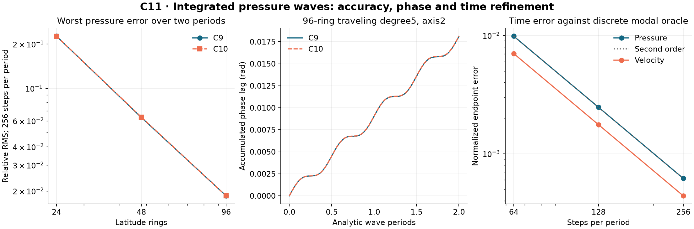

# C11: integrated pressure-wave validation

The C10 metric passes the predeclared integrated pressure-wave regression
gate, but it does not improve every propagation measure. At96rings and256
steps per analytic period, worst pressure RMS error over two periods is
0.01853311 versus C9's0.01854727. At48rings it grows from0.06327947 to
0.06363549, about0.56%. All paired increases are retained explicitly.
This adds validation capability; no dynamical core or default is changed.

## What is being tested

The [protocol](protocol.md) was frozen before the wave matrices ran. The
existing C8 pressure-work and C9 vector-invariant integrator remain exact
sealed sources, as do C10's fitted conductances. C11 asks whether their
rest-state pressure waves propagate with controlled phase, amplitude and
time error. It does not simulate stratified internal atmospheric gravity waves.

At rest with no rotation, r=(p-pref)/pref obeys
M r_t=-D P v and v_t=c2 G r, where M=diag(area*pref), P=diag(prefFace),
and D and G are the inherited weighted adjoints. Hence
r_tt=-c2 M^-1 K r, K=D P G. The new wave-core is an implicit-midpoint
diagnostic for these equations. Its conserved quadratic energy is
(c2 r'Mr+v'Hv)/2, with H=diag(h*prefFace). It is not installed as the
nonlinear runtime integrator. wave-core's pressure elimination is derived
in protocol.md and checked with a literal two-cell oscillator.

Constant-pref sphere modes have analytic angular frequency
sqrt(l(l+1)) at radius=c=1. Standing cases use zonal Legendre functions.
Traveling cases use the real and imaginary parts of a sectoral harmonic
in two different oblique frames, with initial velocity from the common
two-point gradient of its potential. That initial edge velocity is a
discrete potential gradient, not an exact pointwise vector sample; its
spatial error remains part of the continuum comparison. All paired runs
use identical r/v samples and common original cell-area norms.

In particular, the traveling initial pressure tendency is
r_t(0)=c2 M^-1 K g/omega, while the continuum target is omega*g. Their
difference is included in the measured propagation error; initializing
with a graph eigenvector would hide this spatial discrepancy.

The independent endpoint audit evaluates all36traveling initial states.
Worst ||r_t(0)-omega*g||_A / ||omega*g||_A over degrees/axes:

| Rings | C9 derivative discrepancy | C10 derivative discrepancy |
| --- | --- | --- |
|24|0.03714357|0.03662468|
|48|0.01013836|0.01012046|
|96|0.003013711|0.002901563|

All unrounded rows are in review/endpoints-v1.json. This measures initial
pressure-tendency inconsistency, not direct point-vector velocity error.

The216-case matrix is3grids x2metrics x3degrees(1/3/5) x2axes x2wave types
x3time settings(64/128/256steps per period). Each run advances two analytic
periods literally. Standing phase uses pressure and its time derivative;
traveling phase uses two pressure harmonic coefficients. Unwrapped phase,
modal-amplitude deviation, off-mode pressure leakage, pressure error,
quadratic energy and mean drift are recorded at every step. No projection
or correction is applied to the evolving state. Endpoint r/v fields are
retained for every case, including all three time settings.
For a standing wave, the amplitude indicator uses the analytic frequency
to scale the pressure-derivative quadrature. A frequency mismatch can make
that indicator oscillate; it is not by itself a measurement of dissipation.
The separate total quadratic-energy diagnostic measures energy drift.

## Spatial propagation and tradeoffs

Worst values across both axes, all three degrees and both wave types at
256steps per period (phase is absolute endpoint lag magnitude, in radians):

| Rings | C9 pressure RMS | C10 pressure RMS | C9 phase | C10 phase | C10 amplitude deviation |
| --- | --- | --- | --- | --- | --- |
|24|0.22605645|0.22583130|0.22609460|0.22588484|0.01842493|
|48|0.06327947|0.06363549|0.06321746|0.06359215|0.005053129|
|96|0.01854727|0.01853311|0.01852348|0.01851155|0.001422638|

All three grids meet the frozen C10-worst <=1.10*C9-worst+1e-7 pressure
gate. C10's worst pressure/phase/amplitude errors also decrease with grid
refinement, but several paired fields become worse. After two periods,
the finest worst phase error is about1.06degrees. Dividing by4pi gives
about0.1473% mean modal frequency bias for that measured signal. This is
not a universal wave speed: spatial mode leakage can distort a signal.

Every strict paired increase, without a rounding-based exclusion:

| Metric | Increases among108pairs | At256steps/period (36pairs) | Largest absolute increase |
| --- | --- | --- | --- |
|Absolute endpoint phase error|63|21|0.0003954930rad|
|Maximum amplitude deviation|39|13|0.00003177551|
|Maximum pressure RMS error|63|21|0.0003573135|
|Maximum off-mode leakage|33|11|0.001579622|

The largest phase increase is48rings/degree5/axis1/standing/256steps, from
0.06207371 to0.06246920rad. The largest amplitude increase occurs for the
same grid/degree/axis/type at64steps, from0.004914099 to0.004945874. The
largest pressure increase is48rings/degree5/axis2/traveling/64steps, from
0.07252463 to0.07288194. The largest leakage increase is24rings/degree5/
axis2/standing/256steps, from0.01083906 to0.01241868, a14.57% relative
increase in leakage (0.001579622 on the common normalized scale).

These are meaningful tradeoffs, not hidden by the aggregate gate. All108
unrounded pairs are in [wave-comparison.csv](raw/wave-comparison.csv);
all198 metric-specific increases are in
[wave-regressions.csv](raw/wave-regressions.csv). A case can appear under
several metrics. The underlying216 time traces and all endpoint fields
are bound in raw. C10's kinetic-force gains do not imply universal
pressure-wave improvement; further fitting must balance these objectives.

## Time accuracy and actual nonlinear solver

An independent dense symmetric eigendecomposition on the24-ring graph
provides continuous-time evolution of the same discrete spatial system.
It checks the single constant null mode and positive remaining spectrum,
and recovers velocity from the integrated pressure gradient. Both metrics
and constant/varying pref (1+0.15x) are tested. This oracle is independent
of the midpoint step; it is a discrete reference, not exact continuum physics.

Final time-halving error ratios (128 versus256steps/period):

| Metric | Reference pressure | Pressure ratio | Velocity ratio |
| --- | --- | --- | --- |
|C9|constant|4.010592|3.982551|
|C9|varying|4.010622|3.982471|
|C10|constant|3.998255|3.999355|
|C10|varying|3.998253|3.999350|

All pressure and velocity endpoint errors decrease across64/128/256steps
and satisfy the frozen last-ratio interval[3.7,4.3]. Continuum errors need
not decrease monotonically with time refinement because spatial and
temporal phase errors can cancel; the modal oracle separates those errors.

The exact frozen C9 VectorCore is then run with three layers(.2/.3/.5),
zero rotation, constant humidity. For each24-ring metric and pref choice,
and C10's48-ring constant-pref case, initial amplitudes are1e-3 and1e-4.
The ten actual runs integrate one period, using64steps at24rings and128
at48rings. Normalized pressure/velocity discrepancies from the diagnostic
decrease by approximately10x for every pair when amplitude decreases10x.
This validates the claimed linearized limit without substituting the
diagnostic for the actual nonlinear implementation.

All actual steps keep positive pressure, constant humidity within1e-11,
and the original local budgets, Newton residual and complete energy
allowances; there are no rejected or hidden steps. Maximum cumulative
nonlinear energy drift is6.999956e-13. Across the linear matrix, maximum
quadratic energy drift is2.098322e-14 and mean drift5.715232e-16. Energy
conservation alone does not establish correct phase; both are measured.

## Verification and provenance

The selected suite passes284Julia assertions:18diagnostic unit checks,
220integrated wave checks,20modal-reference checks and26nonlinear checks.
The project suite passes278tests, typecheck and build; recursive source
binding tests pass14checks. The independent review and its exact numerical
audits are archived in [code-review.md](code-review.md) and review/.

All attempts are retained. The initial no-op RED fails the two literal
oscillator advance checks. Expanded RED also exercises missing guards and
stops at the not-yet-defined energy helper. The first implementation run
passes17checks but fails an overstrict bit-equality assertion for a constant
state (1+2.2e-16 after a sparse factorization). The stationary assertion
now uses1e-14 roundoff tolerance; all18checks pass. No wave acceptance
threshold, physical coefficient or graph weight changed after results.

Pre-seal tooling initially treated C2's legacy mixed-scope manifest as a
single-directory inventory. Its directory comparison now selects local
bindings while still checking hashes for all external bindings. The
corrected preflight passes nine ancestor manifests and every numerical gate;
both tooling attempts are preserved under tooling/. No simulation changed.

The runner binds before/after source closures and immutable inputs, retains
historical source bytes, and refuses sealed-directory execution. The sealer
rechecks all attempts, selected gates, full traces, derived data hashes,
independent review and preserved ancestors/default before creating one
manifest. Git-byte checks follow commit and merge. Runtime executables
are path/version identified, not content-pinned; numerical evidence is
scoped to the recorded Julia1.12.7 environment. Integration completion is
recorded in Git and build/c11-integration rather than rewriting the seal.

## Next work and boundaries

The pressure-wave gate passes, so this turn does not change the dynamical
core or retune C10. The next metric experiment should balance kinetic-force
accuracy with phase and leakage, using these waves as regression cases.
Rotating wave accuracy, arbitrary wavepacket group velocity, thermal
stratification/buoyancy, nonuniform-layer vertical spatial order, PV and
angular-momentum compatibility remain open. No internal-gravity-wave,
full-atmosphere, long-term stability, climate or default-promotion claim
is made by this experiment.
