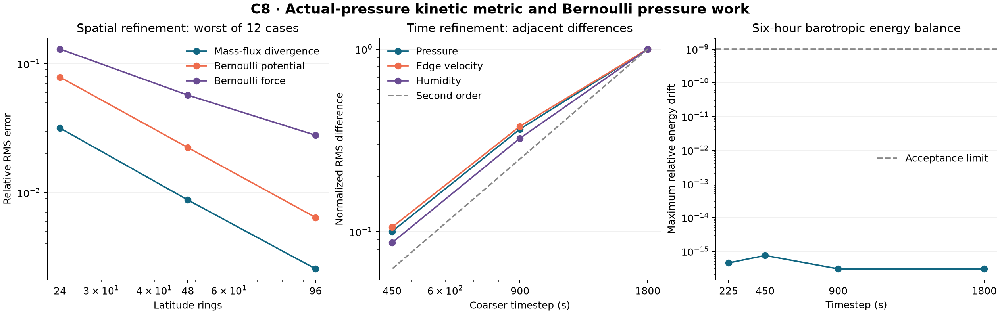

# C8: actual-pressure kinetic energy and barotropic pressure work

C8 implements an isolated Bernoulli/continuity subsystem with a pressure-
dependent kinetic metric. It evolves all edge velocities, cell pressure and
shared water inventories. Its symmetric discrete-gradient solve exchanges
kinetic and barotropic compression energy while preserving their sum to the
measured nonlinear-solve and rounding residual. C1-C7 evidence and the formal
application default are unchanged.

This is a prerequisite experiment for physical coupling, not a replacement
for C7's pressure/Coriolis/transport sequence. C8 does not yet include Coriolis,
vortical momentum transport, vertical momentum advection, thermal energy or
moisture sources. General native winds are accepted without projection, but
their vortical evolution is not represented by this subsystem.

## Energy and force are derived together

With h=edgeLength*centerDistance, actual face pressure pf=(p_a+p_b)/2 and
layer thickness ds, the kinetic energy is sum(h ds pf v^2)/2. The barotropic
compression potential is c2 sum A[p log(p/pref)-p+pref]. This replaces C7's
fixed reference kinetic metric for this experiment. Spatially varying pref
is a fixed background potential; the compression potential is not heat.

The pressure-dependent kinetic metric contributes a positive kinetic term
to the Bernoulli potential. Under the frozen incidence sign, G approximates
the negative physical directional gradient, so the one-layer potential-flow
limit is -grad[c2 log(p/pref)+|u|^2/2]. Omitting this kinetic derivative breaks
the new energy chain rule even if the old acoustic energy was conserved.

For each timestep, the flux is the product of endpoint-mean face pressure
and endpoint-mean edge velocity. The Bernoulli potential uses the divided
difference of compression energy and the endpoint-average kinetic derivative.
The resulting exact algebraic chain rule pairs this one flux with both mass
and pressure work. A sparse damped Newton solve checks the original equations;
it neither projects the final state nor rescales energy. The method is
formally second order for the declared smooth pressure/velocity ODE.

The per-step energy guard permits 1e-10 H0 plus
512 eps [sqrt(Eref)*sqrt(H0)+eps Eref], with Eref=c2 sum(A p0). This is a
practical quadratic-roundoff allowance near rest, not an interval-arithmetic
certificate. The native matrix independently requires accumulated relative
drift below 1e-9. The nonlinear residual threshold is 2e-14.

Shared horizontal/sigma-vertical transfers from that same integrated flux
drive frozen water FCT. The step commits p,v,W,time only after energy and
finite local air/water/dry budgets pass. Positive endpoint and Newton trial
pressures are checked; this is not C5's exact-trajectory positivity certificate.
Because all velocity increments lie in range(G), graph circulation components
and layer velocity differences are retained, rather than physically advected.

## Numerical issues found and corrected

The first implementation lost finite values at extreme positive pressure
ratios because a normalized difference rounded to -1 or overflowed. A
log-domain branch resolves this while a series handles nearly equal endpoints.
Independent review and high-precision regression cases cover these branches.

A native run then exposed cancellation just outside the series branch at
approximately 1% pressure changes. Newton residuals stalled near 4.63e-14
because the divided difference subtracted logarithms of absolute pressure.
Using a cancellation-safe log ratio fixes the scalar operation; the 2e-14
Newton acceptance tolerance was not relaxed. All 48 branch-boundary assertions
pass after 29 clean RED failures. The failed native run and diagnostic trace
remain archived, with their original sources.

The step now explicitly rejects nonfinite or excessive shared-water budget
residuals before state commit. Runtime-only fault injection tests an exception,
NaN residual and excessive finite residual after the genuine water solve.
All fields roll back bit-for-bit. Frozen FCT sources are unchanged.

## Spatial and time accuracy

The 24/48/96-ring study uses two axes, constant/varying reference pressure,
and gradient1, mixed and gradient3 tangent fields: twelve sequences. Worst
global relative RMS errors are:

| Rings | Mass-flux divergence | Bernoulli potential | Bernoulli force |
| ---: | ---: | ---: | ---: |
| 24 | 0.0316940 | 0.0787537 | 0.130205 |
| 48 | 0.00876805 | 0.0223633 | 0.0571004 |
| 96 | 0.00255739 | 0.00641155 | 0.0278736 |

The predeclared gates apply to weak divergence and scalar potential. Force
error is separately measured because convergence of a potential alone does
not establish convergence of its derivative. Per-case force and polar errors
are retained in the analytic JSON; no general continuum consistency theorem
is inferred from these sampled fields.

All twelve measured force-error sequences also decrease. The worst polar
force errors are 0.43920, 0.25026 and 0.13479 on the three grids, substantially
larger than global errors. That remaining polar error limits the spatial
accuracy claim even though the discrete energy identity holds.

The small-grid full nonlinear reference is an independent dense RK4 solver.
Its .0005/.00025 discrepancy is 1.58e-14. C8 errors at .1/.05/.025/.0125 decrease
with ratios 3.99447, 3.99861 and 3.99965. The analytic Newton Jacobian differs
from independent finite differences by 7.28e-12 relative. Exact/near-rest
states, unequal layers, identity mismatches and four-step rebuilt restart
also pass. This order claim concerns pressure and velocity, not bounded water
transport near sharp fronts.

## Native experiment

All runs use the unchanged 3168-cell, 39580-edge graph, c2 of
82671.64740772452, and six hours of explicit timesteps. Imported j is converted
pointwise to v=j/pf, with relative roundtrip error 4.42e-17. No edge component
is discarded. Three humidity fields are run at 1800 seconds, with real humidity
at all finer timesteps. Water has no feedback on pressure or velocity here.

| Timestep (s) | Steps | Maximum local budget residual | Maximum accumulated relative energy drift | Final pressure RMS change (Pa) |
| ---: | ---: | ---: | ---: | ---: |
| 1800 | 12 | 2.338e-15 | 2.988e-16 | 310.041 |
| 900 | 24 | 2.219e-15 | 2.988e-16 | 306.644 |
| 450 | 48 | 6.342e-15 | 7.471e-16 | 306.017 |
| 225 | 96 | 2.388e-15 | 4.482e-16 | 305.860 |

The coarse row includes all three tracer cases; other rows use real humidity.
All explicit steps pass without rejection, hidden substeps or line-search
backtracking. Newton takes at most three iterations. Across the matrix the
largest nonlinear residual is 1.939e-14, below the unchanged 2e-14 threshold.
Kinetic/compression energy exchange reaches about 0.305% of initial total
energy, so the near-roundoff total drift does not describe a static solution.
Minimum pressure is 59464.758 Pa. Maximum absolute air, water and dry-inventory
drifts are respectively 3.78e-12 kg/m2, 4.51e-13 mm and 4.23e-12 kg/m2.

All tracer bounds hold within rounding error, and the constant-humidity error
is 5.56e-17. The real, constant and sharp cases each reconstruct a new core
from a checkpoint and advance four steps to literal-bit identical p,v,W,time.

Review caught that the original native driver retained total/max Newton
iterations and sparse progress logs, rather than the per-step counts required
by the protocol. Four separately bound pressure-only deterministic replays
now retain all 180 step records, including iterations, backtracks, nonlinear
and original-equation residuals and energy guards. Each replay exactly matches
the original iteration aggregates and final p/v bits. The coarse replay also
matches both other tracer endpoints; water does not feed back on pressure
or velocity. These are explicitly replay records, not recovered original logs.

Weighted RMS differences between adjacent timestep solutions are:

| Timesteps (s) | Pressure (Pa) | Edge velocity (m/s) | Humidity (kg/kg) |
| --- | ---: | ---: | ---: |
| 1800 / 900 | 76.1111 | 0.151347 | 3.68091e-7 |
| 900 / 450 | 27.7223 | 0.0571244 | 1.19430e-7 |
| 450 / 225 | 7.63484 | 0.0160137 | 3.20332e-8 |

Pressure difference ratios are 2.74548 and 3.63103; velocity ratios are
2.64944 and 3.56721. They approach the factor of four expected for second
order, but the coarsest native timesteps are not in the asymptotic regime.
Distances to the finest discrete solution also decrease for all three
quantities. This supports temporal refinement on the fixed graph, not an
exact continuum reference or a general second-order claim for limited
humidity fronts.

## Validation scope and next work

The fifteen selected Julia runs pass 365 assertions (313 original acceptance
checks plus 52 iteration-replay checks); seven source checks and
the existing 278 project tests, typecheck and application build also pass.
Source closure checks and independent reviewed-source hashes are recorded
with the evidence. All 31 completed runner attempts, including failed,
diagnostic and superseded runs, are retained with their original source
archives but excluded from the final selected matrix unless explicitly named
in selected-runs.json. Independent review details are in code-review.md.

Next work must add a compatible vortical/vertical momentum operator and
rotation under the evolving kinetic metric before reconnecting the full C7
sequence. Thermodynamic energy and physical moisture sources follow that
derivation. Energy conservation alone does not establish those missing
equations, exact global angular momentum/PV, long climate behavior or useful
production performance. No default promotion or complete-atmosphere acceptance
is made.

The discrete-gradient framework is described in
[Gonzalez's methods overview](https://web.ma.utexas.edu/users/og/numerics.html)
and [Grimm, Kliesch and Quispel](https://publikationen.bibliothek.kit.edu/1000167557/152088221).
The graph-specific construction and measurements are derived and tested in
this repository; those references do not validate this implementation.
