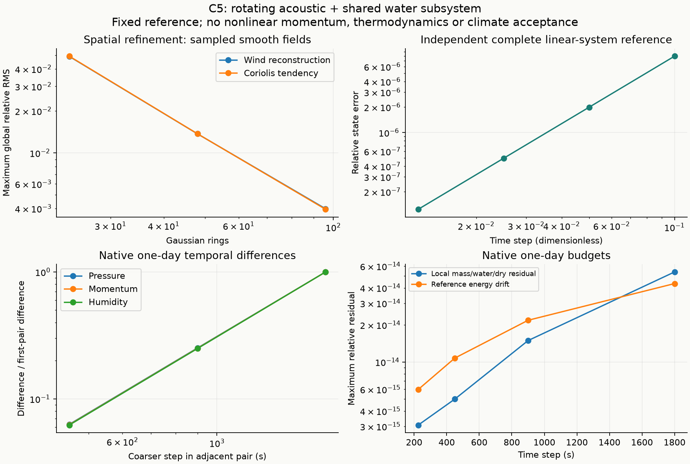

# C5：旋转声学与共享水汽输运验证

本轮加入科氏力和相容的格点风速重建，完成原生一天积分与空间／时间
收敛验收。它是固定参考态的旋转声学子系统，不是完整的非线性大气动力核。
正式应用默认未变。独立代码审查因服务容量不足未能执行；本版本已自审，
应保留在实验分支，补齐独立审查后再评估合并。

## 实现与能量定义

保留 C4 的全部边动量。P 将参考压力加权的格点东／北风映射至边；
H 是既有边动能度量，M 是格点面积乘参考压力，两种风分量使用同一权重。
重建 R=M^-1 P' H 是度量伴随，不是 P 的逆，也不把 j 替换为 P R j。
当前 p 不等于 pref 时，重建量是参考压力对应的速度变量，不能直接声称
它就是实际格点风速；初始比较使用 (p/pref)[u;v]。

用自转向量计算 f=2 Omega·x，格点科氏力为 [f v; -f u]。
边算子 C=P J_f R 满足 H C 反对称，因此任意边动量的科氏力做功为零。
中点法在格点空间求解，再检查原始边方程残差。无法被 R 观察到的边模态
仍保留，但单独科氏力不推进它们；不把这一性质解释成连续涡度守恒。

完整一步依次为半步科氏力、原 C2 精确线性声学及共享 FCT 水汽步、半步
科氏力。仅完整成功后提交 p、W、j、time。这里守恒的是既有固定 pref/c²
二次参考能量，未声称非线性总能量或角动量守恒。Strang 分裂在有限步长下
也不保证精确地转平衡。

## 独立数值参考与空间精度

- 小图直接从笛卡尔几何独立组装 P、R、C，与边空间直接中点求解比较：
  相对误差 1.35e-16，随机非格点可表示边状态的能量相对误差为 0。
- 自转反号、零自转、逆时间旋转、输入保持、无效输入和不可见边模态保留
  均通过。坐标整体旋转的倾向相对误差 1.78e-15；边方向反转也通过。
- 完整旋转声学小系统与独立稠密矩阵指数比较，步长 0.1/0.05/0.025/0.0125
  的相对状态误差为 7.96494e-6、1.99033e-6、4.97525e-7、1.24378e-7。
  缩步比为 4.00183、4.00046、4.00011。
- 零自转与冻结 C2 的 p/W/j/time 逐位相同。静止参考态保持；故障后整步
  回滚、重建核心续算、自转参数不同的断点拒绝均通过。

解析场包括刚体旋转、三阶梯度及混合场，两条斜轴、恒定／变化 pref，
共 36 个格点案例。所有全局与 >75° 极区误差序列均随网格细化减小。

| 环数 | 最大全局重建相对 RMS | 最大全局科氏力相对 RMS |
|---:|---:|---:|
| 24 | 0.0491794 | 0.0493514 |
| 48 | 0.0137082 | 0.0137247 |
| 96 | 0.00397993 | 0.00394522 |

96 环最大极区重建误差／全局真值 RMS 为 0.0313047，科氏力为 0.0285204。
线性刚体地转平衡的动量倾向相对残差，两条轴分别从 0.01617/0.01646
降至 0.001278/0.001287。这是空间倾向检验，不是有限步长平衡保持证明。
刚体流的微小散度残差来自 C3 拟合，最细网格最大 3.68e-7；它没有单调
下降，不声明无限细化时的严格零散度。

## 原生一天积分

沿用 C4 冻结的 3168 格点、8 层、39580 边初态，c²=82671.64740772452，
显式固定 Omega=[0,0,7.292115e-5] s^-1。初态风速重建的样本欧氏相对误差
为 0.00393677；它不是空气质量加权 RMS。
每个声明时间步调用一次完整耦合步，无自适应或隐藏积分步。

| 步长(s) | 步数 | 最大全步局部预算相对残差 | 最大参考能量相对漂移 | 最终水漂移(mm，真实湿度) |
|---:|---:|---:|---:|---:|
| 1800 | 48 | 5.387e-14 | 4.334e-14 | -7.378e-15 |
| 900 | 96 | 1.493e-14 | 2.182e-14 | 0 |
| 450 | 192 | 4.999e-15 | 1.076e-14 | -6.640e-14 |
| 225 | 384 | 3.074e-15 | 5.978e-15 | -9.222e-13 |

1800 秒真实／常量／锋面三种湿度均通过，p/j 轨迹逐位相同，各自重建核心
后连续四步续算逐位相同。常量 q 的最大偏差 9.49e-15；锋面 q 最大
0.020000000000000868。所有案例无拒步，最小压力为 58394 Pa 以上。
更细三个步长只测真实湿度，未重复常量／锋面和重建续算。
最大空气漂移 3.78e-12 kg/m²、干空气漂移 3.85e-12 kg/m²。

| 相邻步长(s) | 压力 RMS(Pa) | 参考速度等效动量 RMS(m/s) | 湿度 RMS(kg/kg) |
|---|---:|---:|---:|
| 1800—900 | 19.6665 | 0.0722179 | 6.83115e-7 |
| 900—450 | 4.94977 | 0.0180762 | 1.70189e-7 |
| 450—225 | 1.23952 | 0.00452037 | 4.25138e-8 |

缩步比：压力 3.9732/3.9933，动量 3.9952/3.9988，湿度 4.0138/4.0032。
与 225 秒末态的差也依次减小，支持当前初态／一天窗口内约二阶时间精度。
225 秒结果是离散参考，不是连续解或真实气候。湿度误差使用同一最细末态
空气质量加权，动量使用固定边度量和 prefFace 归一化。

## 验收、失败和限制

选定运行共 251 项 Julia 断言通过；来源绑定另有 7 项检查。项目 278 项
测试、类型检查和构建通过。C1/C2/C3/C4、105 份原生源码与正式地球默认
保持不变。报告图已目视核对。

保留的失败：科氏力空实现 RED（9 项失败）、缺失旋转及自转身份绑定的
耦合 RED（3 项失败），以及首次时间对比调用漏传四个运行名的启动错误。
最后一项仅修正调用参数，数值源未变。所有选择均列于 selected-runs.json；
源码闭包、协议、执行器和输入输出哈希绑定后才能封存。

独立代码审查四次均在执行前报模型容量不足，不计为审查通过。自审核对了
H 反对称推导、科氏力方向／半径／层厚尺度、Woodbury 消元、原子提交、
断点身份和来源封存。详见 code-review.md。

后续仍需非线性动量及其垂直交换、热力／物理水源、连续涡度或位涡与角动量
行为，以及多年气候验收。固定参考能量和光滑解析场通过不能替代这些验收。
原生案例仅一个以纬向风为主的初态。稠密声学特征分解、格点科氏力稀疏 LU、
示踪物稀疏 LU 的内存／耗时仍是实验限制；各进程并行运行，所存耗时不宜
当作无竞争性能基准。Julia/Python/BLAS 可执行二进制未按内容哈希锁定。
