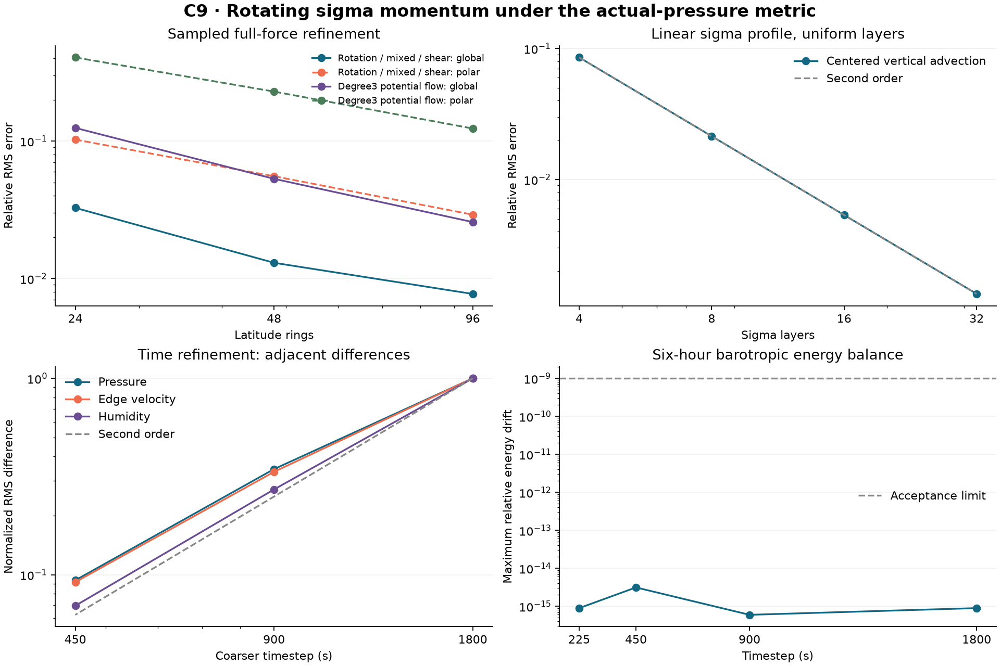

# C9: rotation and sigma momentum with pressure-dependent kinetic energy

C9 adds the absolute-vorticity force and vertical advection of horizontal
momentum to C8's barotropic pressure-work subsystem. All edge velocities
remain prognostic, and actual pressure sets the kinetic metric. This advances
the missing momentum equations while retaining the shared air/water budget
and barotropic energy checks. It is an isolated numerical candidate.

The model still lacks temperature, thermodynamic pressure/geopotential,
latent heat, physical water sources and a prognostic vertical velocity. It
does not establish a complete atmosphere, exact angular momentum/PV closure,
climate behavior or production performance. The formal default and C1-C8
sealed evidence are preserved.

## Coupling derived from the same energy

Kinetic energy is sum(h*pf*ds*v^2)/2, where pf is actual mean face pressure.
The nodal reconstruction is the metric adjoint of geometric interpolation
under this pressure, not the reference pressure and not an inverse. Applying
the local skew absolute-vorticity rotation and mapping it back with that
adjoint gives exactly zero discrete kinetic work. Relative curl is a weak
graph approximation; it is not an exact topological curl-grad operator.

C8's pressure derivative contains the column-mean kinetic potential. The
physical layer momentum equation needs each layer's kinetic gradient and
vertical material transport. C9 adds both together. Sigma interface mass
rates come from the instantaneous layer horizontal divergences and diagnostic
column pressure tendency. Their densities interpolate to edges through the
same h*S/2 metric that differentiates C8 kinetic energy. The vertical work
then cancels the layer-minus-column kinetic-gradient work exactly.

The neutral substep holds pressure fixed. Its diagnostic sigma rates are
evaluated from its midpoint velocity; they are not the pressure substep's
time-integrated tracer transfers. The full symmetric composition combines
these split tendencies into the declared finite-graph ODE. C8's integrated
pressure flux continues to drive the unchanged water FCT once per full step.

Nonlinear midpoint half steps surround one C8 pressure-work step. Each
neutral step checks the original equation and kinetic energy. The full step
checks the barotropic energy and finite air/water/dry budgets before committing
p,v,W,time. It rejects failed solves with no clipping, rescaling or hidden
timesteps. Whole-step roundoff allowance and independent native gates are
specified in protocol.md. Version9 checkpoints bind all dynamical inputs.

## Small-grid verification

The missing-operator stub failed 72 of 117 assertions, and the missing-step
stub failed all four advancement assertions. Corrected vector tests pass 117,
the coupled suite passes 64, and late-failure tests pass 24. Independent
scalar-loop reference equations use a six-cell irregular graph and unequal
layers, without calling the candidate reconstruction or tendency routines.

The full ODE RK4 reference at .0005/.00025 differs by 4.11e-15. Errors at
.05/.025/.0125/.00625 are 1.55634e-5, 3.89241e-6, 9.73200e-7 and 2.43306e-7,
with ratios 3.99840, 3.99960 and 3.99990. This supports second-order p/v
integration on the declared ODE, not a second-order claim for sharp water
fronts. Midpoint reversibility, original residual, exact/near-rest states,
invalid inputs and rebuilt checkpoint identity/restart also pass.

Fault injection calls the genuine water or second momentum solver first,
then throws, returns a nonfinite result, or returns an excessive budget/energy
defect. All six modes reject and retain every state field literally. The
injections are runtime-only test overrides; implementation and frozen FCT
sources contain no test modes.

## Spatial checks and remaining polar limitation

The primary matrix contains twelve cases on each frozen 24/48/96-ring graph:
two oblique axes, constant/varying reference pressure and rotation/mixed/shear
fields. Worst relative RMS full-force errors are:

| Rings | Global force | Polar force normalized by global reference RMS |
| ---: | ---: | ---: |
| 24 | 0.0326802 | 0.102489 |
| 48 | 0.0130238 | 0.0555117 |
| 96 | 0.00772941 | 0.0291425 |

All twelve global sequences decrease. The audit also records weak curl and
vertical-term errors, checks rigid Cartesian covariance and verifies vertical
refinement of a linear sigma profile on a fixed horizontal graph. Uniform
4/8/16/32-layer errors are 0.0854358, 0.0213931, 0.00534882 and 0.00133721,
consistent with second order. This spatial-order evidence is restricted to
equal layer thicknesses. Arithmetic interface velocity averaging preserves
the energy pairing on unequal layers but is not exact for a linear sigma
profile there; unequal-layer tests establish signs, weights and algebra, not
general nonuniform-grid spatial order. Rigid Cartesian covariance errors are
9.50e-17 and 1.25e-16. These tests are separate from a continuum horizontal-grid
claim.

The primary fields differ from C8's harder degree3 potential flow. A separate
zero-rotation paired audit repeats that exact C8 benchmark instead of comparing
incompatible maxima:

| Rings | C8 global | C9 global | C8 polar | C9 polar | Added weak-curl force, global |
| ---: | ---: | ---: | ---: | ---: | ---: |
| 24 | 0.130205 | 0.124738 | 0.439204 | 0.405964 | 0.0436520 |
| 48 | 0.0571004 | 0.0531526 | 0.250265 | 0.229173 | 0.0211933 |
| 96 | 0.0278736 | 0.0257607 | 0.134794 | 0.123434 | 0.0111959 |

The intended relative curl is zero in that potential flow. C9's nonzero weak
curl partly compensates another spatial error, so the modest total-error
reduction is not evidence of an exact curl-grad sequence or a robust polar
metric fix. About 12.3% normalized polar error remains on this benchmark.
Improving spatial metric/curl compatibility remains a priority.

## Native matrix and independent review

The native graph has 3168 cells and 39580 edges. Four six-hour real-humidity
runs use explicit 1800/900/450/225-second steps with physical Earth rotation;
the coarse run also covers constant and sharp-front humidity. All six cases
finish without rejected steps. Three rebuilt coarse checkpoints reproduce
four further steps with identical p/v/W/time bits. The initial tendencies
are nonzero, and pressure RMS changes by 5466.38 Pa in the coarse run while
the relative layer-shear change is 0.455925.

Across these runs, maximum accumulated relative barotropic-energy drift is
3.13767e-15, maximum local air/water/dry relative residual is 5.89651e-15,
and maximum original solver-equation residual is 3.02263e-14. Maximum global
air, water and dry drift magnitudes are respectively 3.77739e-12 kg/m2,
3.31997e-13 mm and 3.74050e-12 kg/m2. Humidity stays within its original
bounds to the declared tolerance; the constant field error is 6.77e-17.
All pressure endpoints are positive. These are observed finite-run results,
not a general stability or climate guarantee.

Every native step has its original iteration/residual/energy/budget trace.
For real humidity, total midpoint iterations (both half steps combined) are
305/480/836/1344; their per-solve maxima are 13/10/9/7. Pressure iterations
total 36/72/138/192, with maxima 3/3/3/2 and no backtracking.

| Adjacent timesteps (s) | Pressure RMS difference (Pa) | Velocity RMS difference (m/s) | Humidity RMS difference (kg/kg) |
| ---: | ---: | ---: | ---: |
| 1800 / 900 | 83.1348 | 0.194604 | 7.52940e-7 |
| 900 / 450 | 28.6782 | 0.0650013 | 2.04609e-7 |
| 450 / 225 | 7.78826 | 0.0178465 | 5.23335e-8 |

Adjacent and finest-reference differences decrease for all three variables.
Pressure and velocity adjacent ratios improve from 2.899/2.994 to
3.682/3.642, approaching the second-order ratio of four; the coarse native
step is not in the asymptotic regime. The 225-second solution is a discrete
reference, not exact truth. The dense RK4 comparison above provides the
stronger finite-graph p/v order evidence. Humidity ratios are 3.680 and
3.910 for this smooth sample, without extending that claim to limited fronts.

The ten selected runs pass 315 numerical assertions, and seven source-binding
checks pass. All thirteen attempts, including both intentional RED failures
and the superseded first vector run, retain exact source archives and logs.
The application suite passes 278 tests, type checking and the production
build. Plot source, numerical inputs and image are hash-bound.

A fresh-context reviewer independently derived the signs and energy pairing
and tested a different eight-node, 28-edge Cartesian graph with four unequal
layers. Its 164 assertions cover the full RHS, pressure scaling, reference
invariance, edge/layer reversal, RK4 refinement, midpoint reversal, near rest,
rollback and rebuilt restart. Another 72 assertions inject six late failure
modes at humidity 0, 0.015 and 1 after genuine solver calls. All 236 pass.
The reviewer also audits all attempt archives, selected source closures,
native traces, temporal inputs, ancestor preservation and final provenance.
See code-review.md and review-source-bindings.json for the final verdict and
reviewed bytes. This evidence does not resolve the spatial limitations above.

## Method context

Vector-invariant horizontal momentum and centered sigma vertical transport
are established numerical model forms. See [Wan et al.](https://gmd.copernicus.org/articles/6/735/2013/)
and [Spensberger et al.](https://gmd.copernicus.org/articles/15/2711/2022/).
[Taylor et al.](https://arxiv.org/abs/1908.04430) discuss discrete product-rule
requirements for energy consistency. The effective-graph pairing and numerical
checks above are repository-specific; these papers do not validate C9.
