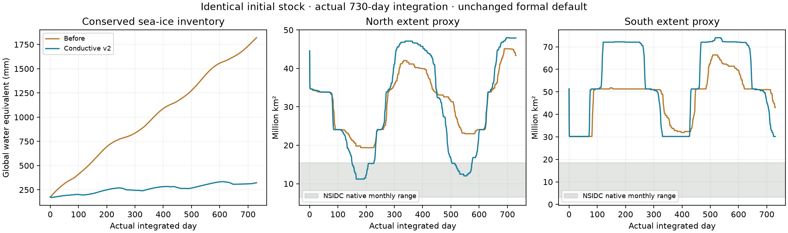
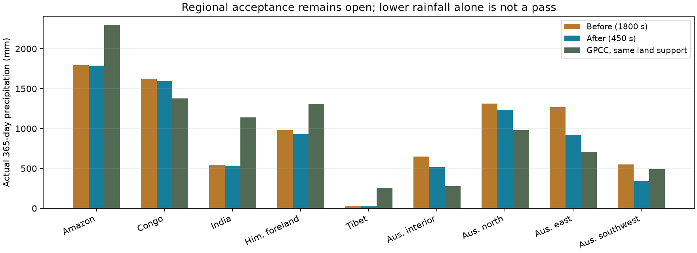

# P1 首轮修复与真实积分验收

**海冰热闭合和河网重复构图的结构修复已完成，预算与恢复检查通过；海冰季节覆盖和 GPCC 整体验收仍未通过，正式默认保持不变。** 精细模式仍为实验。雪片边界的视觉修复与 WebGL 前后截图尚未完成。

## 改动和边界

新增默认关闭的“冰厚热交换（实验）”：诊断冰表温度，以库存决定厚度并通过 K/h 导热；表面辐射及空气交换的差额进入原海洋储层，现有有限相变算子供给冻结/融化潜热。冰下尚有液态海洋时保留封闭海流热输送，海洋耗尽后停止输送。液态海洋耗尽且海温低于冻点时，导热冰底使用实际低温，避免从固定冻点抽取不存在的热量。经典和细分路径共用该闭合，保存文件保留实验开关。

冰表热通量标记最近完整物理步的时间；恢复/回滚清空通量并将时间设为未知，下一步重新生成。没有把诊断零值当保存时刻的实际热通量。

方案采用零层诊断冰表，仍缺少冰内热容量、独立海冰浓度、海雪、漂移和冰应力。海流沿用现有规定/风响应闭合。K/h 形式及导热率参考 [MITgcm SEAICE 热力说明](https://mitgcm.readthedocs.io/en/latest/phys_pkgs/seaice.html#thermodynamics)；保留本项目有效辐射参数，不构成完整海冰气候模型或观测标定。

播放性能改动缓存固定角网格的河道 atlas 接缝、极点和重心坐标，动态更新河宽；重用河道工作数组，输出帧仍独立复制。每个存活汇流网络保留约 108.5 MB 原尺寸 scratch，随网络回收；这是减少重复分配和构图的取舍，不代表降低浏览器总内存。

## 同库存实际积分

完整 Earth 215348 个地形三角形、48×24 大气母格，严格恢复正式第零日库存。对照和候选均保持此前实验 transport、airRadiationFraction=0.5；只切换 conductiveSeaIce。未重新生成气候。对照和候选 1800 秒步长均连续推进 730 个实际日；候选 900/450 秒均实际推进 365 日。各存档再恢复并真实推进下一步，完整快照逐字段相同。

初始物理库存 SHA：51961e8bb0611e0e79c7d4bef14a379c6ca8db2072c3f45f205d0e79cb5b93f5。正式 Earth JSON SHA：afb80a8ab730785eed0cb709a66d938ad20a9690b04ecfa1246d1deb393adca6；正式 transport、辐射分配、精细档和新海冰开关均未启用。正式场景 verify、247 项测试、类型检查、构建及 diff 检查通过。

全部运行独立预算最大绝对残差：水量 **8.233e-7 mm**，焓 **2.631e-4 J/m²**，单格水汽账 **8.049e-11 mm**。预算正确与气候拟真分别判断。

另以正式 legacy 水循环、原辐射分配只开启新海冰开关，从相同库存实际推进 24 日；预算及严格恢复下一步均通过，确认开关可独立使用。这是短期兼容检查，未用于全年观测验收。

| 海冰全球水当量 mm | 第零日 | 365 日 | 730 日 | 第二个 365 日段变化 |
| --- | ---: | ---: | ---: | ---: |
| 对照 | 177.27 | 996.93 | 1819.94 | +823.01 |
| 新闭合 | 177.27 | 268.04 | 322.95 | +54.91 |

库存增长减缓，但候选仍有年际漂移。下表范围是排除陆地、已确认内湖及固定导入冰架占地后，以 seaIce/(wet×917×0.5m) 推算的覆盖代理，15% 阈值。导入冰架几何固定排除；不是所有实际海冰/冰架状态的移动边界。

| 运行 | 365 日段 | 半球 | 每日 extent 最小–最大，百万 km² | 月平均谷/峰月份 |
| --- | ---: | --- | ---: | ---: |
| baseline-1800 | 1 | north | 19.36–42.07 | 10/2 |
| baseline-1800 | 1 | south | 30.17–51.80 | 4/8 |
| baseline-1800 | 2 | north | 23.00–45.11 | 10/2 |
| baseline-1800 | 2 | south | 31.94–66.39 | 4/8 |
| conductive-v2-1800 | 1 | north | 11.20–47.10 | 9/2 |
| conductive-v2-1800 | 1 | south | 30.17–72.22 | 4/9 |
| conductive-v2-1800 | 2 | north | 12.03–47.98 | 9/2 |
| conductive-v2-1800 | 2 | south | 30.17–74.04 | 4/8 |

NSIDC 使用固定 1981–2010 年代、有效年均值，缺测 -9999 明确排除并列出。观测 native 月 extent 是月平均卫星浓度的阈值面积；模型月量是每日库存代理面积的均值，且还没有映射到同一卫星海洋掩膜。因此仅作量级与季节失败检查，**不能宣称同网格 NSIDC 验收通过**。候选北方夏季低值有所下降，南方冬季最大范围反而扩大；库存改善没有消除覆盖闭合/强迫/输送问题，下一步需分别隔离冰表闭合和冰下输送，并补独立浓度与同网格检验。

观测来源：Fetterer et al. (2025), Sea Ice Index, Version 4. Accessed 2026-10-11. Subset: January–December monthly hemispheric extent and area, years 1981–2010. [NOAA/NSIDC G02135 V4](https://nsidc.org/data/g02135/versions/4)。各月 CSV URL、SHA、有效年份和月值见 [nsidc-1981-2010.json](nsidc-1981-2010.json)。未把 1981–2010 当当前年份海冰实况。

## 时间收敛和 GPCC

区域单位 mm/365 实际日；900/450 年量最大绝对差 **7.66 mm**、最大相对差 **0.83%**。以下保留每一区域的减步差，不能由若干差值直接断言全系统收敛阶。逐月覆盖/范围的阈值跳变单独保留原始记录。

| 区域 | 1800s | 900s | 450s | 1800/900 差 | 900/450 差 |
| --- | ---: | ---: | ---: | ---: | ---: |
| Amazon | 1783.23 | 1786.34 | 1787.94 | 3.10 | 1.60 |
| Congo | 1587.79 | 1592.78 | 1595.38 | 5.00 | 2.60 |
| India | 541.30 | 535.68 | 532.59 | 5.63 | 3.08 |
| Himalaya foreland | 935.71 | 931.56 | 929.13 | 4.15 | 2.43 |
| Tibet | 24.41 | 24.47 | 24.49 | 0.05 | 0.03 |
| Australia interior | 522.82 | 517.73 | 515.04 | 5.08 | 2.69 |
| Australia north | 1229.15 | 1230.56 | 1231.20 | 1.41 | 0.64 |
| Australia east | 942.98 | 928.82 | 921.15 | 14.16 | 7.66 |
| Australia southwest | 337.02 | 340.43 | 342.13 | 3.41 | 1.71 |

GPCC 沿用 DWD v2022、1991–2020 正常值、2.5°，与模型使用相同有效陆地交集及球面面积权重；实际陆地沉降除以陆地比例。空间范围和全区域水汽账保留在 [acceptance.json](acceptance.json)。

| 区域 | 对照1800s | 候选1800s | 候选450s | GPCC | 候选450s偏差 |
| --- | ---: | ---: | ---: | ---: | ---: |
| Amazon | 1794.8 | 1783.2 | 1787.9 | 2292.7 | -22.0% |
| Congo | 1622.2 | 1587.8 | 1595.4 | 1378.2 | 15.8% |
| India | 546.4 | 541.3 | 532.6 | 1138.1 | -53.2% |
| Himalaya foreland | 978.8 | 935.7 | 929.1 | 1307.8 | -29.0% |
| Tibet | 26.0 | 24.4 | 24.5 | 257.4 | -90.5% |
| Australia interior | 646.6 | 522.8 | 515.0 | 276.0 | 86.6% |
| Australia north | 1312.3 | 1229.1 | 1231.2 | 981.9 | 25.4% |
| Australia east | 1267.1 | 943.0 | 921.2 | 707.9 | 30.1% |
| Australia southwest | 547.8 | 337.0 | 342.1 | 489.0 | -30.0% |

印度仍只有 532.6/1138.1 mm，全年全区净水汽输运 -151.3 mm；南麓湿于青藏的方向保留，青藏幅值仍过干。澳洲内陆和东岸过湿减轻，但西南 JJA/DJF 为 **0.75/212.09 mm**，观测为 **226.67/51.30 mm**；冬雨反转未解决。热带、印度和澳洲结果不能以海冰库存变化代替验收。

## 播放 CPU 比较与独立复核

长期积分结束后串行运行，正式相同第零日库存、真实单物理步、2 步预热 + 10 个计时样本。每一步同一状态交替调用原实现和缓存实现；三档全部 river/lake/shore typed-array、物理快照逐值相同，旧帧在后续更新后仍相同。改变显示宽度、阈值与开关也相同。

| 档位 | 物理步中位 ms | sync 映射 ms | 原水路几何 ms | 缓存后几何 ms | 几何耗时下降 |
| --- | ---: | ---: | ---: | ---: | ---: |
| classic | 14.5 | 6.3 | 87.2 | 32.4 | 62.9% |
| balanced | 28.2 | 44.2 | 83.8 | 34.3 | 59.1% |
| high | 36.4 | 58.8 | 76.7 | 35.7 | 53.4% |

这是 Node CPU 比较，未测前台浏览器 FPS、GPU 完成时间、加载等待或浏览器总内存，不能据此提升 high 为正式默认。

独立只读复核：耗尽液态海洋 30 日复现转绿，最低海温 216.377 K；恢复/确认帧回滚及下一步诊断有效性通过；5670 组冰表闭合探针无负温度/非有限值，最大冰表残差约 9.95×10⁻¹¹ W/m²。河网 1860 组逐 Float32 比较完全一致，其中 408 组包含接缝或极点。未发现剩余关键/重要/次要代码问题；这些检查不代表气候观测验收。

## 图形和复现

此前 WebGL2 初始化阻塞仍待恢复通知，用户选择先继续数值验收。[已记录的失败画面](../earth-moisture-structural-20261011/webgl-blocker.jpg) 与本轮数值图均不能替代健康 WebGL 前后截图。雪片边界视觉改动仍待同库存、同视角图形检查。恢复后从 manifest 绑定的同日存档补图，重点看极区、印度/喜马拉雅、热带和澳洲。

源码/初始库存/bundle/存档 SHA 在 [manifest.json](manifest.json)，完整预算、GPCC、逐月海冰与收敛在 [acceptance.json](acceptance.json)，原始运行数据在本目录各 continuous/seaice JSON。大存档和冻结 bundles 位于忽略的 build/earth-seaice-p1。conductive-v1 保留作为被否决的边界故障排查记录，未作为最终验收来源。

从仓库根用 esbuild 将 [integrate.ts](integrate.ts) 打包到 build，再以 P1_LABEL、P1_DT、P1_ICE、P1_DAYS 环境变量运行。例：conductive-v2/1800/1/24,90,180,270,365,730；对照 baseline/1800/0 使用相同天数，900/450 候选到 365 日。性能先运行 [prepare-performance.mjs](prepare-performance.mjs) 冻结指定基点的原几何，再打包并运行 [performance.ts](performance.ts)。观测脚本 [observations.mjs](observations.mjs) 重算固定年代月量；打包 analyze.mjs 后生成验收与 manifest，plot.py 生成标准 matplotlib 图，report.mjs 汇总报告。
