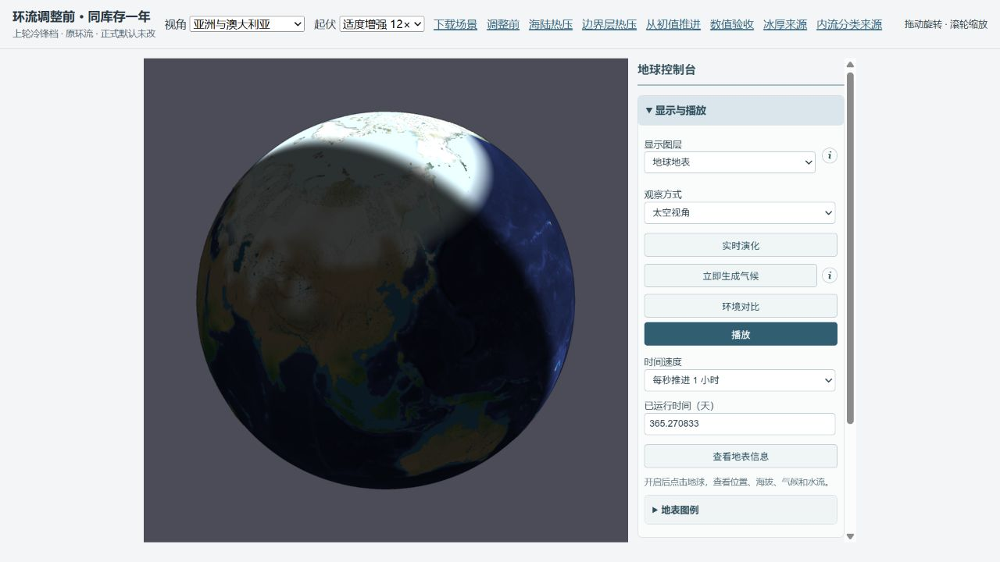
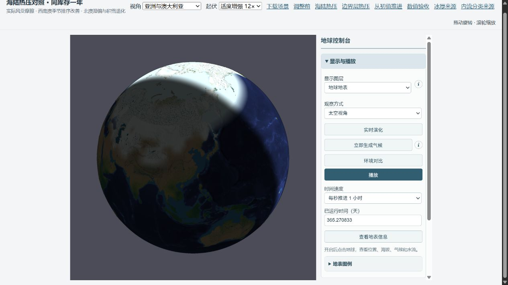
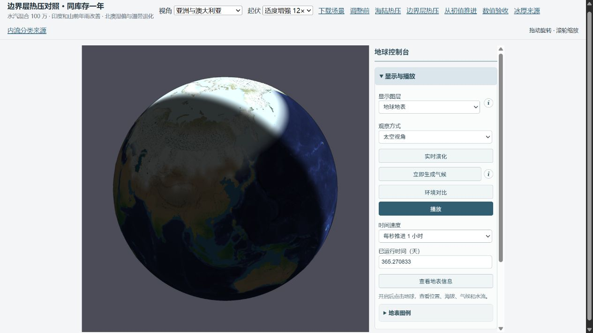

# 季节环流调整：同库存真实年度验收

完成压力势与实际风摩擦的实验实现、独立因果对照和完整地形积分。西南澳冬夏排序能够恢复，但没有候选同时通过印度、喜马拉雅/西藏、温带与澳洲验收。正式默认不改，原冷锋预览保留；两种新压力档仅用于对照。

## 实际改变

原局地热势截断冷异常，阻力耗散的是相对模板的偏差。可选方案保留海陆冷热差的符号，使摩擦作用于实际低层风；将未解析的大尺度海洋背景力明确写入。另测二次表面应力与静力层厚尺度。水汽面通量独立记录实际平流和扩散，恢复时清除未保存诊断，库存不新增。枚举、层厚、合法季节反转风的存档包络与运行时共享验证。

方程、对照变量及物理参考见 [protocol.md](protocol.md)。这是诊断气压势模型，没有干空气质量、垂直回流或动能预算；风向改变不能自动证明季风动力闭合。

## 完整地形 GPCC 验收

三个档从同一湖泊日零存档恢复：215348 地形三角形、48×24 大气格、有限陆海水/湖泊库存与相同温度、显热、焓和风记忆。dt=1800 s，积分真实轨道年；最终实际库存时间 365.270833 d，观测累计截到准确轨道年。GPCC v2022 1991–2020、原区域及共同有效陆地支持不变。一次初值年度不是经过多年平衡的气候态。

| GPCC 区域 / 年雨 mm | 观测 | 控制（上轮冷锋档） | 海陆热压 | 边界层热压 + K=100万 |
| --- | --- | --- | --- | --- |
| Europe | 792.1 | 389.0 | 842.5 | 833.3 |
| East North America | 1056.0 | 565.2 | 276.1 | 254.0 |
| East Asia | 693.9 | 698.5 | 375.3 | 206.3 |
| West Siberia | 451.3 | 140.0 | 298.2 | 414.3 |
| India | 1138.1 | 537.6 | 542.7 | 719.1 |
| Himalaya foreland | 1120.4 | 3318.7 | 4061.6 | 937.9 |
| Tibet | 443.5 | 508.6 | 858.4 | 139.5 |
| Australia southwest | 489.0 | 495.3 | 390.9 | 480.9 |
| Australia north | 985.9 | 1421.1 | 2532.1 | 2355.5 |
| Amazon | 2264.7 | 1497.0 | 1224.6 | 1494.1 |
| Congo | 1385.3 | 1252.7 | 1049.0 | 1168.8 |

| 西南澳 / mm | 观测 | 控制（上轮冷锋档） | 海陆热压 | 边界层热压 + K=100万 |
| --- | --- | --- | --- | --- |
| DJF（南半球夏） | 51.3 | 325.6 | 103.1 | 111.8 |
| JJA（南半球冬） | 226.7 | 4.9 | 117.7 | 138.0 |

边界层档印度年雨增加，喜马拉雅山前年雨靠近观测，但西藏降到 139.5 mm。山前 938 mm 中约 855.6 mm 仍来自扩散直接地形抬升；只是减弱了错误路径，雨影未通过结构性验收。该档叠加 K=100万，改善不能单独归于压力；单因素对照见粗网格表。

西南澳从 DJF 325.6 / JJA 4.9 mm 改为 111.8 / 138.0 mm，冬夏排序修正，振幅仍弱于观测 51.3 / 226.7 mm。北澳却从 1421.1 增至 2355.5 mm（观测 985.9）。欧洲、西西伯利亚改善，东美和东亚恶化，温带四区平均绝对偏差变大。新档不满足“不加重澳洲偏湿”。

## 积雪与 NSIDC

| 指标 | 控制（上轮冷锋档） | 海陆热压 | 边界层热压 + K=100万 |
| --- | --- | --- | --- |
| 温带四区年雨 MAE / mm | 302.5 | 325.5 | 342.0 |
| 北半球海冰范围 MAE / 百万 km² | 9.464 | 9.777 | 9.552 |
| 北半球海冰面积 MAE / 百万 km² | 9.142 | 8.927 | 9.297 |
| 南半球海冰范围 MAE / 百万 km² | 18.387 | 14.758 | 18.101 |
| 南半球海冰面积 MAE / 百万 km² | 21.945 | 19.531 | 22.298 |
| 期末雪库存 / 全球平均 mm | 5.9675 | 9.8298 | 5.9465 |
| 累计降雪 / 全球平均 mm | 10.7845 | 16.5404 | 8.4207 |
| 累计融雪 / 全球平均 mm | 15.0102 | 16.8788 | 12.6843 |
| 累计压实 / 全球平均 mm | 0.0526 | 0.0775 | 0.0356 |

共同初始雪库存为 10.2457 全球平均 mm。海陆热压期末比控制多约 65%，来自降雪增加而非漏水；仍低于自身初始库存。边界层档期末雪库存基本相当。库存是质量，不能代替覆盖面积；NSIDC 海冰观测也不能验收陆地雪。

NSIDC G02202 v2 1981–2010、固定同网格海域支持、15% 范围阈值和 0.5 m 模型浓度规则不变。海陆热压南半球范围 MAE 改善，北半球退化且陆雪增加；边界层档南半球范围小幅改善，面积 MAE 反而增加。全球冰冻范围未通过验收。

## 真实供水与抬升

| 档 | 区域 | 季节 | 向东 m/s | 向北 m/s | 辐合 / 日 | 平流净入 mm | 扩散净入 mm | 总净入 mm |
| --- | --- | --- | --- | --- | --- | --- | --- | --- |
| 控制（上轮冷锋档） | India | DJF | -2.01 | -2.39 | 0.005 | -63.4 | 11.0 | -52.3 |
| 控制（上轮冷锋档） | India | JJA | -7.96 | -0.25 | 0.177 | 235.3 | -156.1 | 79.1 |
| 控制（上轮冷锋档） | Himalaya foreland | DJF | 1.89 | -2.76 | -0.119 | -71.5 | 354.2 | 282.7 |
| 控制（上轮冷锋档） | Himalaya foreland | JJA | -7.30 | -0.59 | -0.100 | -72.0 | 1101.4 | 1029.4 |
| 控制（上轮冷锋档） | Australia southwest | DJF | -5.69 | 1.81 | -0.039 | -72.6 | -12.9 | -85.5 |
| 控制（上轮冷锋档） | Australia southwest | JJA | 4.65 | 2.27 | -0.097 | -63.5 | -19.8 | -83.3 |
| 控制（上轮冷锋档） | Australia north | DJF | -6.22 | -0.22 | 0.064 | 166.7 | 52.2 | 218.9 |
| 控制（上轮冷锋档） | Australia north | JJA | -5.76 | 1.94 | -0.170 | -175.6 | 51.0 | -124.6 |
| 海陆热压 | India | DJF | -0.24 | 0.39 | -0.386 | -175.6 | 139.3 | -36.3 |
| 海陆热压 | India | JJA | -3.07 | 1.11 | 0.099 | 162.2 | -65.5 | 96.7 |
| 海陆热压 | Himalaya foreland | DJF | 6.58 | 5.38 | -0.179 | 44.7 | 363.6 | 408.3 |
| 海陆热压 | Himalaya foreland | JJA | 1.73 | 3.53 | 0.094 | 226.0 | 1104.5 | 1330.5 |
| 海陆热压 | Australia southwest | DJF | -3.30 | 3.68 | -0.126 | -176.7 | 30.0 | -146.7 |
| 海陆热压 | Australia southwest | JJA | 5.29 | -1.70 | 0.163 | 132.7 | -115.9 | 16.8 |
| 海陆热压 | Australia north | DJF | -2.25 | -0.68 | 0.320 | 573.3 | 12.7 | 586.0 |
| 海陆热压 | Australia north | JJA | -2.89 | 0.26 | -0.079 | -74.5 | -27.9 | -102.4 |
| 边界层热压 + K=100万 | India | DJF | -0.82 | -0.58 | -0.124 | -69.1 | 40.5 | -28.6 |
| 边界层热压 + K=100万 | India | JJA | -4.49 | -1.54 | 0.142 | 144.3 | -83.1 | 61.2 |
| 边界层热压 + K=100万 | Himalaya foreland | DJF | 1.42 | 0.57 | -0.251 | -50.2 | 108.6 | 58.4 |
| 边界层热压 + K=100万 | Himalaya foreland | JJA | -4.61 | -1.31 | -0.243 | -231.9 | 271.6 | 39.7 |
| 边界层热压 + K=100万 | Australia southwest | DJF | -3.99 | 2.66 | -0.165 | -201.8 | 52.9 | -148.9 |
| 边界层热压 + K=100万 | Australia southwest | JJA | 5.55 | -2.20 | 0.135 | 132.2 | -91.4 | 40.8 |
| 边界层热压 + K=100万 | Australia north | DJF | -3.62 | 0.58 | 0.140 | 281.6 | 38.4 | 320.0 |
| 边界层热压 + K=100万 | Australia north | JJA | -3.18 | 0.90 | -0.024 | -21.3 | -19.5 | -40.8 |

净入是同格气柱实际面通量的区域支持加权量，正值为净输入；不是海洋来源示踪，也不能直接替代每陆地面积降雨。平流+扩散只在同一观测日历内相加，库存闭合使用全部实际 ceil 步。

控制西南澳冬季平流净输出约 63.5 mm，边界层档转为净输入约 132.2 mm，冬季辐合由负转正，这是冬雨恢复的输送证据。印度夏季平流净输入从 235.3 降至 144.3 mm，总净入从 79.1 降至 61.2 mm；印度年雨增加不能被描述为海到陆平流供水已修好。地区平均偏西风也不能单独排除孟加拉湾支流；尚无 ERA5/NCEP 风场或海洋来源示踪验收。

北澳夏季过强热力辐合及其凝结闭合仍会造成湿偏。喜马拉雅扩散地形雨、陆气热差/海洋背景压强简化、缺少稳定度约束和垂直环流仍是限制。压力代理使用海洋主体温度，尚未以实际冷冰面与开阔水面面积加权替代，本轮未把这个未验证假设混入结果。下一轮宜固定已有证据的西南澳输送响应，逐项查稳定度和地形抬升。

## 全部粗网格因果对照

各档使用同库存真实一年，关闭地形路由，不能替代完整地形验收。signed / dragOnly 分别检查压力和摩擦，pressure 移除模板背景，balanced / boundary 明确保留背景，NoOro 仅去掉扩散直接地形抬升，Mix1 仅降 K。stress 与 layer 分开检查阻力和压力层厚；定义见 [profiles.json](profiles.json)。失败结果均保留。

| 粗网格档 | 期末雪 mm | 温带 MAE mm | 印度年雨 | 山前年雨 | 西藏年雨 | 西南澳 DJF / JJA | 北澳年雨 |
| --- | --- | --- | --- | --- | --- | --- | --- |
| balanced | 9.764 | 324.7 | 488.6 | 3968.1 | 855.2 | 97.6 / 117.2 | 2506.0 |
| balanced900 | 9.774 | 325.2 | 486.4 | 3980.3 | 855.9 | 99.0 / 116.6 | 2511.4 |
| balancedMix1 | 6.270 | 358.5 | 433.5 | 1870.2 | 898.3 | 87.6 / 155.6 | 3017.7 |
| balancedNoOro | 11.608 | 351.1 | 452.5 | 956.5 | 1770.6 | 107.3 / 118.9 | 2528.8 |
| boundary | 9.545 | 324.1 | 591.5 | 2994.2 | 454.7 | 141.7 / 116.9 | 2180.9 |
| boundaryLayer500 | 8.945 | 349.1 | 542.7 | 3403.3 | 519.0 | 434.2 / 103.3 | 2040.8 |
| boundaryMix1 | 5.967 | 354.0 | 693.5 | 899.5 | 133.6 | 117.6 / 138.0 | 2350.7 |
| boundaryMix1900 | 5.967 | 353.9 | 695.0 | 900.0 | 133.7 | 119.0 / 137.7 | 2360.3 |
| boundaryNoOro | 10.821 | 361.2 | 701.9 | 214.9 | 24.3 | 155.2 / 121.2 | 2169.7 |
| boundaryStress | 8.736 | 298.5 | 697.9 | 3417.6 | 516.2 | 442.0 / 98.9 | 1887.9 |
| control | 5.940 | 317.0 | 499.4 | 3248.5 | 501.1 | 324.7 / 4.7 | 1424.5 |
| dragOnly | 5.716 | 320.2 | 518.6 | 3256.7 | 496.7 | 485.4 / 3.8 | 1280.4 |
| layer1000 | 9.252 | 313.9 | 301.6 | 3159.3 | 529.2 | 362.7 / 83.4 | 1029.9 |
| layer500 | 9.452 | 349.9 | 501.3 | 3459.4 | 570.5 | 303.8 / 95.5 | 2000.3 |
| pressure | 6.140 | 290.1 | 364.2 | 4293.6 | 1350.7 | 478.9 / 13.1 | 1643.5 |
| pressureNoOro | 7.069 | 265.9 | 318.4 | 932.9 | 2592.4 | 520.1 / 13.5 | 1646.0 |
| shallowPressure | 10.188 | 368.4 | 449.2 | 3265.9 | 522.0 | 58.5 / 113.3 | 2141.3 |
| signed | 6.464 | 310.7 | 361.2 | 4344.6 | 1428.3 | 297.3 / 15.3 | 1817.3 |
| stress1000 | 9.497 | 319.1 | 234.9 | 2712.3 | 540.9 | 292.5 / 54.9 | 742.2 |
| stress2000 | 9.411 | 339.1 | 199.6 | 2583.5 | 473.2 | 316.2 / 31.1 | 334.4 |
| stress500 | 9.491 | 301.8 | 306.4 | 3450.5 | 783.0 | 219.1 / 86.1 | 1578.1 |

粗网格 1800→900 s 同库存时间收敛：balanced 最大区域年雨差 12.164 mm、逐月差 2.214 mm；boundaryMix1 最大区域年雨差 9.607 mm、逐月差 1.680 mm。两档西南澳冬雨排序均保留；没有进行完整地形半步验证。

## 预算、存档与复现

| 档 | 全水残差 mm | 焓残差 J/m² | 逐格水汽残差 mm | 路由分配残差 m³ | 雪账残差 mm | 日审计次数 |
| --- | --- | --- | --- | --- | --- | --- |
| 控制（上轮冷锋档） | 2.328e-10 | 2.107e-4 | 3.593e-11 | 0.1053 | 2.139e-12 | 366 |
| 海陆热压 | 2.328e-10 | 2.159e-4 | 4.911e-11 | 0.1255 | 1.641e-12 | 366 |
| 边界层热压 + K=100万 | 2.328e-10 | 2.115e-4 | 2.672e-11 | 0.0988 | 9.663e-13 | 366 |

各完整档 366 次每日审计通过。独立从 JSON 端点重读，水汽/雪逐元素等于积分账；JSON 再编码解码后下一步精确一致，见 [serialized-restore.json](serialized-restore.json)。278/278 测试、TypeScript、构建通过；独立实现审查无阻断问题，补齐纯扩散/纯平流/混合面通量的测试，见 [review.md](review.md)。水/焓闭合不代表区域气候正确。

完整初始库存 SHA256：952addee2268260c7acb5cee1f2fe576414c88539719b3b6559d624d5a89ceca。正式场景 SHA256：afb80a8ab730785eed0cb709a66d938ad20a9690b04ecfa1246d1deb393adca6。湖泊输入 SHA256：24bfe8b9a4768000574aa3febf3ed2be692ed2a071346175a9f0463280c2854b。

[comparison.json](comparison.json) 保存区域月雨和全部误差；[full-causes.json](full-causes.json) / [screen-causes.json](screen-causes.json) 保存驱动和输送；raw/*.json.gz 无损保留完整输出，bundles/*.mjs.gz 保留对应运行 bundle。原字节/bundle 哈希见 comparison 和 manifest。存档和预览在 build/earth-seasonal-pressure，未覆盖正式场景。

复现：npm test、npm run typecheck、npm run build；node docs/evidence/earth-seasonal-pressure-20261012/setup.mjs；设 PARAM_PROFILE 运行 build/earth-seasonal-pressure/screen.mjs 或 full.mjs（900 s 另设 PARAM_DT=900）；运行 restore.mjs；设 CAUSE_STAGE=screen/full 运行 causes.mjs 并传入档名；再运行本目录 analyze.mjs、report.mjs、preview.mjs。旧运行版本可从对应 bundle gzip 解压使用。

## 实际 WebGL 截图

同库存一年端点、固定地球姿态和亚洲/澳大利亚视角、表面层、12× 地形起伏、云关闭。截图验证渲染，不作为年度雨量验收。

