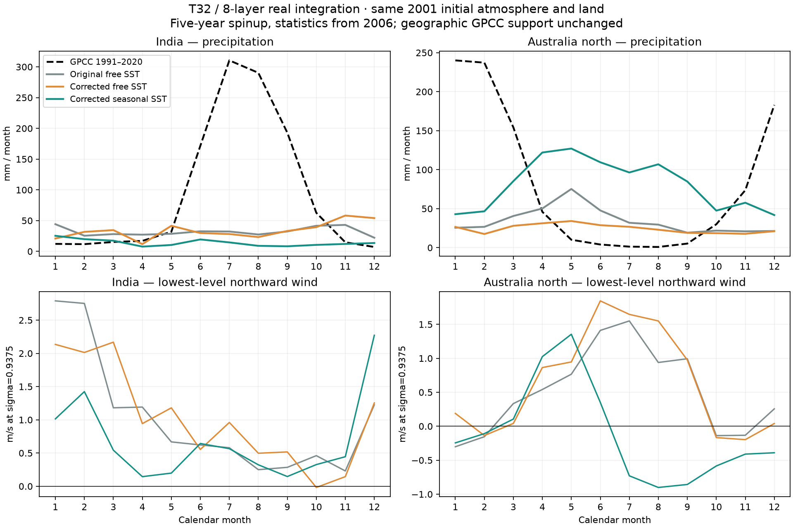
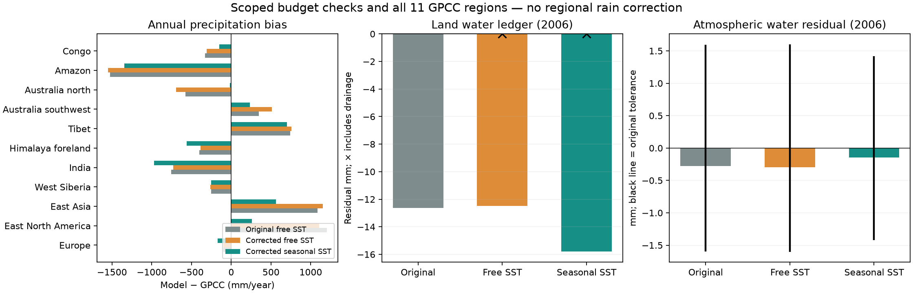
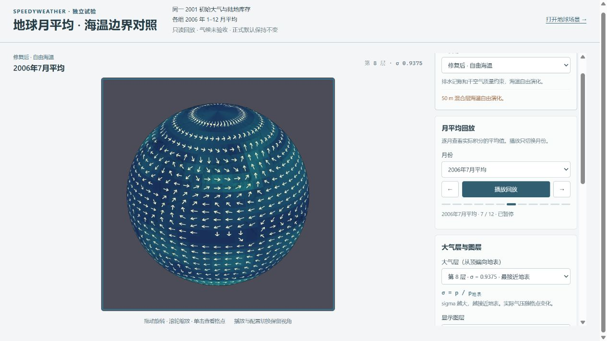
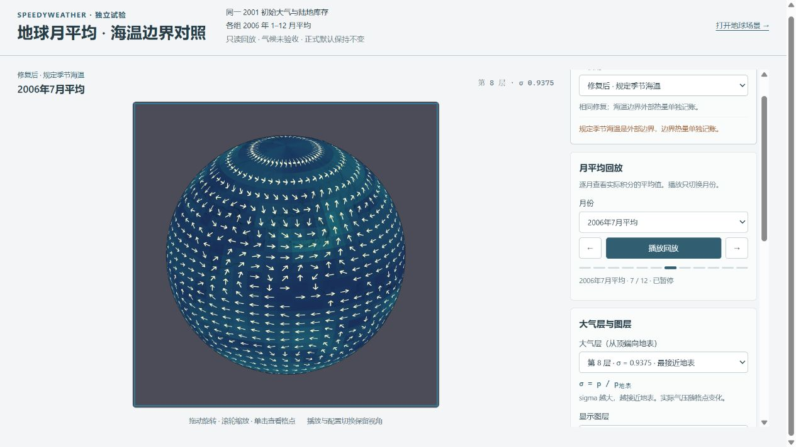
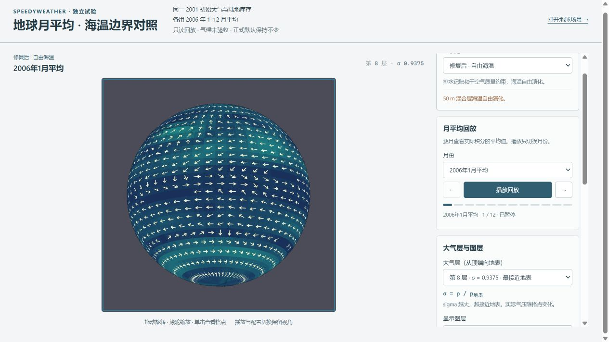
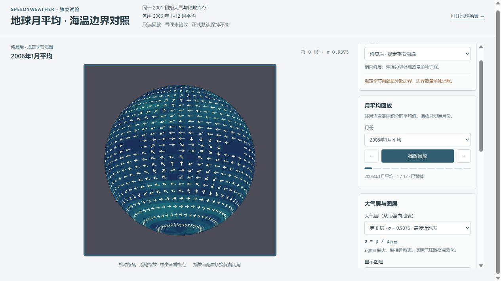

# SpeedyWeather 排水、干空气质量与季节海温对照结果

2026-10-13 续接完成。上一会话两组积分均于 2026-10-12 晚正常结束；本次复用原始输出，补齐分析、当前源码短测/续算、浏览器验收、审阅与归档。仓库基线 HEAD 为 80414dc；较早多轮实验仍有未提交改动，本轮只新增/更新本实验的诊断和证据，没有提交或推送。

## 结论

**土壤出水账本和干空气质量约束达到预先规定的验收线；规定季节 SST 没有修好印度和北澳季风，不能升为正式默认。** 北澳的年降水接近 GPCC，是季节错误下的年总量接近；月误差反而增加。印度夏季雨量进一步减少。全年的大气水残差在原门槛内，启动前三天仍失败，不能把长期累计通量带来的宽门槛当成启动期已修复。

已接到 [独立地球回放](http://localhost:8001/build/earth-speedy-budgets-sst/index.html)。三组、12 个月、8 层风/温可切换。播放切换已积分的月平均数据；它不是浏览器实时推进六年气候。正式地球 JSON 与三组 DEFAULT_* 通过逐字/哈希核对，仍保持不变。

## 对照条件与物理语义

- Julia 1.12.7、SpeedyWeather 0.23.0、T32、3168 Gaussian 点、8 层 sigma、Float64、1800 s 正常步长。两次 900 s 启动，2001-01-01 至 2007-01-01 各 105169 次真实推进；前五年预热，2006 年统计。两组墙钟耗时分别约 28.5 / 29.8 分钟，不是浏览器 FPS。
- 三组共用首个物理步前的原始存档。大气光谱和陆地库存 SHA 为 4c665c83b08918fad6f8b67968fae472539c8796515afc93a22099d682b44a68；初始温湿风压、SST、海冰逐值差为零。2006 年初状态是各自积分产物，不能再宣称相同。
- 排水包装器补记下层超容量流出、土壤负值裁剪及雪正上限移除，保持原土壤演化和上层 runoff。负雪候选裁剪抵消未实现融雪，单独记录，但不重复当作真实水源。
- 干空气是全球平均 ps/g−W；原 ps/g 是含水气柱质量。显式全局压力零阶模式约束保留原候选漂移及数值水/显热变化；它没有把整个动力核改成守恒格式。RAW 记忆层只作另列诊断，不重复计入当前物理通量。
- SST 使用固定包的 12 个月场，按公历月中心插值（包括跨年/闰年），不是本次新下载的 1991–2020 海温观测；源元数据未声明气候平均年代。两组保留相同 slab 表面通量和海冰响应，规定组在完成步后施加海温边界并记外部热量。
- GPCC 为 [DWD 官方 v2022 1991–2020，2.5°月常年值](https://opendata.dwd.de/climate_environment/GPCC/gpcc_normals_v2022/normals_1991_2020_v2022_25.nc.gz)。官网目录已复核；本轮使用原冻结数据、原 11 区和固定有效陆地支持。模型雨＋雪保守映射至 48×24，月累计量直接比较。单个模拟统计年对多年气候平均，能用于此轮敏感性判断，尚不能代表稳定多年气候。

## 印度与北澳

单位：年量 mm/年、当地夏季量 mm/季、月 MAE mm/月。印度夏季为 JJA，北澳夏季为 DJF；北澳 DJF 是同一统计年的 1、2、12 月组合，并非额外保存的连续跨年雨季。

| 地区 | 配置 | 年降水 | 当地夏季降水 | 夏季份额 | 峰值月 | 月 MAE |
| --- | --- | --- | --- | --- | --- | --- |
| 印度 | 原配置 | 384.93 | 92.36 | 24.0% | 1月 | 81.43 |
| 印度 | 修复＋自由海温 | 406.52 | 81.10 | 19.9% | 11月 | 85.65 |
| 印度 | 修复＋规定季节海温 | 168.12 | 42.97 | 25.6% | 1月 | 85.80 |
| 印度 | GPCC | 1138.06 | 772.51 | 67.9% | 7月 | — |
| 北澳 | 原配置 | 410.80 | 73.58 | 17.9% | 5月 | 78.96 |
| 北澳 | 修复＋自由海温 | 292.59 | 65.25 | 22.3% | 5月 | 76.12 |
| 北澳 | 修复＋规定季节海温 | 968.50 | 131.36 | 13.6% | 5月 | 100.89 |
| 北澳 | GPCC | 985.87 | 660.31 | 67.0% | 1月 | — |

印度：修复＋自由海温的 JJA 为 81.10 mm，改规定 SST 后只有 42.97 mm，GPCC 为 772.51 mm。夏季份额虽从 20.0% 变为 25.6%，主要因为全年量更低，不能解释为季风改善；峰值仍落在冬季。

北澳：规定 SST 年量 968.50 mm 对 GPCC 985.87 mm，仅差约 −1.8%；但 DJF 为 131.36 对 660.31 mm，JJA 为 312.81 对 6.26 mm。夏季份额从 22.3% 降至 13.6%，GPCC 为 67.0%；峰值仍是五月。月 MAE 从 76.12 升至 100.89 mm。**年量改善不构成雨季验收。**

### 海温、水汽与低层风诊断

下表按当地夏季天数加权。外海区域固定为印度 5–15°N、60–90°E，北澳 10–2°S、110–140°E；海温/外海湿度用原生海洋权重，区域低层风和柱水用固定陆地支持。sigma=0.9375 不等于固定 2 m 气温或 10 m 风。陆海温差是上层土壤温度减外海 SST 的模型代理。

| 地区 | 配置 | 外海 SST °C | 外海低层 q g/kg | 陆区柱水 mm | 陆区 u/v m/s | 陆−海 K | 粗网格水汽汇聚 mm/d | SST 东/北梯度 K/1000 km |
| --- | --- | --- | --- | --- | --- | --- | --- | --- |
| 印度 | 修复＋自由海温 | 30.27 | 7.70 | 23.28 | 1.54 / 0.67 | 7.60 | 0.039 | -1.65 / 1.63 |
| 北澳 | 修复＋自由海温 | 33.32 | 8.08 | 26.24 | -2.24 / 0.04 | 5.58 | 0.088 | -0.29 / 4.63 |
| 印度 | 修复＋规定季节海温 | 28.55 | 5.89 | 18.77 | 2.50 / 0.51 | 9.57 | 0.357 | 0.22 / -0.30 |
| 北澳 | 修复＋规定季节海温 | 29.10 | 5.93 | 19.02 | -1.50 / -0.25 | 7.31 | 0.289 | 0.25 / 0.03 |

规定 SST 后外海变冷，低层比湿和陆区柱水均减少；模型陆海温差反而增大。印度的区域东向风和粗网格水汽汇聚增大，但降水减少。北澳夏季仍未形成正确月降水峰型。这些是本组实际诊断，提示后续应查水汽的垂直输送、对流/凝结与动力输送的连接，不能仅凭海陆温差更大或全年供水更多判断季风正确，也不能据此锁定唯一成因。水汽汇聚来自月均原生 q×风×气柱积分后的粗网格散度，不能代替原生逐过程水预算。

## 水量和质量预算

下表水深都以全球总面积归一；陆地项包含陆地面积权重，不是“每平方米陆地”的平均水深。“残差 / 门槛”越靠近零越好。

| 配置 | 逐步最大干质量相对误差 | 2006 原始陆水残差 mm | 补账后陆水残差 mm | 2006 大气水残差 / 门槛 mm | 六年大气水残差 / 门槛 mm |
| --- | --- | --- | --- | --- | --- |
| 原配置 | 未约束；六年末 3.441e-3 | -12.63 | 未修复 | -0.274948 / 1.595092 | -1.800728 / 9.110604 |
| 修复＋自由海温 | 1.665e-15 | -12.49 | 1.357e-12 | -0.295202 / 1.602085 | -1.655137 / 9.090536 |
| 修复＋规定季节海温 | 1.554e-15 | -15.78 | -3.184e-12 | -0.146783 / 1.420618 | -1.024845 / 8.316055 |

两组补账后六年陆水残差为 8.214e-12 / -1.142e-11 mm；未补账分别为 −62.00 / −74.72 mm。2006 深层排水为 12.49 / 14.36 mm；规定组另有 1.42 mm 雪上限移除。无需改变土壤物理轨迹即可解释此部分漏账。

原配置三天干质量漂移约 0.1553%，六年末约 0.3441%；修复后逐步误差约 1.6e−15。修复组每步约束前最大候选误差仍约 2.204e−4，不能隐藏。六年当前层数值水修正为 −0.22036 / −0.22401 mm，显热代理修正约 −1.758e7 / −1.890e7 J/m²。它们单列为数值影响，不冠以真实蒸发/降水名称。

**未通过项：** 当前最终生产输出在 2001-01-04 的三天大气水剩余残差为 −0.105902 / −0.105793 mm，超过原短期 0.05 mm 门槛。后续年度门槛按累计通量增长，并不推翻这个失败。本次没有修完湿度动力/滤波/裁剪的全部预算。

## 能量和海冰限制

规定组 2006 年外部 SST 维持热量为 −4.6262e8 J/m²，约全球平均 −14.67 W/m²；海洋表面输入为 +3.5775e8、冻点夹限调整为 +1.0487e8 J/m²。外部项与海洋显热账分开，总体代数残差约 1.10e−5 J/m²。外部项逐格计算后仅保留全球累计量，本轮没有导出空间热量历史。

原模型没有有限海水库存和海冰厚度/潜热库存，空气能量也只列显热代理及 TOA 通量。因此通过局部账本不能称完整地球水/能量守恒；海冰浓度随本次边界变化，也未通过 NSIDC 预报验收。三组显示细地形不改变大气 T32 的实际分辨率。

## 其余区域回归

最后一列为规定 SST 相对修复自由 SST 的月 MAE 变化，负数表示月降水误差减小。

| 区域 | GPCC 年量 | 原配置 | 修复自由 SST | 修复规定 SST | 月 MAE 变化 |
| --- | --- | --- | --- | --- | --- |
| 欧洲 | 792.09 | 693.77 | 692.03 | 621.13 | 10.24 |
| 北美东部 | 1055.99 | 2260.22 | 2163.04 | 1316.21 | -63.68 |
| 东亚 | 693.91 | 1779.38 | 1844.73 | 1257.15 | -37.12 |
| 西西伯利亚 | 451.33 | 199.09 | 186.99 | 196.95 | -0.83 |
| 印度 | 1138.06 | 384.93 | 406.52 | 168.12 | 0.15 |
| 喜马拉雅山前 | 1120.42 | 720.48 | 734.30 | 557.52 | 1.61 |
| 西藏 | 443.54 | 1187.52 | 1201.14 | 1144.29 | -4.51 |
| 澳洲西南 | 489.04 | 833.57 | 1001.10 | 721.35 | -6.88 |
| 北澳 | 985.87 | 410.80 | 292.59 | 968.50 | 24.77 |
| 亚马孙 | 2264.66 | 740.37 | 715.42 | 922.57 | -17.26 |
| 刚果 | 1385.30 | 1054.17 | 1074.41 | 1236.16 | -4.65 |

北美东部和东亚的过湿明显减轻，亚马孙/刚果也有所改善，但仍存在缺雨。欧洲变差；澳洲西南虽年量和月 MAE 改善，其 DJF/JJA 比例向错误方向变化。不可用跨区平均分掩盖季节退化。

## 地球回放实测

用真实浏览器检查三组一月/七月、八层、风/温、固定视角、探针、播放中配置切换、十二月自动停止及手动暂停。18 条状态记录中 126 个探针数值与真实 display 数据逐值相同，控制台未见 warning/error。图层箭头方向为气流去向；风速颜色在 30 m/s 饱和、气温在 −80～60°C 饱和，探针原值保留。三组整份数据均经验证，风分量没有超过 ±100 m/s 的编码范围。

以下印度两图同为七月第八层、同镜头；北澳两图同为一月第八层、同镜头。单个探针是映射格点，不能替代上文区域平均。

回放接入复用现有 Renderer 与 terrain-only 底图恢复；bundle 检查排除旧 ThermalRuntime、WaterModel 和时钟恢复入口。原服务不在运行，本次仅恢复 localhost:8001 服务。没有测浏览器 FPS；切换可用不能替代帧率基准。

## 验证、审阅和证据

- 仓库测试 278/278，回放合同测试 14/14；仓库/回放类型检查和独立回放构建通过。
- 排水、质量约束与公历插值 13 项解析测试通过；当前两组恢复后下一步的五类容器、时钟、质量/SST 账本均逐值一致（4 项断言）。JLD2 会报告匿名函数按名称存储警告；自定义恢复方法复建模型，当前固定环境续算通过不代表跨版本可移植。
- 最终源码的原生 bucket 对照与三天真实积分另存 resume-probe 日志。历史旧版 probe 日志保留，没有冒充当前证据。
- [独立审阅](review.md) 未发现关键实现缺陷。保留一处不影响运行的旧注释，以免修改已完成积分的生产源码哈希；未导出的空间热量账本作为限制列出。
- [acceptance.json](acceptance.json) 保存完整区域/月值和预算；[browser-verification.json](browser-verification.json) 保存浏览器核对；[manifest.json](manifest.json) 绑定源码、输入、资产和 11 份 gzip 原始数据/存档；[final-verification.json](final-verification.json) 是实现与证据完整性验收，不等于气候验收。

## 下一步优先级与验收建议

1. **补齐启动期原生大气水逐过程账本。** 沿固定初始库存，先拆分水汽输送、光谱变换、RAW 滤波、非负裁剪、对流/凝结与压力模式影响。三天残差必须回到原 0.05 mm 门槛，干质量和陆水同时保持本轮标准；不通过延长统计窗放宽门槛。
2. **定位季风雨季错位。** 固定本轮两组基线，输出印度 JJA、北澳 DJF 的垂直湿度/温度/风、对流与大尺度降水分量、陆海表面通量及水汽收支。优先解释“水汽汇聚增大而印度雨量下降”和“北澳五月峰”。单因素修改后要求雨季峰值、夏季份额、月 MAE 同时向 GPCC 改善，北澳年量接近不能单独算通过。
3. **机制证据成立后再做多年统计。** 固定同一配置延长多个统计年，对照固定 GPCC 支持并检查其余 9 区回归；之后再讨论正式接入。此前继续保留独立实验和明确的只读回放标识。

本轮不实施这些下一阶段机制修改，也不改变已经冻结的正式默认。
