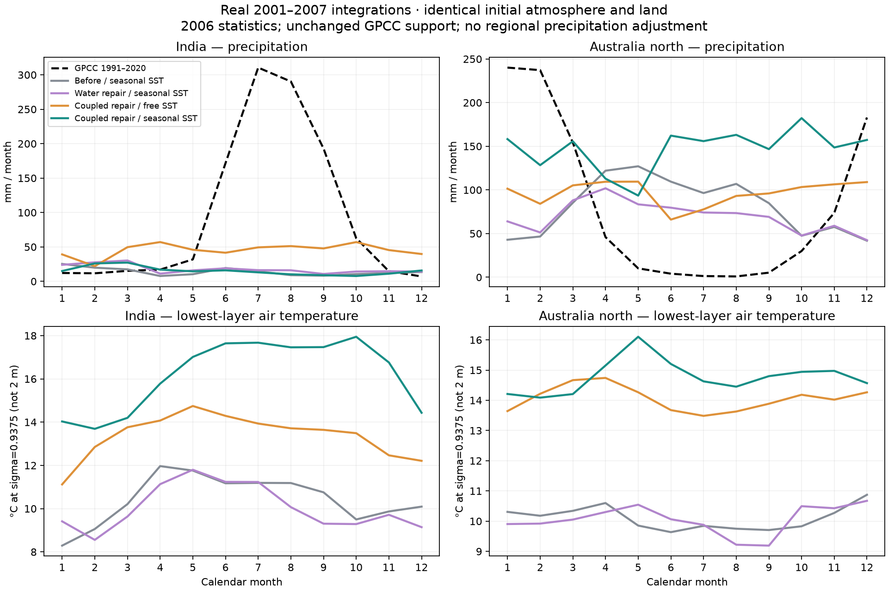
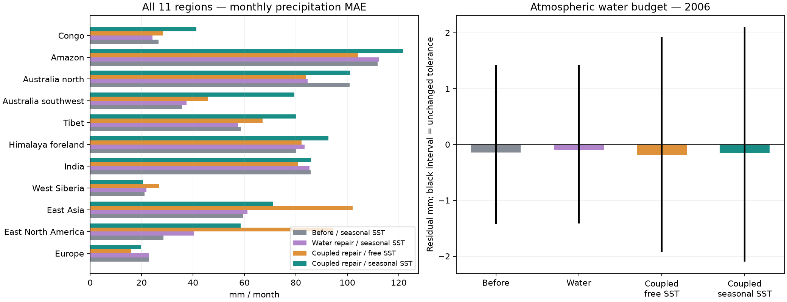

# 湿过程守恒与季风机制修复：实跑结果

三天终点、年度及全程水量收支通过原门槛，但印度和北澳季风仍未修好；规定海温联合组11区中9区月降水MAE高于旧组，因此不替换正式默认。启动日内仍有中间时刻残差，不能称为逐步完全闭合。

本轮修复四个机制问题：雨滴再蒸发与空气增湿不相等、干质量固定器连带改变水汽库存、垂直混合的邻层索引失效、地表稳定性判断缺少真实地表温度。它们均由原实现失败的回归测试和过程审计支持，未使用区域降水倍率或观测场回写。正式地球默认配置、原包源码与上一轮证据保持不变。

三组候选从相同的2001年初态真实连续积分至2007年初：T32、3168原生格点、8层、30分钟、105169步，前五年预热，统计2006年。上一轮规定季节海温结果作为冻结基线。各组使用相同GPCC有效陆地支持；2006年模拟与1991–2020观测气候态的比较不能替代多年气候验证。

观测数据：[GPCC v2022 normals 1991–2020 2.5° mm/month](https://opendata.dwd.de/climate_environment/GPCC/gpcc_normals_v2022/normals_1991_2020_v2022_25.nc.gz)。

## 印度与北澳

| 地区／配置 | 年降水 mm | GPCC年量 mm | 峰月／GPCC | 当地夏季占比／GPCC | 月降水MAE mm |
|---|---:|---:|---|---|---:|
| 印度 · 修复前／季节海温 | 168.12 | 1138.06 | 1／7 | 25.6%／67.9% | 85.80 |
| 印度 · 仅修水量／季节海温 | 214.36 | 1138.06 | 3／7 | 23.9%／67.9% | 85.29 |
| 印度 · 联合修复／自由海温 | 546.02 | 1138.06 | 4／7 | 26.0%／67.9% | 80.84 |
| 印度 · 联合修复／季节海温 | 182.91 | 1138.06 | 3／7 | 21.5%／67.9% | 85.90 |
| 北澳 · 修复前／季节海温 | 968.50 | 985.87 | 5／1 | 13.6%／67.0% | 100.89 |
| 北澳 · 仅修水量／季节海温 | 834.14 | 985.87 | 4／1 | 18.9%／67.0% | 84.62 |
| 北澳 · 联合修复／自由海温 | 1161.19 | 985.87 | 5／1 | 25.4%／67.0% | 83.75 |
| 北澳 · 联合修复／季节海温 | 1764.74 | 985.87 | 10／1 | 25.2%／67.0% | 100.98 |

当地夏季按印度JJA、北澳DJF统计。下列四项为预先定义的敏感性筛查，未因结果改变阈值。

| 配置／地区 | 峰月误差≤1月 | 夏季占比≥50% | 年量偏差≤25% | 月MAE下降 |
|---|---|---|---|---|
| 仅修水量／季节海温 · India | 未通过 | 未通过 | 未通过 | 通过 |
| 仅修水量／季节海温 · Australia north | 未通过 | 未通过 | 通过 | 通过 |
| 联合修复／自由海温 · India | 未通过 | 未通过 | 未通过 | 通过 |
| 联合修复／自由海温 · Australia north | 未通过 | 未通过 | 通过 | 通过 |
| 联合修复／季节海温 · India | 未通过 | 未通过 | 未通过 | 未通过 |
| 联合修复／季节海温 · Australia north | 未通过 | 未通过 | 未通过 | 未通过 |

## 水量与质量

三天启动门槛保持 `max(0.05 mm, 0.001×(|E|+P))`，不通过时也保留原值。

| 配置 | 三天大气水残差 mm | 门槛 mm | 结果 | 最差中间时刻残差 mm |
|---|---:|---:|---|---:|
| 修复前／季节海温 | -0.105793 | 0.05 | 未通过 | -0.288436 |
| 仅修水量／季节海温 | 0.008579 | 0.05 | 通过 | -0.196655 |
| 联合修复／自由海温 | -0.006369 | 0.05 | 通过 | -0.219778 |
| 联合修复／季节海温 | -0.006083 | 0.05 | 通过 | -0.220164 |

终点通过不表示每一步闭合；启动日内误差逐步保留在原始审计中，没有补加全局湿度残差项。干空气固定器现在保持每格每层 `p*q` 不变，其压力和显热影响仍单独记账。

| 配置 | 2006水残差／门槛 mm | 六年水残差／门槛 mm | 年度／全程通过 | 干质量最大相对误差 | 2006陆地水残差 mm |
|---|---:|---:|---|---:|---:|
| 修复前／季节海温 | -0.146783／1.421 | -1.024845／8.316 | 通过／通过 | 1.55e-15 | -3.18e-12 |
| 仅修水量／季节海温 | -0.103280／1.418 | -0.493055／8.344 | 通过／通过 | 1.55e-15 | -7.30e-13 |
| 联合修复／自由海温 | -0.186039／1.919 | -1.002099／11.177 | 通过／通过 | 1.55e-15 | 8.38e-13 |
| 联合修复／季节海温 | -0.154482／2.098 | -0.810897／12.372 | 通过／通过 | 1.55e-15 | 5.24e-13 |

## 地表与大气耦合诊断

这些是实际月均字段的按月份秒数加权结果。最低层为σ=0.9375，不能当作2米温度；地表减最低气层温差不是近地面梯度的直接观测。旧组缺失的诊断记作“—”。

| 配置／当地夏季 | 地表温度 K | 最低层温度 K | 温差 K | 最低层比湿 g/kg | 最低层RH | 垂直混合发生率 | 陆地蒸发 mm/d |
|---|---:|---:|---:|---:|---:|---:|---:|
| 修复前／季节海温 · India | 311.27 | 284.33 | 26.94 | 6.03 | — | — | — |
| 仅修水量／季节海温 · India | 311.00 | 283.99 | 27.00 | 6.02 | — | — | 0.50 |
| 联合修复／自由海温 · India | 300.55 | 287.13 | 13.43 | 7.74 | 69.3% | 14.7% | 1.18 |
| 联合修复／季节海温 · India | 306.81 | 290.74 | 16.07 | 8.62 | 61.2% | 17.3% | 0.38 |
| 修复前／季节海温 · Australia north | 309.56 | 283.61 | 25.95 | 6.03 | — | — | — |
| 仅修水量／季节海温 · Australia north | 308.00 | 283.32 | 24.67 | 5.99 | — | — | 1.13 |
| 联合修复／自由海温 · Australia north | 298.57 | 287.19 | 11.38 | 8.05 | 73.4% | 9.5% | 2.59 |
| 联合修复／季节海温 · Australia north | 296.50 | 287.45 | 9.05 | 8.37 | 75.0% | 2.9% | 3.11 |

## 其余地区回归

以下比较联合修复与修复前，均为规定季节海温；MAE变化为“新减旧”，正数表示退化。全部11区列出，不以平均改善掩盖单区问题。

| 地区 | 修复前月MAE mm | 联合修复月MAE mm | MAE变化 mm | 修复前年量 mm | 联合修复年量 mm | GPCC年量 mm |
|---|---:|---:|---:|---:|---:|---:|
| Europe | 22.93 | 19.82 | -3.10 | 621.13 | 899.52 | 792.09 |
| East North America | 28.57 | 58.47 | 29.89 | 1316.21 | 1757.57 | 1055.99 |
| East Asia | 59.49 | 71.02 | 11.53 | 1257.15 | 1534.13 | 693.91 |
| West Siberia | 21.20 | 20.54 | -0.66 | 196.95 | 204.83 | 451.33 |
| India | 85.80 | 85.90 | 0.10 | 168.12 | 182.91 | 1138.06 |
| Himalaya foreland | 79.96 | 92.65 | 12.68 | 557.52 | 426.42 | 1120.42 |
| Tibet | 58.62 | 80.11 | 21.49 | 1144.29 | 1404.92 | 443.54 |
| Australia southwest | 35.79 | 79.45 | 43.67 | 721.35 | 1442.47 | 489.04 |
| Australia north | 100.89 | 100.98 | 0.09 | 968.50 | 1764.74 | 985.87 |
| Amazon | 111.84 | 121.58 | 9.74 | 922.57 | 805.74 | 2264.66 |
| Congo | 26.62 | 41.34 | 14.72 | 1236.16 | 899.30 | 1385.30 |

## 验证与边界

- 凝结18项、保水干质量12项、地表交换152项、垂直扩散240项回归通过；同源物理下一步两种海温模式均逐位一致。全仓库278项测试与类型检查通过。
- 四组只读回放显示真实2006月均场，探针保留原始数值，不受颜色饱和影响。48×24展示重映射不改变T32动力分辨率，独立land-mask重映射检查保持原生陆地降水积分。GPCC主比较沿用上一轮口径：先把未mask降水重映射为父格均值，再取固定GPCC有效陆地支持；该区域取样不等同于原生陆地mask积分。陆面诊断也使用相同父格支持，沿海可能混合原生陆海格点；地表温差用于粗格机制诊断，不能当作纯陆地观测。
- 检查点没有序列化统计Observer，边界层组件由相同源码重建；只能声明同源物理下一步复现，不能声明统计断点续跑或跨版本重启。三次六年实验全部连续运行。
- 混合系数保留原生基于边界层顶Ri的稳定抑制近似，并非完整Frierson复现；未提供独立海冰皮肤温度或有限海冰水量／潜热库存。因此没有完整地球水量或能量闭合的结论。
- 规定海温使用原包的12个月气候态和月中心插值，其观测基准期尚未核验；不是2006年逐日实况。单年敏感性结果不升级为气候模型验收；正式默认保持不变。

物理依据：[Frierson等（2006）原文](https://www.gfdl.noaa.gov/bibliography/related_files/dmwf0601.pdf)，区分式15地表参考与式16最低气层参考。实现仍基于SpeedyWeather 0.23.0，派生代码保留EUPL来源声明和许可证。

[实现说明](implementation-notes.md) · [独立审查](physics-review.md) · [机器结果](acceptance.json) · [完整性校验](final-verification.json) · [文件清单](manifest.json)
