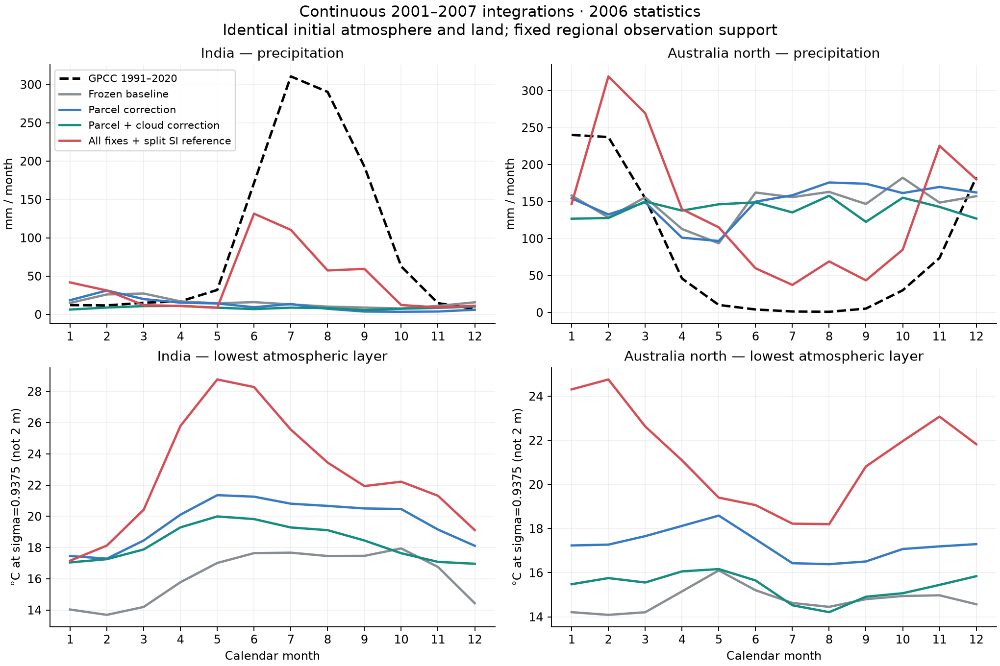
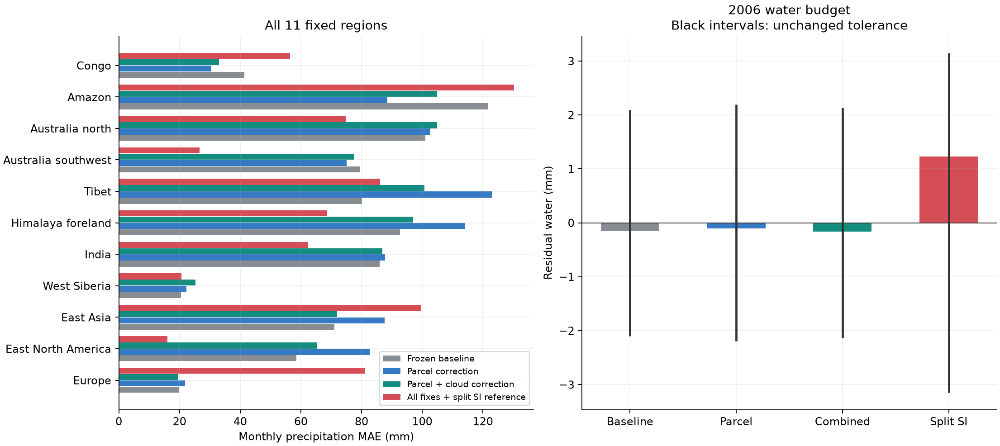
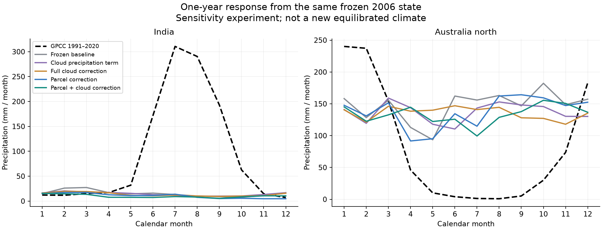
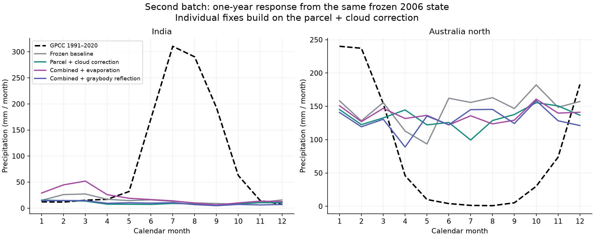
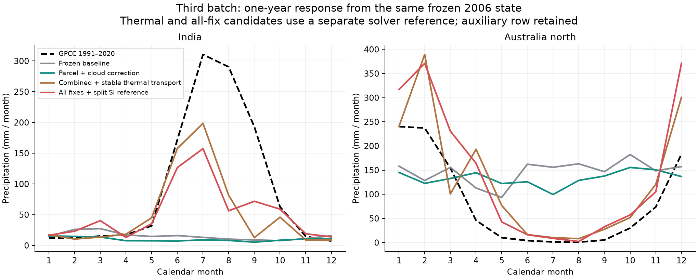
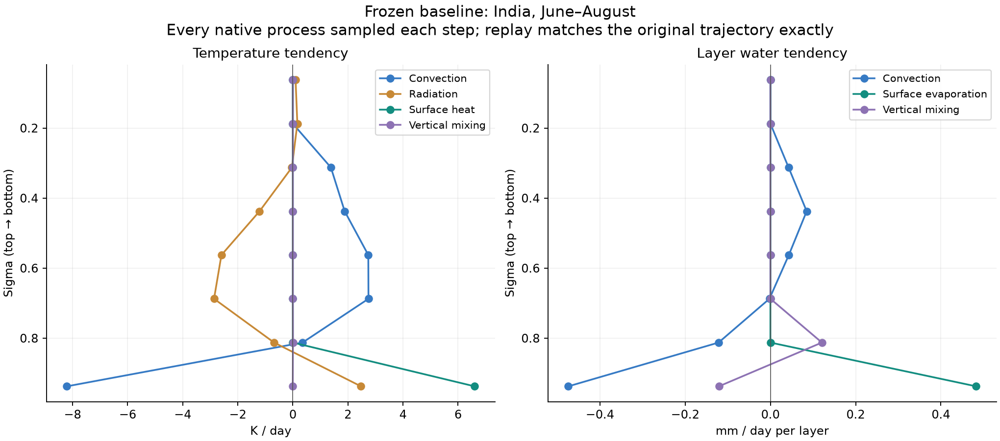
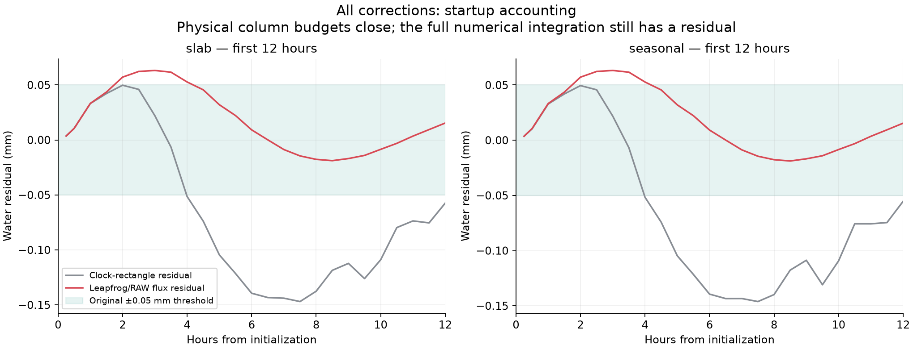
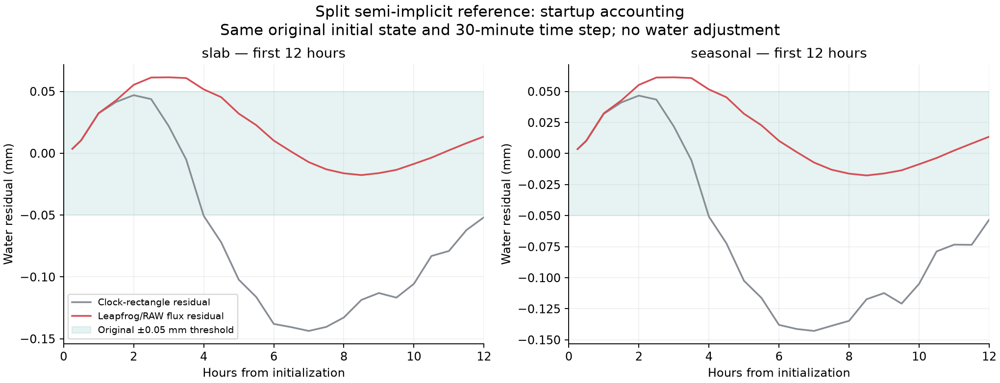
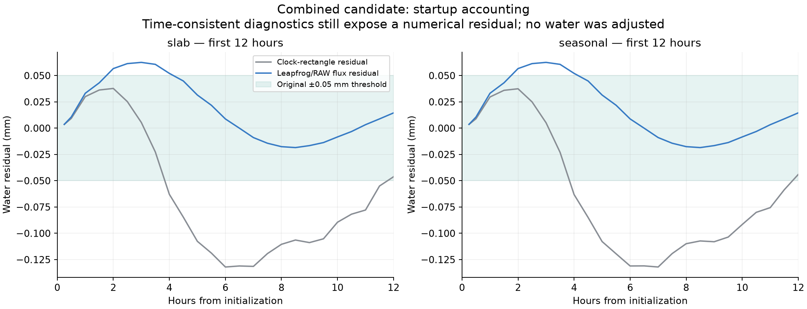
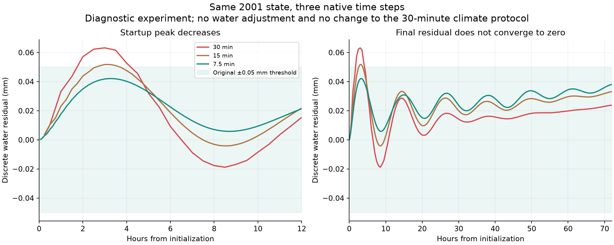

# 湿物理、热力输送与水量账本：继续修复记录

本轮先检查气块抬升、云量、背景温度输送及其半隐式配对、陆面蒸发和灰体长波反射，并把启动水量峰值分解到原生离散操作。第二批热力方案在长期运行中失稳，随后另建第三批候选，分开动力参考温度与半隐式求解参考温度。实现检验通过不能代替季风验收；固定区域的降水结果和失败门槛全部列在下方。正式地球默认和上一轮冻结证据保持不变。

**第三批六年积分已完成，源码与输入均保持原散列。** 印度年雨 496.05 mm，当地夏季占 60.3%，峰 6 月，四项季风门槛通过 3/4。北澳年雨 1690.35 mm，当地夏季占 38.2%，峰 2 月，四项季风门槛通过 2/4。固定 11 区中 6 区月 MAE 高于上一轮。两地完整季风门槛没有同时通过，不能据此推广默认模型。年水量预算通过也不能代替启动每步 0.05 mm 门槛。

**第二批长期运行的失败记录仍完整保留。** 以下运行停止后未产生完整年度结果，不进入气候验收表；保留其原始日志和同初态输出用于复现。第三批结果单独列出，不以新版本完成覆盖旧版本的失败。月进度是最后已记录时刻，不一定是具体失败时刻。

| 运行 | 最后月进度 | 退出码 | 错误 |
|---|---|---:|---|
| implicit-sensitivity | 2006-02-01T00:00:00 | 1 | ERROR: LoadError: ArgumentError: virtual temperature must be positive |
| all-corrections-sensitivity | 2006-03-01T00:00:00 | 1 | ERROR: LoadError: ArgumentError: virtual temperature must be positive |
| all-corrections-seasonal | 2002-02-01T00:00:00 | 1 | ERROR: LoadError: ArgumentError: virtual temperature must be positive |

## 完整六年积分

已完成 3 组，均从相同冻结 2001 初态真实连续积分至 2007-01-01，T32、8 层、30 分钟、五年预热，最后一个完整年度统计。基线是上一轮连续积分，本轮无改动重启分支已逐值复现其 2006 结果。

| 配置 | 印度年雨 mm | JJA占比 | 峰月 | 月MAE mm | 四项通过数 | 北澳年雨 mm | DJF占比 | 峰月 | 月MAE mm | 四项通过数 |
|---|---:|---:|---:|---:|---:|---:|---:|---:|---:|---:|
| 上一轮基线 | 182.91 | 21.5% | 3 | 85.90 | 0/4 | 1764.74 | 25.2% | 10 | 100.98 | 0/4 |
| 仅气块抬升 | 146.66 | 20.6% | 2 | 87.72 | 0/4 | 1785.39 | 25.2% | 8 | 102.71 | 0/4 |
| 气块＋云量 | 101.95 | 23.5% | 4 | 86.87 | 0/4 | 1678.28 | 22.7% | 8 | 104.86 | 0/4 |
| 第三批分离隐式参考 | 496.05 | 60.3% | 6 | 62.37 | 3/4 | 1690.35 | 38.2% | 2 | 74.71 | 2/4 |

完整季风门槛通过 0/3 组。各地区的单项通过数保留，未以平均改善掩盖失败项。

四项沿用原门槛：峰月距观测不超过一月、当地夏季降水占全年至少 50%、年雨量相差不超过 25%、月 MAE 低于冻结的 `before-seasonal` 基线。观测印度 1138.06 mm、峰 7 月；北澳 985.87 mm、峰 1 月。此处的观测是 GPCC 1991–2020 月气候态，并非 2006 实况。

| 区域 | 上一轮月MAE | 仅气块抬升月MAE | 气块＋云量月MAE | 第三批分离隐式参考月MAE |
|---|---:|---:|---:|---:|
| Europe | 19.82 | 21.81 | 19.53 | 81.12 |
| East North America | 58.47 | 82.74 | 65.16 | 16.03 |
| East Asia | 71.02 | 87.64 | 71.88 | 99.57 |
| West Siberia | 20.54 | 22.31 | 25.32 | 20.69 |
| India | 85.90 | 87.72 | 86.87 | 62.37 |
| Himalaya foreland | 92.65 | 114.19 | 97.06 | 68.64 |
| Tibet | 80.11 | 123.02 | 100.80 | 86.12 |
| Australia southwest | 79.45 | 75.07 | 77.52 | 26.68 |
| Australia north | 100.98 | 102.71 | 104.86 | 74.71 |
| Amazon | 121.58 | 88.54 | 104.88 | 130.23 |
| Congo | 41.34 | 30.52 | 32.98 | 56.48 |

以上误差单位为 mm/月；与上一轮 `coupled-seasonal` 对比，与季风 MAE 门槛使用的更早 `before-seasonal` 不同，机器结果同时保留两种差值。

## 相同 2006 初态的一年响应

| 配置 | 印度年雨 mm | JJA占比 | 峰月 | 月MAE mm | 四项通过数 | 北澳年雨 mm | DJF占比 | 峰月 | 月MAE mm | 四项通过数 |
|---|---:|---:|---:|---:|---:|---:|---:|---:|---:|---:|
| 上一轮基线 | 182.91 | 21.5% | 3 | 85.90 | 0/4 | 1764.74 | 25.2% | 10 | 100.98 | 0/4 |
| 仅云降水项 | 172.47 | 19.9% | 2 | 84.78 | 1/4 | 1642.34 | 23.8% | 3 | 99.67 | 1/4 |
| 完整云量 | 162.09 | 20.4% | 2 | 85.37 | 1/4 | 1627.15 | 24.4% | 6 | 98.66 | 1/4 |
| 仅气块抬升 | 125.98 | 25.9% | 3 | 86.06 | 0/4 | 1651.92 | 26.1% | 9 | 94.15 | 1/4 |
| 气块＋云量 | 118.12 | 20.6% | 1 | 86.59 | 0/4 | 1601.88 | 25.2% | 10 | 97.59 | 1/4 |
| 气块＋云量＋陆面蒸发 | 253.33 | 15.9% | 3 | 90.54 | 0/4 | 1645.89 | 25.5% | 10 | 96.42 | 1/4 |
| 气块＋云量＋灰体反射 | 115.79 | 23.4% | 2 | 86.04 | 0/4 | 1560.33 | 24.4% | 10 | 98.31 | 1/4 |
| 第三批分离隐式参考 | 632.34 | 53.8% | 7 | 51.35 | 3/4 | 1718.94 | 61.6% | 12 | 61.09 | 3/4 |
| 气块＋云量＋稳定热力分支 | 618.41 | 70.8% | 7 | 46.82 | 3/4 | 1535.48 | 60.6% | 2 | 54.75 | 3/4 |

9 组起始大气／陆地库存哈希相同，各运行 17,520 步，保留原两个 Leapfrog 时间层与干质量目标。第一批分离气块和云量改动；第二批以第一批组合为基础，分别增加蒸发、成对热力和全部修复。它们包含从旧平衡态调整的瞬态，不能称为新平衡气候。

一年分支的峰月与夏季占比改善，不等于逐月曲线已经准确；印度 8 月仍仅约 56.3 mm，固定 GPCC 气候态约 290.3 mm。组合方案包含多项改动，不能单独归因于半隐式参考；另用冻结入口的稳定热力分支作机制对照。区域温湿风、陆面水量和辐射的独立分析见 [第三批一年气候复核](v3-climate-review.md)，附加分支的选择依据见 [热力对照记录](thermal-split-selection.md)。

机制对照在第一批气块＋云量基础上加入热力配对和分离求解参考，尚未加入新的露水及长波反射修复，也出现了两地各 3/4 的季风响应。因此改善并不依赖后两项同时存在，但不能用单条混沌轨迹计算各修复的因果贡献百分比。印度 8、9 月仍仅 81.48、12.59 mm，对照气候态 290.32、192.90 mm；夏季占比提高也不能替代完整逐月验收。该分支 TOA 净输入已经是 -56.42 W/m²，较大的辐射失衡不能单独归咎于后加的灰体反射。

## 已修的机制与可复现检查

1. **气块抬升**：旧代码跨 LCL 时将整段当作饱和湿抬升，并用饱和湿度覆盖原水汽，能产生不存在的水。新代码先干绝热抬升到 LCL，再以压力坐标积分饱和段；夹卷后重新判定饱和。原生回归先出现 2 个真实失败，最终 1,497 项通过；独立检查 12,344 次抬升未增水或异常。保留原生 RH、夹卷、调整时间尺度及最终列水／焓预算。它是恒定 cp/Lv、稀薄水汽近似的热力算法替换，并非仅改索引；不使用旧 geopotential 参数。Float32 极暖湿状态的约 1.31 J/kg 焓舍入余项已记录，本轮生产运行均为 Float64。详见 [对流报告](convection-report.md) 和 [独立审查](review-parcel.md)。

2. **云量**：降水 m/s → mm/day 应乘 1000，旧实现却除 1000；修复后平方根云贡献恢复原单位。层积云稳定度用上层减下层干静能并除以位势差，恢复无量纲 G，保留原阈值。原生相同测试 16 个失败；仅降水项 117/117、完整修复 119/119 通过，实际原生辐射列能量闭合到约 5.7e−14 W/m²。`cloud_cover` 不包含另存的层积云，不能作为总云量解释。详见 [云量报告](cloud-report.md)。

3. **无干预复放证明**：完整逐过程诊断复放 17,520 步，12 个月雨量和温／湿／东西风／南北风与原连续积分最大差 0；无物理改动的新统计入口又比较 2,851,224 个已存数值，最大差 0。因此诊断本身没有修改轨迹。

4. **温度输送与半隐式配对**：原生核从温度中减去参考剖面后只平流扰动，缺少背景温度平流；其线性温度算子的层厚系数和界面使用也不等于原生完整核的雅可比。成对恢复背景平流并构造一致 L，不改湿度或压力库存。1,134 项通过，独立随机层结构的原生核误差约 5.2e−14。2006 分支保留原 2001 参考温度并重建 L/S，未用新平均温度重设参考。关闭隐式时仍保留背景平流修复，不是完整显式对照。见 [热力报告](implicit-followup.md)、[独立审查](review-implicit.md)。

5. **陆面蒸发与露水**：保留正蒸发算法 `max(alpha*qs-q,0)`；当空气湿度确实超过地表饱和值时，允许 `qs-q` 真实露水。旧扩展在暖面未饱和时也会因土壤可用指数产生负通量。现实土壤存在吸附，本模型的 bucket 未表示吸附水势或能量，因此这里恢复其正蒸发语义并限定液态露水条件。原生 13 个失败，修复后包括雪衰减和混合陆海水热账共 346 项通过。见 [蒸发报告](surface-evaporation-report.md)、[交叉审查](review-evaporation.md)、[环流诊断](circulation-followup.md)。

6. **灰体长波地表反射**：补上 `(1-epsilon)*下行长波` 的反射，沿原透过率向上传播并记入大气吸收和顶层出流。发射率和光学厚度未调；黑体极限逐值等同原生。原生 26 个失败，修复后 175 项通过。固定温度下该修复增加出射长波，不能作为抵消云短波冷却的调参。见 [辐射报告](radiation-followup.md)。

## 第二批失稳与第三批候选

两次一年分支已逐值重现首次非正温度，分别在 2006-02-28 05:30 和 2006-03-06 17:30 的北太平洋中层。首次坏点的物理倾向是加热；进入最终更新前，动力候选温度已经为负。两个 Leapfrog 时间层的温度振荡和垂直速度先增长，因此不能靠裁掉负温度解决。原探针的垂直 Courant 数使用 3600 秒双步跨度，按常规 30 分钟定义须除二；并不把后期越界倒推为最初原因。见 [逐步失稳复现](implicit-instability-report.md)。

独立的实际剖面线性化发现，原参考下 SI、RAW 和原生水平扩散的组合可放大负计算模态，即使对应的连续干动力系统中性。故障前健康检查点也出现这种增长。等温参考消除了所检查的强负模态，但扫描仍有少量弱复模态；这不是无条件稳定的证明，也不能单凭局部干系统解释全部非线性过程。第三批采用原大气组件已有的 288 K 等温求解参考，保留原动力参考，并补齐压力线性项的两个时间层配对。两个真实 48 小时窗口各完成 96 步并跨过原失败时刻，全窗最低温分别 186.64 / 192.78 K，最大名义垂直 Courant 数 0.1261 / 0.1090。与第二批已修正的完整物理动力倾向相比，短窗对照逐位一致。新鲜启动还单独修正了参考刷新的时机，最终候选自测 651 项通过；同一旧轨迹影子参考的三个启动阶段最大差均为零。全年及六年结果按新标签分别列在上方。见 [候选与短窗报告](implicit-split-report.md)、[独立稳定性审查](physics-implicit-instability-review.md) 和 [第三批协议](v3-protocol.md)。

另已查清一个独立的初态问题：T32 标量的最后辅助谱行在原生地形压力初始化中非零，原生水平扩散只清该行倾向，时间推进会一直保留初值。有效标量是 degree 0–31，辅助 degree 32 不能算进有效系数比较。只在副本中清压力辅助行，即可消除本次压力梯度的 curl / Laplace 恒等式误差；质量约束没有生成这些系数。这解释了此前改变动力参考时的离散不变性失败，不单独证明它导致长期失稳。第三批纯隐式参考试验保留原辅助行；初态投影另建派生状态、库存账和对照，不能混入同一实验。见 [辅助谱行来源审查](readonly-reference-review.md)。

独立初态投影 helper 的主检查 112 项和保存后重载 8 项通过，所有有效谱系数逐位保持。旧格点包含 RAW 前的历史，不能从已滤波的旧谱直接覆盖；2006 旧湿度历史无法追溯的部分保留到下一次自然轮转。派生 2001 状态的两种海温模式各运行三天，五标量两个谱层的辅助行全程为零。导入水变化 −1.7578e−6 mm 单列，干质量目标因派生初态增加约 5.6970e−5 kg/m²；不能声称初态 SHA 或全部控制量未变。

| 派生初态模式 | 三天离散峰 mm | 超原0.05mm步数 | 三天离散终点 mm |
|---|---:|---:|---:|
| slab | 0.06139592 | 5/145 | 0.02107169 |
| seasonal | 0.06138823 | 5/145 | 0.02121104 |

辅助行约束得到维持，但启动水量峰没有消除；它不是原 0.061 mm 余项的修复。见 [投影接口与保存验证](scalar-initial-projection.md) 和 [原始／派生初态逐步对照](scalar-initial-projection-audit.md)。

旧基线印度 JJA 平均雨量仅 0.427 mm/day，浅对流占 85.8%、深对流 9.0%。对流对底层施加约 -8.21 K/day 温度倾向，地表显热提供约 +6.60 K/day。它表明旧错误参与了持续的垂直热量重分配；不等于修复后必然产生正确季风。旧 7 月瞬时状态上的修正气块诊断几乎全部无浮力，是瞬时反事实，不能当作修复后的全年频率。

## 水量结果：物理列闭合与数值核心分开

新合并候选两种海温模式各从原始初态运行三天。物理倾向逐过程与 E−P 闭合，但完整光谱动力积分仍有启动余项。原时钟矩形账本和相同 Leapfrog/RAW 离散账本同时保留；只改诊断，未调整任何水库存。

| 模式 | 物理残差最大 kg/m²/s | 三天矩形余项 mm | 三天离散余项 mm | 离散最大绝对余项 mm | 超原0.05mm步数 |
|---|---:|---:|---:|---:|---:|
| slab | 2.71e-20 | -0.011802 | 0.011046 | 0.062542 | 5/145 |
| seasonal | 4.07e-20 | -0.014112 | 0.011273 | 0.062535 | 5/145 |

第二批全部修复的同初态三天结果：

| 模式 | 物理残差最大 kg/m²/s | 三天矩形余项 mm | 三天离散余项 mm | 离散最大绝对余项 mm | 超原0.05mm步数 |
|---|---:|---:|---:|---:|---:|
| slab | 4.24e-20 | -0.013960 | 0.023618 | 0.063190 | 5/145 |
| seasonal | 4.07e-20 | -0.012138 | 0.023775 | 0.063182 | 5/145 |

第三批分离隐式参考的同初态三天结果：

| 模式 | 物理残差最大 kg/m²/s | 三天矩形余项 mm | 三天离散余项 mm | 离散最大绝对余项 mm | 超原0.05mm步数 |
|---|---:|---:|---:|---:|---:|
| slab | 4.74e-20 | -0.013076 | 0.021094 | 0.061369 | 5/145 |
| seasonal | 5.42e-20 | -0.009894 | 0.021292 | 0.061361 | 5/145 |

上一轮约 −0.22 mm 的峰值主要来自两种时间口径的差，原生逐操作归因严格重建库存；真实剩余峰值主要与半隐式压力改变压力加权湿质量有关。全步守恒尚未通过，不能拿三天终点通过来代替。见 [启动详细归因](startup-report.md)。

进一步的无源短例关闭全部物理、质量约束和海温回调，从导入库存单独记账的合法投影初态运行原生三步。空气增加约 2.1641 kg/m²、水增加 0.0323236 mm；三个时刻的湿度裁剪均为零，辅助谱行也保持为零。因此该例不能归咎于 E−P、辅助行或负湿度裁剪，但它不等于耦合三天峰值的完整归因。

另建共同空气质量 M 与水质量 Q 的无源原型，通过 92 项守恒／常量示踪机制检查及 34 项双时间层库存复核；接入现有模型的压力一致性、正性和谱回投三类门槛仍有 9 项失败。原型仅作影子计算，未写回第三批模型。下一步需要协调压力连续性／半隐式步骤、Q 时间层和重启、共享输送、物理水源与总／干气质量定义、正性及重映射，不能用全局补水或只换湿度 wrapper 达成。见 [原型与失败证据](wet-carrier-report.md) 和 [独立接口审查](physics-moisture-carrier-review.md)。

| 配置／阶段 | 年大气水残差／原容限 mm | 年陆水残差 mm | 年干质量相对差 |
|---|---:|---:|---:|
| 上一轮基线／一年分支 | -0.154482／2.098 通过 | -6.43e-13 | 1.78e-15 |
| 仅云降水项／一年分支 | -0.191200／2.046 通过 | 3.81e-13 | 4.44e-16 |
| 完整云量／一年分支 | -0.189653／2.024 通过 | -6.78e-13 | 0.00e+0 |
| 仅气块抬升／一年分支 | -0.098982／2.201 通过 | -4.41e-13 | 6.66e-16 |
| 气块＋云量／一年分支 | -0.139825／2.131 通过 | 1.95e-12 | 1.33e-15 |
| 气块＋云量＋陆面蒸发／一年分支 | -0.174256／2.169 通过 | -1.31e-13 | 1.55e-15 |
| 气块＋云量＋灰体反射／一年分支 | -0.148383／2.073 通过 | -1.73e-12 | 4.44e-16 |
| 仅气块抬升／六年积分统计年 | -0.107116／2.191 通过 | 7.33e-12 | -1.67e-15 |
| 气块＋云量／六年积分统计年 | -0.158724／2.133 通过 | -2.05e-12 | 6.66e-16 |
| 第三批分离隐式参考／一年分支 | 1.368046／3.181 通过 | -1.27e-12 | 8.88e-16 |
| 气块＋云量＋稳定热力分支／一年分支 | 1.780735／3.157 通过 | 6.61e-13 | 8.88e-16 |
| 第三批分离隐式参考／六年积分统计年 | 1.232598／3.150 通过 | -1.03e-12 | 4.44e-16 |

完整六年（含五年预热）累计预算：

| 配置 | 大气水余项／原容限 mm | 陆水余项 mm | 干质量相对差 |
|---|---:|---:|---:|
| 仅气块抬升 | -0.551185／12.855 通过 | 1.97e-11 | -7.77e-16 |
| 气块＋云量 | -0.900982／12.491 通过 | 9.46e-12 | 4.44e-16 |
| 第三批分离隐式参考 | 7.908366／18.721 通过 | 1.82e-11 | 4.44e-16 |

另行进行的 30/15/7.5 分钟三天季节海温试验用于检查时间离散敏感性，不替换上述 30 分钟气候协议。峰值下降不等于残差严格趋零，结果与共同采样检查见 [时间步报告](timestep-convergence-report.md)。

长期验收沿用旧矩形口径 `max(0.05 mm, 0.001*(|E|+P))`，未用新的离散账本替换原门槛。土壤深排水、径流、雪上限流出继续单列；固定干质量是数值约束，不能称为保守湿动力核心。

## 辐射与适用边界

| 配置 | 全球反射短波 W/m² | 全球TOA净输入 W/m² | 全球降水 mm/day |
|---|---:|---:|---:|
| 上一轮基线／一年分支 | 114.22 | -15.42 | 2.873 |
| 仅云降水项／一年分支 | 146.56 | -41.18 | 2.805 |
| 完整云量／一年分支 | 146.86 | -41.33 | 2.774 |
| 仅气块抬升／一年分支 | 113.22 | -9.40 | 3.015 |
| 气块＋云量／一年分支 | 143.68 | -34.47 | 2.922 |
| 气块＋云量＋陆面蒸发／一年分支 | 144.79 | -34.58 | 2.973 |
| 气块＋云量＋灰体反射／一年分支 | 142.60 | -34.56 | 2.842 |
| 仅气块抬升／六年统计年 | 108.64 | -4.66 | 3.001 |
| 气块＋云量／六年统计年 | 140.76 | -30.65 | 2.920 |
| 第三批分离隐式参考／一年分支 | 141.42 | -57.18 | 4.354 |
| 气块＋云量＋稳定热力分支／一年分支 | 141.21 | -56.42 | 4.321 |
| 第三批分离隐式参考／六年统计年 | 139.84 | -55.64 | 4.316 |

全球净辐射并未因此自动趋零。当前短波云量耦合了原包 Frierson 灰体长波，其长波光学厚度按纬度与 sigma 规定，不响应水汽或云；这是理想化配置限制，不是完整 Fortran SPEEDY 辐射。规定 SST 外部供热继续明确计账，不能把模式运行稳定当作完整能量闭合。模型仍没有有限海冰水量／潜热库存，也没有可续跑统计 Observer 的完整检查点。采用原包 12 个月海温气候态，其观测基准期未核验；不是逐日实况海温。

区域雨量比较沿用未mask原生场 → 48×24 父格均值 → 固定 GPCC 有效陆地支持；不是原生纯陆水量积分。附加原生陆地重加权与海洋诊断仅用于机制判断，分别标注。月均 qv 通量由瞬时 p*q*v 累积，未用月均乘积冒充；区域平均通量向量本身也不等于水汽辐合。

## 运行与完整性

首次 `baseline-sensitivity` 与 `clouds-full-sensitivity` 在首日主动终止：发现从恢复网格重新计算干质量目标产生约 7e−12 kg/m² 舍入差，会使无改动混沌轨迹分叉。改为恢复原目标后以 `-v2` 重跑，旧终止日志保留、不用作气候结果。其余运行源码和输入各有 before/after 散列、退出码及源码快照。早先启动的逐过程 replay 未应用后来增强的 launcher 自身／输入散列功能，不追认该功能；它有原 collector 递归源码绑定及逐值复现证明。

[机器比较](sensitivity-comparison.json) · [区域状态](candidate-fields.json) · [基线复放验证](baseline-replay-verification.json) · [旧证据保全](preservation-verification.json) · [长积分选择](candidate-selection.md)

[最终文件清单](manifest.json) · [完整性与科学门槛分列核验](verification.json) · [独立验收审查](final-review.md)
