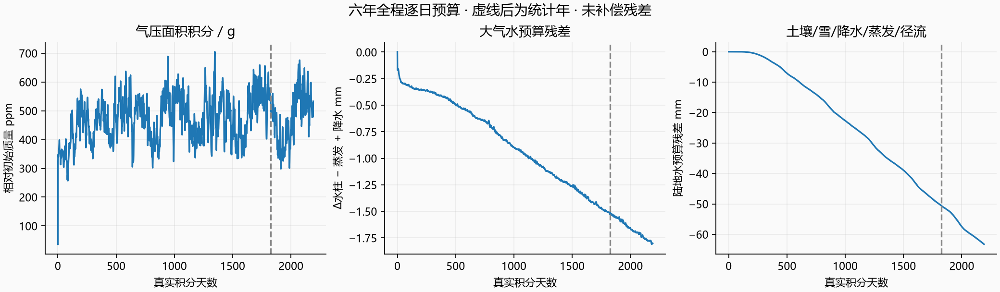
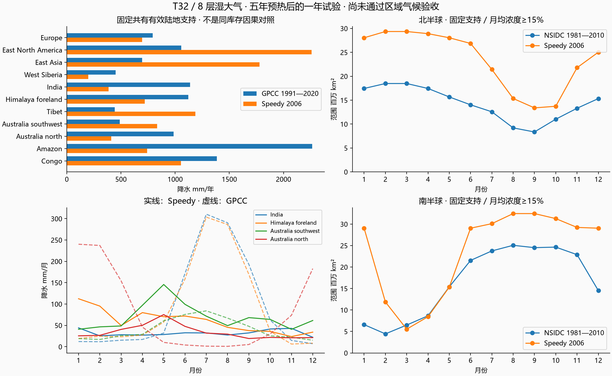
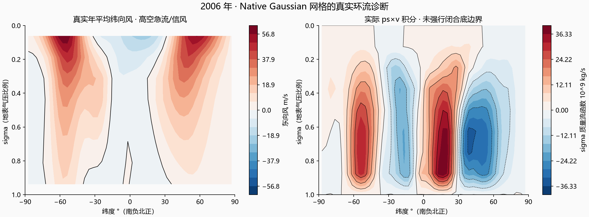

# SpeedyWeather T32 / 8 层湿大气：独立真实积分试验

已完成真实积分、预算检查、GPCC/NSIDC 固定支持对照和独立月平均回放。**正式默认保持原字节，实验尚未通过区域气候与完整水热闭合验收。** 新模型的多层大气、土壤、板块海洋初值与旧模型库存定义不同；这里不是旧/新同库存因果对照，不能将差异全部归因于动力核。

## 实验与可复现性

- 官方 Julia 1.12.7，SpeedyWeather 0.23.0 注册版本，独立 depot / Project / Manifest，CPU Float64，2 Julia threads / 1 BLAS thread，固定随机种子 20261012。
- 官方版本 API `truncation=32`（该版本计入 degree 0，最大球谐 degree 31），8 个 sigma 层，3168 个 Octahedral Gaussian 格点；时间步 1800 s，前两个启动步各推进 900 s。
- PrimitiveWetModel 原生 Earth 地形/陆海掩膜、默认物理参数化、50 m SlabOcean、ThermodynamicSeaIce、两层土壤和雪。海温气候态只用于初始状态，之后真实积分；没有按月重设海温/湿度/温度或区域降水修正。这个海洋配置没有水平海洋热输送。
- 从 2001-01-01 连续积分至 2007-01-01：五个公历年预热，然后统计完整非闰年 2006。共 105169 次实际求解器回调，约 23.6 分钟；模型时钟、起止库存、每日预算与月场均已保存。五年预热不证明多年平衡气候或分辨率收敛。
- 存档验证：保存 2001-01-02 状态，再算下一步；恢复两步时间层、物理组件、由保存状态重建的位势和平均温度剖面之后，`prognostic / grid / parameterizations` 与不中断下一步逐值完全一致：**true**。首次失败记录保留在 restart-first-failed.json；测试期望对象也改为深拷贝，避免 finalize 改写引用。

固定 producer 的启动哈希在 annual-launch.json；最终 manifest.json 绑定脚本、Project/Manifest、正式场景、Earth 六个 NetCDF 输入、GPCC/NSIDC、旧支持输入、native 月场、存档和回放。raw/ 内保留压缩 native 年度结果、几何、三个原生存档及显示数据。软件测试记录和独立审查分别见 code-verification.json / review.md。

## 预算检查：统计年和六年全程分开

全部采用原生 Gaussian 面积积分；水量 mm 等于 kg/m²，库存/累计量均按全球面积归一。统计年账本在 2006-01-01 精确切分，没有把五年预热通量算入 2006。

| 项目 | 2006 实测 | 预设检查 / 状态 |
|---|---:|---|
| 大气质量面积积分相对变化 | 1.048732e-5 | 门槛 1e-6：未通过 |
| 大气水柱 ΔW − E + P | -0.274948 mm | 门槛 1.595092 mm：通过 |
| 陆地土壤/雪水 ΔW − P + E + runoff | -12.631979 mm | 缺少下层排水独立记账，未标通过 |
| 海洋表面热预算全年残差 | -2.481443e-6 J/m² | 包含冻点截断调整；最大逐步残差 2.367788e-7 J/m² |
| 冻点截断调整的年平均功率 | 5.8170 W/m² | **没有对应有限海冰潜热库存，不能视为完整能量闭合** |

大气全年蒸发 798.010 mm、总雨雪 797.082 mm。TOA 年平均入射 341.25、反射短波 114.35、出射长波 230.28、净辐射 **-3.38 W/m²**；板块海洋平均温度一年变化 0.1003 K。TOA 和气柱显热代理只是诊断，不等于含陆地、动能、位能、水相变的完整总能量预算。

已定位的结构限制：原生压力预报变量是 log(ps)，其零阶 tendency 被设为零，保证平均 log(ps) 的口径并不等于严格保证面积积分 exp(log(ps)) 的空气质量；报告仍按真实 ps/g 库存检查。湿度格点采用 ClipNegatives，Leapfrog 还有滤波/分裂积分；这里未逐项分离水汽残差，不能断言残差都来自某一项。LandBucketMoisture 明确将下层超额水移除，未全部记录到 runoff；报告保留未闭合残差。SlabOcean 没有有限海水质量；ThermodynamicSeaIce 仅有浓度，没有冰厚/质量及独立潜热库。因此不能声称整个地球水库存或含冰总焓闭合，不能直接接替当前有限库存模型。

## GPCC：固定原有效陆地支持

沿用 GPCC v2022 normals 1991–2020 2.5° mm/month、原 11 个区域及原始有效陆地权重；重算的观测年值与旧报告差值均为零。对每个实际大气柱的总雨雪累计量做 Gaussian→48×24 等面积保守映射，保持旧地域支持。近海粗格的新旧陆海掩膜不同：另列 native-land 归一降水、覆盖比例，并单独校验 native 陆地降水体积守恒；没有丢弃失配格点来提高结果。这里只是粗格柱平均，不能解析喜马拉雅狭窄山脊/雨影。

下表每格为 **模型 / GPCC**，单位 mm。DJF 是同一统计年的 12/1/2 月之和，JJA 是 6/7/8 月之和。

| 区域 | 年降水 | DJF | JJA |
|---|---:|---:|---:|
| 欧洲 | 694 / 792 | 133 / 171 | 219 / 239 |
| 北美东部 | 2260 / 1056 | 457 / 203 | 596 / 308 |
| 东亚 | 1779 / 694 | 378 / 45 | 466 / 383 |
| 西西伯利亚 | 199 / 451 | 20 / 68 | 93 / 180 |
| 印度 | 385 / 1138 | 92 / 31 | 92 / 773 |
| 喜马拉雅山前 | 720 / 1120 | 242 / 52 | 181 / 748 |
| 西藏 | 1188 / 444 | 314 / 16 | 351 / 293 |
| 西南澳 | 834 / 489 | 149 / 51 | 220 / 227 |
| 北澳 | 411 / 986 | 74 / 660 | 109 / 6 |
| 亚马逊 | 740 / 2265 | 190 / 752 | 190 / 327 |
| 刚果 | 1054 / 1385 | 262 / 240 | 231 / 281 |

温带四区年降水 MAE **660.1 mm**。旧单层控制年量仅作背景，不作新/旧同库存的效果证明。年度与季节偏差均公开，没有改地区阈值、权重或参数来把结果标为通过。

## NSIDC：实际浓度、固定海域和 15% 阈值

复用 **NOAA/NSIDC G02202 v02r00; NASA Team monthly field (not the merged official CDR)**，变量 `goddard_nt_seaice_conc_monthly`，DOI 10.7265/N55M63M1，1981—2010 月气候态；不是 merged CDR、G02135 native extent CSV 或当前最新版产品。北/南固定共同有效支持为 39.15 / 47.22 百万 km²，排除无数据和极点孔。直接使用原生海冰浓度，不用旧模型的 0.5 m 质量代理；先对月均浓度做 marine-mask 归一映射，再在同网格应用 15% 范围阈值。native Gaussian 面积/范围另存，不能把共同支持范围冒充整个原生半球范围。

| 半球 | 模型年内范围 min—max | min / max 月 | NSIDC min—max | 月范围 MAE |
|---|---:|---:|---:|---:|
| 北半球 | 13.39—29.36 | 9 / 2 | 8.35—18.48 | 9.16 |
| 南半球 | 5.54—32.45 | 3 / 8 | 4.44—25.07 | 7.32 |

单位百万 km²。原生与参考海岸线/陆架定义不同；没有更改参考权重，缺少 native marine 的参考面积也单独列出。这个无水平海洋热输送、无有限冰潜热的配置不构成可直接替换的海冰动力预报。

## 真实环流与地球界面

只读页面：`http://localhost:8001/build/earth-speedyweather/index.html`。复用现有 WebGL 地球 Renderer 和地理底图，单独 bundle 不包含旧 ThermalRuntime/Water/存档控制器，播放只切换 2006 年真实月平均，不在浏览器继续物理积分，不旋转地球；手动拖动/方向键仍可浏览。八层从大气顶端至近地表按 sigma 标注，气压随格点 ps 变化；探针显示原值。颜色和箭头为显示编码，风速颜色 30 m/s 饱和，温度色标越界明确提示。

高细节地形与河流只作地理参考，不能冒充 T32 气候或 Speedy 水文分辨率。降水是该大气柱的雨雪月均率；海冰探针是 marine-normalized 粗格浓度。月中太阳相位只是现有界面照明的日历展示，未写回外部模型时钟。

纬向风和经向质量流函数来自 native 年平均场；流函数由实际 ps×v 和 sigma 厚度自顶向下积分，没有补绘三圈、固定纬带风或强行扣除底边界残留。它是 sigma 坐标的质量流函数，不是固定气压插值。

浏览器实际验证与截图记录见 webgl-verification.json；截图仅验证显示，不代替预算/气候验收。

## 复现命令

在仓库根运行（便携 Julia 与独立 depot 已在 build/earth-speedyweather）：

`node docs/evidence/earth-speedyweather-20261012/run-julia.mjs docs/evidence/earth-speedyweather-20261012/run.jl`

观测后处理必须先打包（climate-diagnostics.ts 使用 TypeScript parameter property，不能直接用 Node 的默认 strip-types 执行源码）：

`node node_modules/esbuild/bin/esbuild docs/evidence/earth-speedyweather-20261012/analyze.mjs --bundle --platform=node --format=esm --outfile=build/earth-speedyweather/analyze.mjs`

`node build/earth-speedyweather/analyze.mjs`

`node docs/evidence/earth-speedyweather-20261012/build-viewer.mjs`

`node docs/evidence/earth-speedyweather-20261012/verify.mjs`

图表由 plot.py 使用既有隔离 plot-libs（本机 Python 3.14）生成。checkpoint_test.jl / diagnostics_test.jl 可同样通过 run-julia.mjs 执行。代码、数值与显示验收产物均附哈希。

固定源码依据：[SpeedyWeather v0.23.0](https://github.com/SpeedyWeather/SpeedyWeather.jl/tree/v0.23.0)，以及 manifest 绑定的本地已安装源码；[GPCC 数据说明](https://www.dwd.de/EN/ourservices/gpcc/gpcc.html)，[NSIDC G02202 v2](https://nsidc.org/data/g02202/versions/2)。
