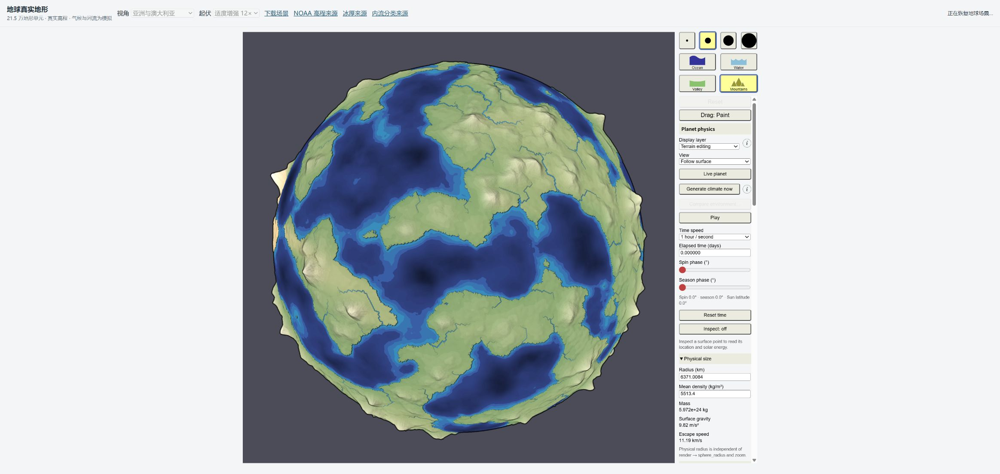
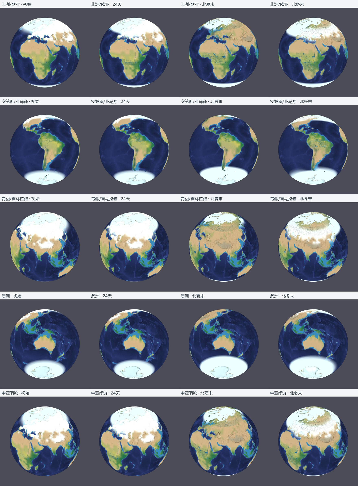
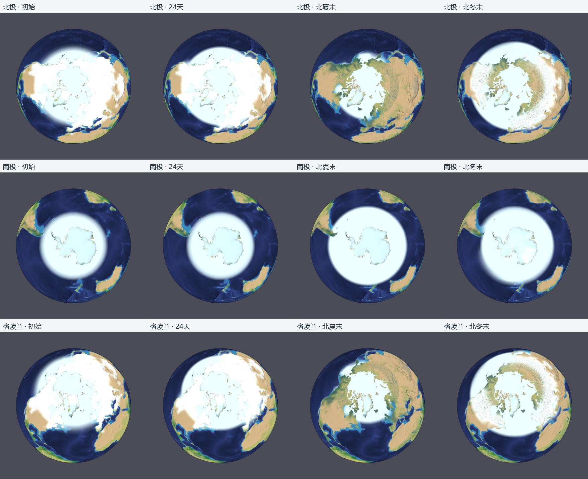
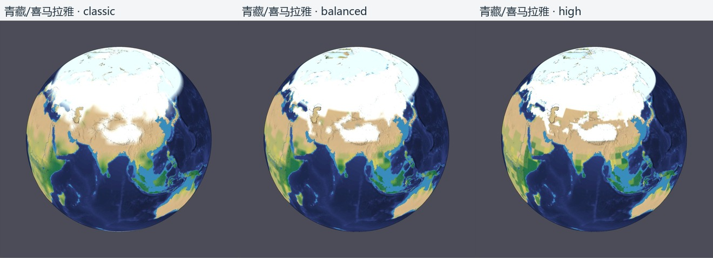
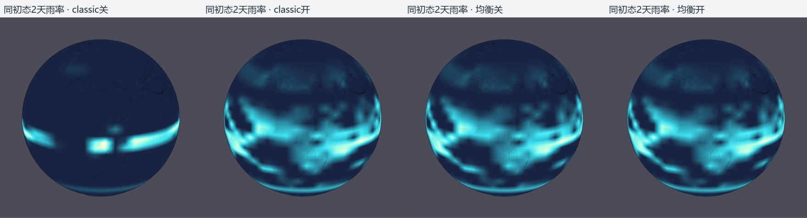
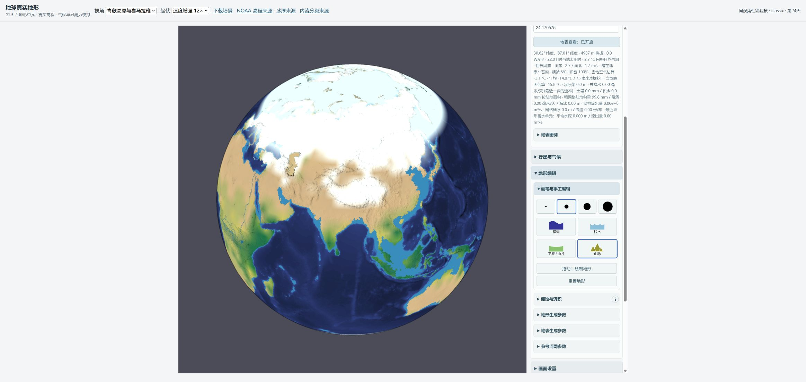

# 地球场景现状复评与下一步工作

2026-10-11，Asia/Shanghai。仓库：`D:/ws/app/mapgen4/mapgen4-sphere`；正式入口：[localhost:8002](http://localhost:8002/scenes/earth-land-sea/index.html)。

**结论：五部分都有实现，但正式默认只采用了海面光照、真实冰库存与三热库、内流河网与有限湖盆。共享水汽和局部精细储层仍应保留为实验。当前最主要的拟真障碍是区域水汽供给与时间收敛、过大的海冰范围与不正确的季节循环，以及粗气柱/局部显示的空间与温度口径差异。继续提高表面精度不会自动修复这些问题。**

本轮仅新增此目录中的评估材料和诊断脚本，重建忽略的 build 产物并启动 8002。未修改业务源码、正式配置、正式存档或旧证据，未提交、推送或发布。8000/8001 未操作；结束时 8000 有另一监听进程、8001 无监听，8002 为此次评估服务。最终页面已回到第0天、暂停、classic、共享水汽关闭。

## 1. 当前基线与证据可信度

本地 main/HEAD 与本轮在线查询的 origin/main 同为 `e3222280a0ceddd597245f3c45d75f75d2def9f5`。开始时工作区干净；结束时只有本证据目录未跟踪。首次访问 8002 为连接拒绝，随后从实际仓库运行 `npm run build` 和 `PORT=8002 node scripts/serve.mjs`。服务器为 localhost、`Cache-Control: no-store`。真实 Chrome 下载的 bundle、worker、version、正式 JSON 均与磁盘字节 SHA-256 相同，排除了旧构建/错误目录/缓存混用。见 [baseline.json](baseline.json)。

正式 `earth-simulation.json` 为 11,364,186 字节，SHA-256：`afb80a8ab730785eed0cb709a66d938ad20a9690b04ecfa1246d1deb393adca6`。它与第五部分实验使用的 baseline 文件字节及 runtime 完全相同。不能沿用第三部分报告的旧正式文件哈希。

重新阅读正式 README 和现实性、海冰光照、冰库存、水汽气候、内流河网、精细储层六份报告，并由独立审阅者重新核对当前源码、配置、存档和观测。README 中部分早期描述及测试数量属于历史阶段；下面的当前结果优先。完整技术复核见 [MODEL-AUDIT.md](MODEL-AUDIT.md)，一手观测与口径见 [OBSERVATION-SOURCES.md](OBSERVATION-SOURCES.md)。

| 本轮重新执行/复核 | 结果 | 能证明的范围 |
| --- | --- | --- |
| `npm test` | 213/213通过，[日志](tests.log) | 当前机制、数据约束和恢复测试；不等于现实气候校准 |
| `npm run typecheck`、`npm run build` | 通过，[类型](typecheck.log)、[构建](build.log) | 当前源码可构建 |
| 当前正式场景 verify | 通过，[日志](verify.log) | 来源、海岸/极区、导入高程及数据结构；高程传递误差约0.00094m是序列化误差，不是空间精度 |
| 实际 Chrome GPU 页面 | 光照20、内流渲染16、风场528项通过 | 当前 GPU 像素/几何机制，见 [光照](gpu-surface-lighting.json)、[内流](gpu-endorheic.json)、[风场](gpu-wind.json) |
| 14份长期 checkpoint | 原 SHA全部匹配；当前严格来源恢复、snapshot、下一1800秒步逐值一致全部通过 | classic/balanced 的0/24/90/180/270/365天、high的0/24天可复用 |
| 新浏览器下载/恢复 | runtime、terrain、view逐值相同；Node来源恢复和下一步一致 | 当前保存恢复通路可用；无放宽水/焓/来源/拓扑检查 |

旧恢复脚本用当前代码重新编译后的 bundle 与旧 bundle 完全相同（`cc7eb0ab…8607a3`）；第五部分 manifest 的10份主来源和已审阅产品文件也匹配。长期结论不是只相信旧报告文字。本轮没有重新耗时积分所有全年组合；复用的是已经证明与当前运行代码及初态一致的连续积分存档。high 缺少全年记录，不能给全年通过结论。

## 2. 五部分状态必须分开判定

| 部分 | 代码存在 | 正式默认采用 | 机制验收 | 地球拟真验收/剩余限制 |
| --- | --- | --- | --- | --- |
| ① 海水/海冰光照 | 是 | 是 | 通过；海面径向法线、可见高度描边消除海床透印；本轮固定海床变化影响像素为0 | 光照修复成功；海冰面积、厚度和季节尚未通过 |
| ② 真实冰库存、空气/陆表/海表三热库 | 是 | 是，`separateReservoirs=true`，GFZ grounded/shelf种子 | 有限千米冰库存、热库分离及预算通过 | 内陆厚冰保留成功；粗热状态、季节海冰、固定DEM下岸线退缩/崩解未通过或未实现 |
| ③ 共享水汽 | 是 | **否**，默认 legacy，UI关闭 | 有限供水、蒸发凝结输送及短期预算通过 | 初始化步长敏感；热带有改善，印度/山地供水及澳洲季节仍失败/未证明修复 |
| ④ 内流河网、有限湖盆 | 是 | 是，正式 drainage、里海166个内湖三角形 | 参考河线内止、有限库存、蒸发/干涸及鞍部溢流通过 | 未导入观测初始湖水位/库容；湖冰仍复用海库，无独立淡水湖热库；Lake Eyre负床面处理仍受旧海岸约定限制 |
| ⑤ 局部精细储层 | 是 | **否**，classic默认，balanced/high实验 | 独立局部热、水、雪冰状态；守恒迁移与严格恢复通过 | 局部高度差异改善；雪块边界、雨影/雪线、粗气柱供水及播放成本仍未通过；high只24天 |

正式可见配置为12×起伏、顶光60、陆/水轮廓3、融合河网开启，门槛1000m³/s、宽度系数0.025、上限边长比例0.35；第0天北方春分季相，跟随地表、每秒1小时、天气粒子关闭。物理高程没有乘12。

真实地形为215,348个三角形；父气候网格只有1152格（48×24等面积），单格约442,766km²。classic的96×49是参考/显示采样；balanced/high显示192×97/384×193，局部储层8922/29418片，最高分片4×4/8×8。空气、水汽和冰川水平输送仍依赖粗父格。地形平均三角面积对应约74km等边边长，仅为等效尺度，不能据此声称峰顶精度。

## 3. 实际截图与区域判断

所有原始图均为本轮 Chrome 在8002截取，2327×1105，相同视角、zoom=0.26、12×起伏、surface图层和正式河网样式。切换视角后等待两次 iframe 动画回调再取证，并核对相机 x/y、模式、开关和实际时钟。早期快速截图发现画布未随控件完成绘制，相关比较图已全部重拍；最终使用各文件最后一条 `verifiedAfterDraw` 记录。没有用时间滑块、换色或重绘图像模拟演化。

以下拼图只裁剪、缩小、排列真实截图并加标签；完整原图保留同目录，[像素来源与SHA](contact-sheet-provenance.json)、[浏览器操作记录](browser-audit.json)可复核。第180天约为北夏末/南冬末，第365天回到近春分；标签是季相近似，不是客户端日期。

当前固定控点的解析参考如下。它们是**存档中年参考值**，不是播放全年累计雨量，也不是观测正常值。右列 GPCC 为不同最近观测格的1991–2020年正常值，仅筛查方向/量级，不能计算精确百分比误差。观测坐标、站点数和17组月/季年量见 [观测复核](OBSERVATION-SOURCES.md)。

| 区域/模型控点 | 模型参考年P mm | 初始类别或连续演化发现 | 独立观测约束与判断 |
| --- | ---: | --- | --- |
| 亚马孙 −3/−60 | 628 | grassland；第365天仍该类，土壤约129mm，最近步雨率11.1mm/day | GPCC约2718；已有局部供水不等于雨林气候完成，需累计月雨量和旱季土壤供水 |
| 刚果 0/23 | 394 | grassland；第180天雨率16.0，第365天0mm/day，土壤105mm | GPCC约1410，观测格0站点、为插值；单个无雨时刻不能判全年干旱 |
| 撒哈拉 24/15、萨赫勒14/0 | 115 / 192 | 两者desert；正式夏末萨赫勒土壤约105mm但该步0雨 | 沙漠方向合理；萨赫勒夏雨需要按同面积月累计检验。本文不把不同经度的GPCC萨赫勒值当同点误差 |
| 欧亚德国50/10、西伯利亚62/100 | 452 / 163 | 初始当地空气−14.4/−23.1°C；北夏末17.5/20.2°C，雪随季节退去；西伯利亚仍desert | 有季节响应，但年温、振幅和植被分区未校准；白色消失不是温带森林验收 |
| 印度22/80 | 136 | desert；第180和365天土壤0、最近步雨0 | GPCC印度内陆约1097，夏雨主导；当前供水偏弱仍是主要失败 |
| 喜马拉雅旧点28/86、山脊28.25/86.85 | 79 / 75 | 旧点desert、山脊tundra，共用父气柱；夏末/365天土壤与该步降水均0 | 南麓GPCC约1385，青藏约329；迎风南麓必须有水才谈雨影。旧点不是珠峰 |
| 青藏33/88 | 66 | tundra，初始粗陆雪约100mm；夏末局部表面6.5°C，365天−7.5°C，导入当地厚冰0 | 雪的季节变化存在，但粗供水、雪线和山地冰川未验收。导入厚冰0不能解释为现实没有冰川 |
| 安第斯东坡−12/−70及阿塔卡马沿岸 | 393 / 102 | 东坡grassland；初始约100mm土壤、365天116mm；西侧控点仍有更高参考雨量，梯度未统一 | GPCC中央东坡约1537，东湿西干及高程带雪盖需区域匹配。沿岸阿塔卡马不能与含高原的观测粗格直接评分 |
| 澳洲内陆−25/134、东岸−30/152 | 155 / 466 | desert / grassland；夏末两点土壤及雨率为0，365天仍土壤0 | GPCC约285 / 716；正式内陆干与沿海较湿的方向存在，湿润海岸和全年季节供水仍未通过 |
| 澳洲北部−12/131、西南−32/116 | 1212 / 226 | 北部tropical-forest、西南desert；夏末均该步0雨；西南经典采样跨海岸 | GPCC约1268 / 462；年量近似不能替代北澳夏湿、西南冬雨。需修正混合海岸映射再评分 |

降水观测固定采用 [DWD/GPCC v2022专门的1991–2020文件](https://opendata.dwd.de/climate_environment/GPCC/gpcc_normals_v2022/normals_1991_2020_v2022_25.nc.gz)，本轮重新下载原文件，417,040字节、SHA与旧原始资料相同，并重新解析年/季/月值。v2025另有发布，本轮没有把固定资料称为最新版。NASA资料显示热带森林可以有旱季；常绿不要求每一步都有雨。[亚马孙季节性](https://science.nasa.gov/earth/earth-observatory/satellite-senses-subtle-amazon-seasonality-148363/)、[刚果旱季](https://science.nasa.gov/earth/earth-observatory/a-longer-dry-season-in-the-congo-rainforest-145253/)。

澳洲观测要求北部10–4月湿季、南部多在4–11月，西南冬季较湿；不能将整个南澳概括为只有冬天降雨。[BoM月/季正常值](https://www.bom.gov.au/climate/maps/averages/rainfall/)。山地应按同月、同高程带匹配 [MOD10CM v61月雪盖](https://nsidc.org/data/mod10cm/versions/61)；雪盖比例不是SWE，卫星表皮温度不是2m空气温度。本文没有新下载全套雪盖栅格，不能宣布定量雪线评分通过。

### 两极与格陵兰：冰库存修复有效，季节海冰仍失败

格陵兰72N/40W当地grounded从约3087.5m变为365天3087.33m；南极85S/0从2526m变为2525.94m。厚冰没有因为一个暖季全部消失，这是第二部分的实际成功。格陵兰裸露边缘和大陆季节雪在截图中随季相变化。大陆冰、浮冰架、海冰和季节雪分别记账；白色覆盖不能混合计量。

然而粗热状态与显示仍明显不一致：初始85S/0父空气+1.6°C、当地估计空气−59.6°C、可见表面−60.6°C，相差约61°C；365天当地空气−61.8°C、表面−30.1°C。这些来自不同储层/下尺度定义，不能挑一个字段当观测气温。GFZ数据接入也不提供海冰季节约束；冰面ETOPO已包含冰盖表面，不能再把厚度加到显示DEM。[NOAA ETOPO](https://www.ncei.noaa.gov/products/etopo-global-relief-model)、[GFZ GDEMM2024官方README](https://datapub.gfz-potsdam.de/download/10.5880.GFZ.1.2.2024.002-Veebui/2024-002_Abrykosov-et-al_readme_GDEMM2024.txt)。

| 连续积分日 | classic全北/南半球海冰代理范围 百万km² | 与旧报告同域：纬度≥60° / ≤−50° 百万km² |
| ---: | ---: | ---: |
| 0 | 44.563 / 52.576 | 20.591 / 48.510 |
| 24 | 35.839 / 31.455 | 20.613 / 31.455 |
| 90 | 33.829 / 47.263 | 20.613 / 44.220 |
| 180 | 22.541 / 52.576 | 19.686 / 48.510 |
| 270 | 27.239 / 52.576 | 20.613 / 48.510 |
| 365 | 46.260 / 50.937 | 20.613 / 47.186 |

这里计数面积扣陆地与确认内湖，库存只用seaIce、不加大陆冰/冰架质量；粗混合格的冰架所在海面未另按掩膜剔除。浓度仍按共同父载体的seaIce库存/全部水面积估算，未独立分离湖冰库存。0.5m厚视为100%，达到15%才计海洋面积，**不是卫星实测浓度**。同时列半球与历史裁切域，防止裁掉异常低纬海冰。NSIDC固定1981–2010正常值最大/最小为北15.5/6.3、南18.6/2.8百万km²；北方约3月最大9月最小，南方相反。这是固定旧年代正常值，不能称2026实测，也不能把模型厚度代理与卫星extent直接计算严格误差。[NSIDC南北对比](https://nsidc.org/learn/ask-scientist/how-does-antarctic-sea-ice-differ-arctic-sea-ice)、[Sea Ice Index v4定义](https://nsidc.org/data/g02135/versions/4)。

即使考虑代理与粗网格限制，范围量级、极区季节幅度、夏末残留和漂移仍明显不可信。模型seaIce冻结库的全球等效水深（包含内湖复用粗海库的载体）从177.275mm增至classic1121.646mm、balanced1098.332mm；不能称已进入稳定循环。balanced365天全半球45.595/52.204百万km²，也没有修复这一点。

### 闭流盆地：参考终点已正确，实际湖面尚不能按现代观测验收

本轮追踪参考receiver树，里海、咸海、塔里木、Lake Eyre均在内部终止；亚马孙、刚果到海岸。HydroBASINS末端盆地有些虚拟下游连接并非真实地表出流，当前独立内流标签修复方向正确。[HydroBASINS官方技术文档](https://data.hydrosheds.org/file/technical-documentation/HydroBASINS_TechDoc_v1c.pdf)。

正式里海确认内湖166个三角形、约397,052km²；初始水库存为0，随后classic24/90/180/270/365天为2.391/32.873/0/13.893/28.584km³，采样时点无流出确认内湖的实际通量。balanced365天36.560km³。有限库可积蓄、蒸发、干涸；参考河线不是实际溢流。当前GPU内湖用有水/干床及反向光照的控制夹具验证：干床无蓝色泄漏、有水区域随库存增大、WebGL错误0，见[控制画面](gpu-controlled-lake.jpg)。该夹具注水量是机制试验，不能当里海预测。

现有正式床面和库存未接观测湖位/库容，故第0天干床与现代里海外观不符；咸海分湖还受取水、堤坝和管理影响。塔里木和Lake Eyre终点可以干涸，不能强行画常年蓝湖。淡水湖冰、现代湖岸和人工调控列为后续独立工作。[NASA里海](https://science.nasa.gov/photojournal/volga-delta-and-the-caspian-sea/)、[咸海](https://science.nasa.gov/earth/earth-observatory/new-water-in-the-aral-sea-90857/)、[罗布泊](https://science.nasa.gov/earth/earth-observatory/the-wandering-lake-2046/)。

## 4. 精细储层与共享水汽是否值得转为默认

classic/balanced/high对照均由严格恢复的同源初态连续积分到24天、共享水汽关闭。精细储层能保留当地高度引起的热/雪差异，高地局部雪比classic更独立；截图也暴露矩形/片状雪界，high并没有普遍更自然。新增的是持久局部库，不是仅插值；但粗空气供水、山脉屏障和参考植被条件仍限制区域结果。仅增加片数不能补出喜马拉雅迎风降水或雨林。

本轮另做四组合：classic/balanced × 共享水汽off/on。均用当前公开严格恢复器从正式runtime建立，原始全部库存、三热层温度、风记忆、季相、参考气候和植被逐值相同；on采用UI对应的 `moistureScheme=transport` 和 `airRadiationFraction=.5`，balanced仅守恒分片。随后真实运行96个1800秒步至第2天。没有强改私有key、跳时间或关闭地形水路。配置变化同时涉及水汽、风代理和辐射分配，不能把全部差异单独归给凝结项。

| 两天父格累计降雨 mm | classic off | classic on | balanced off | balanced on |
| --- | ---: | ---: | ---: | ---: |
| 亚马孙 | 8.388 | 30.613 | 8.421 | 29.797 |
| 刚果 | 0 | 13.984 | 0 | 12.542 |
| 萨赫勒 | 0 | 7.834 | 0 | 7.602 |
| 印度、喜马拉雅山前/山脊、青藏 | 0 | 0 | 0 | 0 |
| 澳洲北部 | 0 | 17.547 | 0 | 13.342 |
| 澳洲东岸 | 0 | 0.058 | 0 | 0.068 |
| 澳洲内陆 | 0 | 0 | 0 | 0 |

这证明开启后热带供水响应存在、细化不会自动补足亚洲干区。它是播放算子的短期因果隔离，**没有验收正常UI重建的transport参考初态，也不是全年平衡气候**。春分两天印度0雨不足以独立判全年季风；北澳有雨不能推翻历史夏季失败；澳内陆两天0雨不能宣布长期过湿已修复。图是最近步雨率、表是实际两天累计，两者都不能乘365当年量。

第三部分历史实验明确记录：transport全年亚马孙改善，印度/山前/青藏供水不足、澳内陆约801mm过湿；初始化减半步长使澳内陆参考723→0、北澳531→1516、亚马孙2190→2584mm，时间收敛未通过。当前 `reference-moisture.ts`、`climate.ts`、`circulation.ts` 与该阶段LF字节一致，因此未改初始化闭合的失败仍适用；后续 `water.ts` 增加湖盆与精细挂钩，所以这些旧全年数值只标为历史实验，不能充当本轮新全年结果。[历史报告及原始验证](../earth-moisture-climate-20261010/REPORT.md)。

本轮独立补偿求和的全球水残差：classic365天−1.102×10⁻⁷mm、balanced365天3.263×10⁻⁷mm、high24天−2.785×10⁻⁷mm；balanced365天焓残差−2.508×10⁻⁴J/m²。四组合两天水残差绝对值≤3.28×10⁻⁸mm；fine与父库存最大差约9.32×10⁻¹⁰kg/父m²。预算与迁移可靠，**预算正确不能证明强迫、输送、区域降水和温度正确**。旧半步初始化水残差约−1.96×10⁻⁶mm另记为历史结果，不能概括全部试验都过10⁻⁶阈值。

## 5. 查询、保存恢复与性能

实际打开地表信息，在画布中央点击得到30.62N/87.01E、地形海拔4937m、网格日均空气2.7°C、当地空气估算−3.1°C、当地表面−15.8°C、参考年温−14°C/75mm年雨量、最新步降水0mm/day。读数不同是不同字段的物理定义；界面已有部分标签区分，仍需把“网格日均气温”与观测2m气温明确分开。开启拾取需要退出旋转拖动模式，当前提示未说明这一点；切换后真实拾取可用，绘制未发生。

独立定位也发现：旧28N/86E最近地形三角均高2861.8m、中心距点15.2km，而classic旧气候参考高65.8m、采样中心距点252.4km。“山前低地”只描述旧气候样本，不能当实际目标点66m，更不能标珠峰。山脊控点近邻均高4948m、参考5129m，也不是精确峰顶。旧安第斯“crest”点附近均高约587m。正式verify的小高程传递误差与这些空间采样差异是两件事。优先统一查询、地形、气候格心和海陆掩膜，才有可靠山地验收。

真实原生拖动使相机742/330变为662.405/290.202，滚轮使zoom从0.26变为0.334，时钟保持暂停。正常播放/暂停从初态推进到约第1天，以及恢复classic365天、balanced/high24天后继续正常时钟均走通。大存档加载时有明显等待，不能称瞬时恢复。

点击“下载完整模拟”实际生成文件；恢复后再次下载，runtime/terrain/view逐值相同，浏览器存档11,259,675字节。Chrome扩展本地文件选择因未启用file URL权限失败；未扩权，改由同源fetch取得原始Blob并通过正常File/DataTransfer change事件进入**原有严格加载器**，未绕过校验。这条恢复证据覆盖应用加载逻辑，不证明当前扩展文件选择权限已可用。原始文件在忽略的 `build/reassessment`，SHA与来源/下一步校验在 [model-audit.json](model-audit.json)。旧反照率跨引擎舍入阻塞已修复：8×EPS容差接受约5.55×10⁻¹⁷舍入，但0.001篡改被明确拒绝。

| 当前相同配置CPU短样本 | classic | balanced | high |
| --- | ---: | ---: | ---: |
| sync含映射，中位ms | 32.25 | 79.19 | 189.79 |
| 地形水路几何，中位ms | 151.76 | 130.90 | 175.64 |
| 每样本合计中位ms | 176.88 | 210.09 | 378.63 |
| 初态7步后存档MB（十进制、无comparison） | 11.09 | 12.65 | 15.64 |
| 局部state+拓扑typed-array MB | 无新增fine | 1.25 | 4.12 |

当前Node顺序计时为2步预热+5个1800秒步，使用正式河网1000/0.025/0.35；合计中位数不是两列中位直接相加。几何与映射成本足以解释精细模式为何更易等待，但GC、短样本和不同阶段状态会波动，不能据此给相对旧版本的回归百分比。typed-array不是网页总RAM，也没有把Node审计进程RSS当浏览器RAM。

本轮真实浏览器回调采样先出现约16.7ms中位、high播放长尾更大；后续相同classic24天前台/原生点击复测仍出现约1000ms节流，尽管DOM报告visible/focused。它们是主页面/iframe回调，既非GPU完成帧，也未稳定复现，全部保留原记录但**不用于FPS、模式速度排名或精确回归结论**。可靠性能验收仍需固定硬件前台、实际物理步、主线程长任务、GPU帧及同场景加载计时。当前证据足以保持high实验默认，不足以说它满足流畅播放目标。

## 6. 建议的少数下一步任务

| 优先任务 | 预期收益 | 成本与依赖 | 可评审的验收结果 |
| --- | --- | --- | --- |
| **P0：先统一诊断，再修水汽收敛和海到陆供水** | 同时改善热带、印度/喜马拉雅、山地雪与澳洲；避免把采样或年量口径误差当物理调参目标 | 诊断低成本，输送/耦合中高成本；先固定格心、海陆比例、储层语义和真实累计量 | 同库存dt/dt/2/dt/4累计P/E/输入/储量差随减步收敛；再做当前完整初态真实全年。同面积GPCC月量检验热带供水、印度及南麓夏雨、南麓湿于青藏、澳内陆干于湿海岸、北澳夏湿及西南冬湿；预算和拟真分别通过 |
| **P1：独立修海冰热闭合与季节循环** | 直接消除最显眼、覆盖最大的极区失真 | 中高成本；需分区净辐射/混合层/冰热阻/海流诊断，以及海冰覆盖代理定义 | 排除大陆冰/冰架/内湖，输出每半球逐月extent/area、冰缘、峰谷月份和幅度；同网格NSIDC固定年代匹配、阈值敏感性、连续重复年漂移。厚冰保留与海冰季节分开验收 |
| **P1：优化播放与片界显示，保留精细模式实验** | 改善使用体验，降低高精度试验成本；减少方块雪界 | 性能低中成本可并行；雪界插值必须保留真实库存/覆盖，不能把平滑外观当供水修复 | 在固定前台硬件和同24天视角，分开记录物理步/映射/水路几何/GPU与存档加载；增量/降频改动前后snapshot/下一步一致。雪界按相同库存比较，classic默认直到区域气候和性能门槛共同通过 |

湖水位/库容数据、独立淡水湖冰与现代湖岸可作为后续区域专项；收益范围小于当前水汽与海冰问题。暂不把共享水汽或balanced/high切为正式默认，也不以再次加密替代粗大气闭合。表内门槛应在统一面积和观测口径后明确，是项目建议，不是观测机构规定的合格标准。

## 7. 复核与复现入口

本轮通过两条独立审查：模型审查复核当前源码/存档/库存/下一步一致性；观测审查核对NSIDC、NASA、NOAA、GFZ、DWD/GPCC、BoM、HydroBASINS及冰川/雪盖资料。最终文字审查记录见 [REVIEW.md](REVIEW.md)。

- [当前基线与文件哈希](baseline.json)、[最终证据清单](manifest.json)
- [独立模型结论](MODEL-AUDIT.md)、[全量27控点/14时点/四组合原始统计](model-audit.json)、[诊断源码](model-audit.ts)
- [一手观测约束及重算结果](OBSERVATION-SOURCES.md)
- [浏览器操作/采样](browser-audit.json)、[截图同步辅助](browser-capture.mjs)、[拼图脚本](contact-sheets.py)

从仓库根运行当前测试、类型、构建与场景验证；模型复现命令见独立报告。长期大存档位于忽略的build/refinement，脚本先验证历史SHA；缺失会报错，不会用季节滑块生成替代证据。四组合和浏览器新存档在build/reassessment，逐份SHA已记录。最后重新加载正式入口，而不是将实验存档留作默认。
