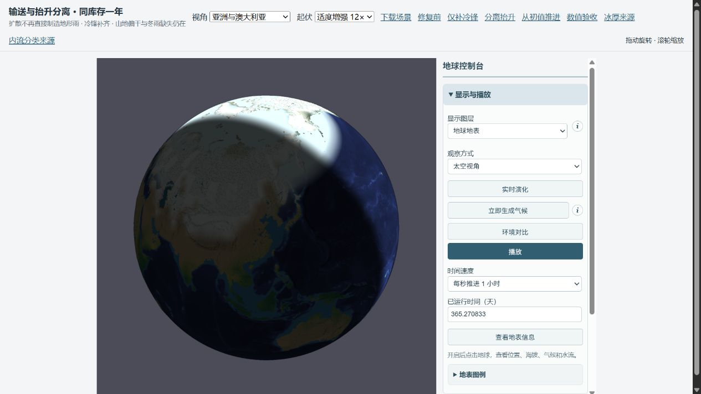
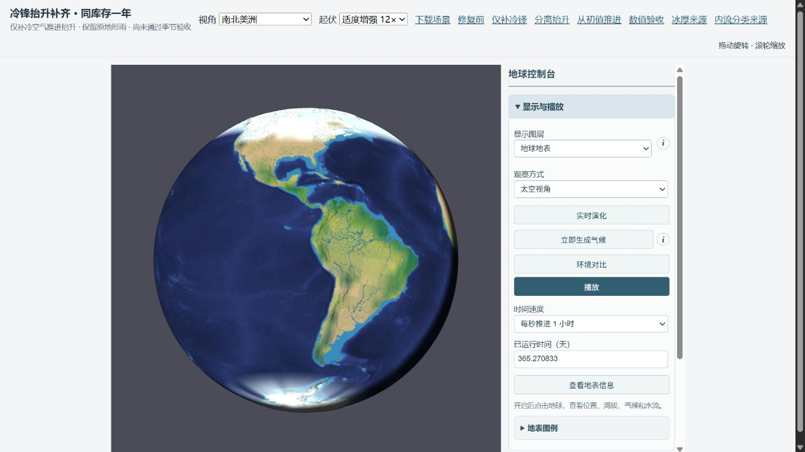
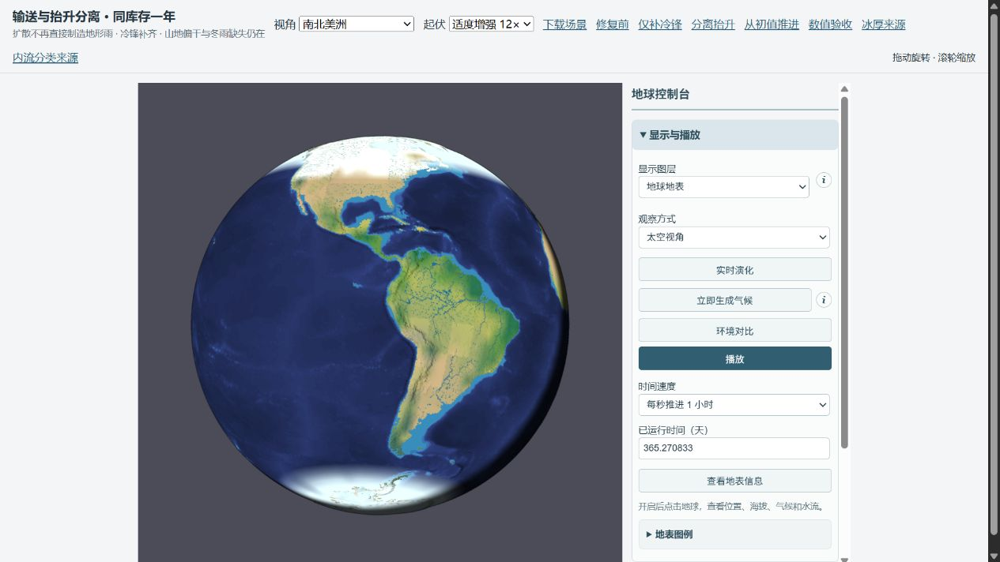

# 水汽输送与抬升闭合：本轮结果

**补齐冷锋驻留暖气团抬升，并提供扩散/机械抬升分离对照；完整年度预算与恢复检查通过，GPCC 区域整体验收仍未通过。正式默认未变。** 本轮适合保留的最小修复是 coldFront；分离地形抬升的 eddyCold 只作为因果诊断，未替换上轮预览或进入正式默认。

## 查明的原因

**喜马拉雅过湿由扩散雨出主导。** 控制组前缘年雨 3319.53 mm，其中 3315.82 mm 来自扩散路径的地形雨，真实平流地形雨为 0；剩余仅约 3.71 mm 锋面雨。无风、等温、未饱和的均匀水汽在旧闭合中也会在山坡产生雨，已用先失败后通过的回归测试验证。混合系数同时调水平供水和机械雨出，没有独立的垂直涡旋运动约束。分离后前缘降至 375.96 mm，而 GPCC 为 1120.42 mm，转为过干；西藏也明显过干。它证明了来源问题，同时暴露真实迎坡供水不足，不能把去掉过量雨当作雨影整体正确。

**陆地积雪扩大主要是冷区降雪输入增加，未发现雪量重复入账或融雪质量丢失。** 同初值的粗路由 mix1/control 对照，全球年降雪从 2.552 增至 10.791 mm 水当量，融雪也从 11.378 增至 15.017 mm，但增加幅度不足以抵消降雪；年末雪从 1.391 增至 5.967 mm。加拿大 50–65°N 雪带按陆地面积的降雪 18.49→112.49 mm，融雪 150.74→178.39 mm，年末 8.25→74.50 mm；西伯利亚同纬带降雪 5.91→68.77 mm，年末 1.71→40.62 mm。这些是机制筛查，不冒充完整地形或观测雪覆盖验收。完整地形分离抬升后，更多水汽进入冷的温带锋面，加拿大/西伯利亚年末雪反而增加；全球年末雪未改善。没有调整 30 mm 雪覆盖、反照率、融化温度或强制融雪。

**西南澳冬季有西风，但模型仍给出较干、发散的低层空气，而且漏了冷锋对暖湿驻留空气的抬升。** 控制组 JJA 东向风 4.65 m/s，真实平均 RH 59.1%，辐合率 -0.096 /day（负值为发散）；DJF 地面比气柱暖约 11.85 K，对流贡献占全年约 87%。这使夏季对流主导、冬季抬升受抑。补齐冷锋将冬雨 2.63→4.93 mm、夏雨 333.65→325.56 mm，方向略改善但远未达到 GPCC 的冬雨 226.67 mm。冬季风向正确并不等于水汽净输入和锋面降雨正确。

冷空气推进时排开暖湿空气的过程参考 [Met Office 锋面说明](https://weather.metoffice.gov.uk/learn-about/weather/atmosphere/weather-fronts)；西南澳冬雨还依赖高压脊移动与冷锋到达，见 [澳洲气象局](https://www.bom.gov.au/resources/learn-and-explore/climate-knowledge-centre/climate-factors/subtropical-ridge)。现模型没有垂直温湿廓线、CAPE/CIN、预报气压/干空气质量或锋面位置，因此单凭地面热和静态平均风仍不足以闭合冬雨。这里是模型机制诊断，不是由观测反推风速。

## 完整地形 GPCC 对照

单位 mm/真实轨道年。coldFront 仅补冷锋；eddyCold 在其基础上禁止湿度扩散直接制造地形雨，并保留有限涡旋锋面交换。温带四区等权绝对年偏差 305.88→302.45→242.91 mm；分离闭合虽改善温带平均偏差，却使东亚过湿、西藏过干，不能作为全区通过。

| 区域 | GPCC | 控制组 | 仅补冷锋 | 分离抬升 + 冷锋 |
|---|---:|---:|---:|---:|
| Europe | 792.09 | 388.88 | 389.02 | 458.98 |
| East North America | 1055.99 | 558.91 | 565.16 | 577.86 |
| East Asia | 693.91 | 698.31 | 698.47 | 780.71 |
| West Siberia | 451.33 | 132.52 | 139.99 | 377.73 |
| India | 1138.06 | 537.24 | 537.62 | 794.62 |
| Himalaya foreland | 1120.42 | 3319.53 | 3318.74 | 375.96 |
| Tibet | 443.54 | 508.72 | 508.64 | 102.33 |
| Australia southwest | 489.04 | 496.07 | 495.30 | 532.04 |
| Australia north | 985.87 | 1422.13 | 1421.10 | 1422.56 |
| Amazon | 2264.66 | 1505.16 | 1496.97 | 1513.34 |
| Congo | 1385.30 | 1260.37 | 1252.66 | 1269.16 |

## 季节排序

DJF / JJA 三个月累计 mm，采用同日历与有效陆地支持。

| 区域 | GPCC DJF / JJA | 控制组 | 仅补冷锋 | 分离抬升 + 冷锋 |
|---|---:|---:|---:|---:|
| Australia southwest | 51.30 / 226.67 | 333.65 / 2.63 | 325.56 / 4.93 | 351.33 / 4.95 |
| Australia north | 660.31 / 6.26 | 682.30 / 38.19 | 683.81 / 35.76 | 690.55 / 24.58 |
| India | 31.03 / 772.51 | 28.23 / 284.73 | 28.22 / 284.53 | 16.58 / 497.27 |
| Himalaya foreland | 52.17 / 748.47 | 419.18 / 1284.61 | 419.27 / 1283.30 | 30.44 / 195.06 |
| Tibet | 15.76 / 292.83 | 59.48 / 200.10 | 59.48 / 199.93 | 5.88 / 69.48 |

西南澳三个完整地形方案都仍为夏雨多、冬雨少，**季节验收失败**。印度分离方案年雨改善，但 JJA 仍向西、略向南，全年净水汽输送仍为输出；实际气柱水汽账不是按陆地面积的 GPCC 雨量，原数值与单位在 full-causes.json 中分别保留。不能把印度年雨改善称为海到陆供水闭合。

## 陆地积雪与 NSIDC 海冰分开核算

下表为实际末步库存账的全球平均水当量 mm；共同初始雪高于各组末值，“扩大”指相对小混合档增大，不能写成相对共同日零总库存持续增长。雪的空间覆盖也不能只用全球质量判断。

| 雪账项 | 控制组 | 仅补冷锋 | 分离抬升 + 冷锋 |
|---|---:|---:|---:|
| initial | 10.2457 | 10.2457 | 10.2457 |
| snowfall | 10.8242 | 10.7845 | 8.8221 |
| melt | 15.0203 | 15.0102 | 13.0267 |
| compaction | 0.0530 | 0.0526 | 0.0379 |
| final | 5.9967 | 5.9675 | 6.0033 |

NSIDC 同网格海域全年逐月范围 MAE（百万 km²），北 9.4637→9.4637→9.4670，南 18.3866→18.3866→18.3699。冷锋路径对海冰基本没有影响；分离方案北略退化、南略改善，都不证明海冰季节覆盖接受。北半球夏末海冰不足、南半球冬季范围过大仍在。NSIDC 是海冰产品，不能据此宣称陆地积雪已观测验收。

## 预算、库存和时间步验证

三组完整地形共同库存哈希：

<code>952addee2268260c7acb5cee1f2fe576414c88539719b3b6559d624d5a89ceca</code>

输入 lake-day0 SHA256：

<code>24bfe8b9a4768000574aa3febf3ed2be692ed2a071346175a9f0463280c2854b</code>

每组 366 次日预算检查；完整地形同一物理年、同初始有限湖泊水与显热/焓，存档恢复下一真实步完全一致。预算最大绝对残差如下。

| 组 | 全水 mm | 焓 J/m² | 单格水汽 mm | 路由分配 m³ | 雪账 mm |
|---|---:|---:|---:|---:|---:|
| control | 2.328e-10 | 2.248e-4 | 2.865e-11 | 0.112 | 1.350e-12 |
| coldFront | 2.328e-10 | 2.107e-4 | 3.593e-11 | 0.105 | 2.139e-12 |
| eddyCold | 2.328e-10 | 2.104e-4 | 2.433e-11 | 0.108 | 8.171e-13 |

半步长为共同粗路由初值的真实全年对照；coldFront 年雨最大差 4.251 mm，eddyCold 3.641 mm，月最大差分别 1.707 / 1.735 mm。两步长的西南澳季节判定一致；没有宣称完整地形已跑 900 s，也没有把小时间步差异替代 GPCC 接受。

## 否决与保留的候选

consistent 将混合陆海高度修正统一为面积加权四次方辐射律，结果几乎不变，不是主因。buoyant 去掉绝对 290 K 对流门槛后，夏季西南澳更湿，冬雨仍缺，否决其作为改善档。advective 连涡旋锋面交换也去除，西南澳显著更湿、积雪更多，同样否决。所有完成的筛查都保存原始数值与预算，没有只挑正向指标。

| 粗路由试验 | 年末雪 mm（全球） | 温带年偏差 mm | 喜马拉雅 mm/年 | 西南澳 mm/年 |
|---|---:|---:|---:|---:|
| advective | 7.952 | 264.9 | 342.1 | 925.6 |
| buoyant | 5.975 | 278.9 | 3242.5 | 688.6 |
| coldFront | 5.940 | 317.0 | 3248.5 | 494.3 |
| consistent | 5.978 | 320.7 | 3249.4 | 495.2 |
| control | 5.967 | 321.0 | 3248.4 | 495.0 |
| eddyCold | 5.956 | 243.3 | 348.4 | 530.8 |
| eddyFront | 5.997 | 245.4 | 349.2 | 533.0 |
| mix1 | 1.391 | 338.2 | 1203.1 | 676.1 |

## 截图与复现

独立页面保留修复前、仅补冷锋、分离抬升和共同日零入口。真实 WebGL 年末截图使用相同时间、视角、地表图层、12× 起伏和关闭云层；形态不代替全年降水累计。文件列表与浏览器条件见 manifest.json / browser-verification.json。

运行 setup.mjs 构建，再按 profiles.json 选择 PARAM_PROFILE 运行 screen/full。analyze.mjs 汇总；CAUSE_STAGE=full 运行 causes.mjs 提取因果诊断；preview.mjs 生成独立页面；manifest.mjs 记录哈希。完整协议见 [protocol.md](protocol.md)。GPCC 和 NSIDC 缓存、支持、阈值与原区域均保持原样；这是一年瞬态对照，不是长期气候平衡。

正式 Earth 场景 SHA256 仍为 <code>afb80a8ab730785eed0cb709a66d938ad20a9690b04ecfa1246d1deb393adca6</code>。269 个 Node 测试、TypeScript 检查、WebGL 构建和 diff 空白检查通过。下一处需要修的是低层水汽输入、发散抑制与垂直稳定度共同决定的抬升；把地图再细化或继续增大全球混合，不能直接补齐这些缺失过程。
